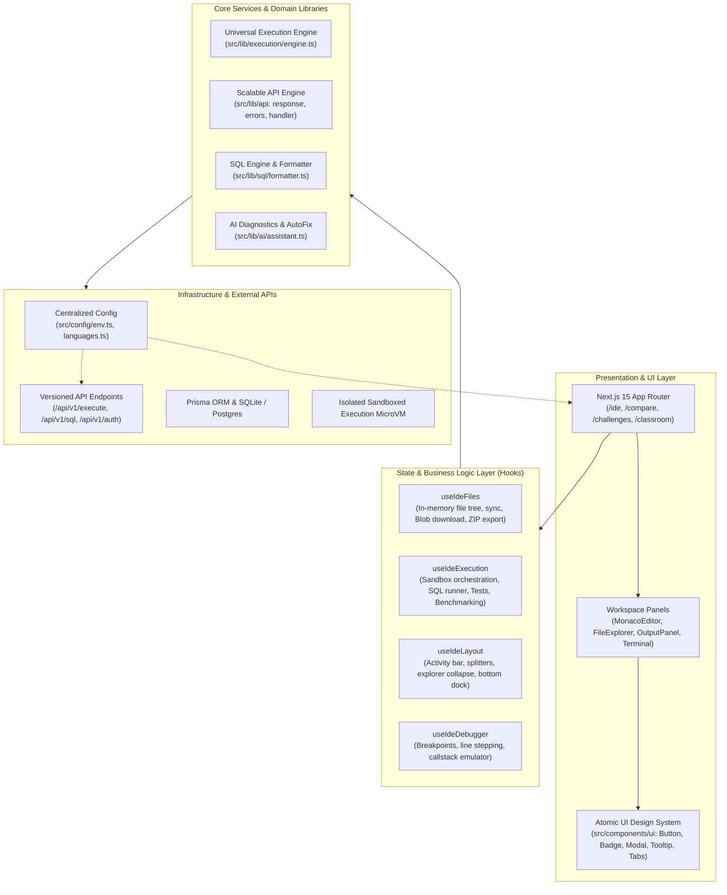

# Cortex Code Platform — System Architecture & Developer Guide

Welcome to the architectural specification and technical documentation for **Cortex Code Platform** — an enterprise-grade cloud development environment, live classroom hub, competitive arena, and multi-language algorithmic benchmarking platform.

---

## 1. Architectural Overview & System Blueprint

Cortex is built on Next.js 15 App Router, React 19, Tailwind CSS, Monaco Editor, and an isolated backend execution worker pipeline. It enforces a strict Clean Architecture boundary between presentation, state orchestration, domain services, and infrastructure.



---

## 2. Directory Structure & Domain Boundaries

The project directory tree is strictly structured by responsibility:

```
src/
├── app/                  # Next.js 15 App Router (Routes & Pages only)
│   ├── api/v1/           # Scalable, versioned REST API routes
│   │   ├── auth/         # Authentication, session, password reset
│   │   ├── execute/      # Multi-language code execution
│   │   ├── sql/          # SQL database query execution
│   │   ├── benchmark/    # Algorithmic performance profiling
│   │   ├── ai/           # Gemini AI diagnostics, autofix, code conversion
│   │   └── projects/     # User project CRUD, file persistence, import/export
│   ├── ide/              # Cloud IDE workspace page (lean orchestrator)
│   ├── compare/          # Performance Benchmark comparison page
│   ├── challenges/       # Competitive Coding Practice
│   ├── classroom/        # Classroom Hub, Live Classrooms, Exams
│   ├── error.tsx         # Next.js route-level error boundary
│   └── global-error.tsx  # Root fatal error boundary
│
├── components/           # UI Components (Pure Presentation)
│   ├── ui/               # Reusable Atomic Design System (Button, Badge, Modal, etc.)
│   ├── brand/            # Cortex Logo & Branding assets
│   ├── layout/           # AppShell, Navbar, GlobalSidebar (Activity Bar)
│   ├── editor/           # MonacoCodeEditor, editor tabs, status bar
│   ├── panels/           # OutputPanel, TerminalPanel, TestCasesPanel, Debugger
│   ├── sidebar/          # FileExplorer (Project file tree)
│   ├── modals/           # DiffModal, SettingsModal, ShareModal, FeedbackModal
│   ├── visualization/    # CodeVisualizationWorkspace & Memory graph
│   └── classroom/        # Classroom management, assessments, exam proctoring
│
├── config/               # Centralized Configuration & Environment Validation
│   ├── env.ts            # Validated environment variables (safe defaults & types)
│   ├── languages.ts      # 17 supported language runtimes & starter code
│   └── seo.ts            # SEO metadata, OpenGraph, Twitter tags
│
├── hooks/                # Business Logic & State Management Hooks
│   ├── useIdeFiles.ts    # File operations, autosave, in-memory sync, export
│   ├── useIdeExecution.ts# Code execution, test runner, benchmark, SQL formatting
│   ├── useIdeLayout.ts   # Sidebar collapse, splitters, bottom dock tabs
│   └── useIdeDebugger.ts # Breakpoints, stepping, call stack state
│
├── lib/                  # Core Business Services & Utilities
│   ├── api/              # Standardized API response, error hierarchy, route wrappers
│   ├── execution/        # Sandbox communication, language diagnostics parser
│   ├── sql/              # SQL formatting & runner utilities
│   ├── ai/               # AI Assistant prompt engineering & auto-fix logic
│   ├── auth/             # JWT token handling & password hashing
│   └── db/               # Prisma database connection client
│
└── types/                # Centralized Type Contracts & Data Models
    ├── api.ts            # ApiResponse<T>, pagination, error contracts
    ├── ide.ts            # IDE layouts, active tabs, save status
    └── execution.ts      # ProjectFile, ExecutionResult, TestCase, BenchmarkMetrics
```

---

## 3. State Management & Separation of Concerns

### Architecture Rules
1. **Presentational Components are Pure**: Components in `src/components/ui` and `src/components/panels` receive data via props and emit events via callbacks. They never call `fetch` or access database resources directly.
2. **Business Logic Lives in Custom Hooks**: Complex orchestration (e.g. compiling code, managing breakpoints, managing unsaved edits, downloading files) is encapsulated within cohesive custom hooks in `src/hooks/`.
3. **Decoupled IDE State**:
   - `useIdeFiles`: Manages active file, file tree mutations, and direct client Blob/ZIP downloads.
   - `useIdeExecution`: Manages execution lifecycle, terminal output, SQL table rendering, and automated test cases.
   - `useIdeLayout`: Manages Activity Bar icon-rail, File Explorer collapsible sidebar, horizontal/vertical resizers, and dock visibility.
   - `useIdeDebugger`: Manages breakpoint sets, active debug line pointer, and stepping actions.

---

## 4. Scalable API Architecture & Standardized Envelopes

Every API route under `/api/v1/` adheres to a standardized JSON response contract:

### Success Response Contract
```typescript
interface ApiSuccessResponse<T> {
  success: true;
  data: T;
  meta?: Record<string, unknown>;
  timestamp: string;
}
```
Helper: `apiSuccess(data, meta?, status = 200)`

### Error Response Contract
```typescript
interface ApiErrorResponse {
  success: false;
  error: {
    code: string;
    message: string;
    details?: unknown;
  };
  timestamp: string;
}
```
Helper: `apiError(message, status = 400, code = 'ERROR', details?)`

### Higher-Order Route Handler (`apiHandler`)
```typescript
import { apiHandler, apiSuccess, BadRequestError } from '@/lib/api';

export const POST = apiHandler(async (req) => {
  const body = await req.json();
  if (!body.language) {
    throw new BadRequestError('Language identifier is required');
  }
  const result = await executeCode(body);
  return apiSuccess(result);
});
```

### Typed Error Hierarchy (`src/lib/api/errors.ts`)
- `BadRequestError` (400)
- `UnauthorizedError` (401)
- `ForbiddenError` (403)
- `NotFoundError` (404)
- `ConflictError` (409)
- `ValidationError` (422)
- `InternalServerError` (500)

---

## 5. Centralized Environment Configuration

Raw access to `process.env` is restricted. All environment variables are validated, given secure fallbacks, and typed in `src/config/env.ts`:

```typescript
import { env } from '@/config/env';

// Access validated environment variables:
const apiUrl = env.NEXT_PUBLIC_APP_URL;
const isProd = env.isProduction;
const jwtSecret = env.JWT_SECRET;
```

---

## 6. Supported Languages & Multi-Runtime Execution

Cortex supports 17 compilation and interpretation environments configured in `src/config/languages.ts`:
- **Compiled**: C++ (GCC 13), C (GCC 13), Rust (1.75), Go (1.21), Java (OpenJDK 21), C# (.NET 8), Kotlin (1.9)
- **Interpreted**: Python (3.12), JavaScript (Node.js 20), TypeScript (5.3), Bash, Ruby, PHP, Lua, Perl
- **Data & Query**: SQL (SQLite dialect with in-memory execution and ASCII table rendering)
- **Markup / Presentation**: HTML5, CSS3, Markdown

---

## 7. Naming & Style Conventions

- **React Components**: `PascalCase.tsx` (e.g. `GlobalSidebar.tsx`, `OutputPanel.tsx`)
- **Custom Hooks**: `camelCase.ts` prefixed with `use` (e.g. `useIdeFiles.ts`, `useIdeLayout.ts`)
- **Utilities & Config**: `kebab-case.ts` (e.g. `safe-json.ts`, `database-engine.ts`)
- **Constants**: `UPPER_SNAKE_CASE` (e.g. `SUPPORTED_LANGUAGES`, `DEFAULT_AI_SETTINGS`)
- **Types & Interfaces**: `PascalCase` (e.g. `ProjectFile`, `ExecutionResult`, `ApiResponse<T>`)

---

## 8. Verification & Quality Assurance

To ensure codebase health, run the automated verification suite:

```bash
# 1. Typecheck entire workspace
npx tsc --noEmit

# 2. Production build validation
npm run build

# 3. End-to-end integration test suite
npx tsx tests/run-e2e.ts
```
