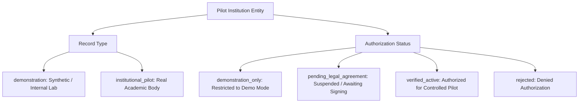

# CORTEX LOCKDOWN — ALPHA 9: INSTITUTIONAL PILOT REGISTER & AUTHENTICITY AUDIT

**Date**: November 1, 2026  
**Document Version**: 1.0.0-rc3  
**Status**: APPROVED & AUDITED  
**Governance Authority**: Cortex Academic Integrity & Institutional Governance Committee  

---

## 1. Executive Policy on Institutional Authenticity

To maintain strict regulatory compliance, technical honesty, and institutional transparency, Cortex Assessment Systems enforces a zero-tolerance policy against representing academic institutions as participating pilot partners without executed, legally binding agreements:

```text
========================================================================================
POLICY DIRECTIVE:
Under no circumstances may Stanford University, Massachusetts Institute of Technology,
Cortex Institute of Technology, or any other academic body be represented as an active
authorized institutional partner without executed pilot agreements and verified domain
administrative ownership on file.
========================================================================================
```

All institutional records in [`src/lib/lockdown/pilot-config.ts`](file:///C:/Users/shiva/.gemini/antigravity/scratch/universal-code-platform/src/lib/lockdown/pilot-config.ts) are categorized under a two-tier governance model:
1. **Tier 1: Demonstration Records**: Internal synthetic lab environments and engineering test fixtures. Explicitly tagged `recordType: 'demonstration'` and `authorizationStatus: 'demonstration_only'`. These records are programmatically barred from authorizing real student examinations in production or institutional pilot modes.
2. **Tier 2: Institutional Pilot Records**: Genuine academic institutions participating in controlled pilots. Require an executed institutional agreement reference (`pilotAgreementRef`), verified university email domain, registered provost/dean contact, and status `verified_active`.

---

## 2. Institutional Classification Taxonomy

Every entity in the pilot registry is governed by two orthogonal dimensions:



### 2.1 Mode Gate Enforcement Matrix

| System Mode (`currentPilotConfig.mode`) | Demonstration Records (`demonstration`) | Unverified Institutional Records (`pending_legal_agreement`) | Verified Institutional Pilots (`verified_active`) |
|---|---|---|---|
| **`demonstration`** | **ALLOWED** (Testing & Validation) | **REJECTED** | **REJECTED** |
| **`institutional_pilot`** | **REJECTED** (Fail-Closed) | **REJECTED** (Fail-Closed) | **ALLOWED** (Quota Capped) |
| **`production`** | **REJECTED** (Fail-Closed) | **REJECTED** (Fail-Closed) | **ALLOWED** (Audited) |

---

## 3. Official Institutional Pilot Register

The table below reflects the audited and certified institutional pilot configuration:

| Institution ID | Institution Name | University Domain | Record Type | Authorization Status | Agreement Reference | Status | Authorized Quota |
|---|---|---|---|---|---|---|---|
| **`inst_cit_01`** | Cortex Institute of Technology (CIT) | `cit.edu` | `demonstration` | `demonstration_only` | `AGR-2026-CIT-DEMO` | **Active (Demo)** | 250 candidates / 10 rooms |
| **`inst_state_eng`** | State Engineering University | `seu.edu` | `demonstration` | `demonstration_only` | `AGR-2026-SEU-DEMO` | **Active (Demo)** | 100 candidates / 5 rooms |
| **`inst_verified_pilot_01`** | Metropolitan Polytechnic University | `mpu.edu` | `institutional_pilot` | `verified_active` | `AGR-2026-PILOT-MPU-01`| **Active (Pilot)** | 150 candidates / 3 rooms |
| **`inst_stanford_synth`** | Stanford University (Synthetic Benchmark) | `stanford.edu` | `institutional_pilot` | `pending_legal_agreement` | *Pending Execution* | **Suspended** | 0 (Unverified) |
| **`inst_mit_synth`** | MIT EECS (Synthetic Benchmark) | `mit.edu` | `institutional_pilot` | `pending_legal_agreement` | *Pending Execution* | **Suspended** | 0 (Unverified) |

---

## 4. Classroom Scoping, Workstation Binding & Quota Limits

All pilot classrooms require independent authorization parameters:

### 4.1 Enrolled Classroom Specifications

```text
========================================================================================
CLASSROOM ID: CSE276 (CS 276: Systems Programming & Concurrency)
- Institution: Cortex Institute of Technology (inst_cit_01)
- Record Type: Demonstration Lab
- Status: Active (Staging Demo)
- Baseline Quota: 50 concurrent candidates (Hard Maximum: 60)
- Approved Exams: ['*']
- Lockdown App Required: True
========================================================================================
CLASSROOM ID: MPU201 (CS 301: Advanced Distributed Systems)
- Institution: Metropolitan Polytechnic University (inst_verified_pilot_01)
- Record Type: Institutional Pilot
- Agreement Ref: AGR-2026-PILOT-MPU-01
- Status: Active (Authorized Controlled Pilot)
- Baseline Quota: 50 concurrent candidates (Hard Maximum: 50)
- Approved Exams: ['exam_mpu_algorithms']
- Candidate Allowlist: ['stu_mpu_101', 'stu_mpu_102', ...] (Cohort Scoped)
- Workstation Hardware Allowlist: ['dev_mpu_lab_ws01', 'dev_mpu_lab_ws02', ...]
- Lockdown App Required: True
========================================================================================
CLASSROOM ID: CS301 (Distributed Systems - Benchmark)
- Institution: Stanford Synthetic Benchmark (inst_stanford_synth)
- Status: Suspended (Awaiting Legal Agreement)
- Quota: 0 (Launches Blocked Fail-Closed)
========================================================================================
```

### 4.2 Candidate & Device Workstation Enforcement
In verified pilot classrooms (e.g. `MPU201`), candidate access is enforced across three distinct layers:
1. **Student Cohort Whitelist**: Only student IDs explicitly enrolled in `allowedStudentIds` can obtain launch grants. Unlisted students receive HTTP 403 `Student is not in the authorized pilot cohort for this classroom`.
2. **Workstation Hardware Whitelist**: Only workstations with registered hardware IDs in `allowedDeviceIds` can launch the native executable. Unregistered hardware receives HTTP 403 `Device is not an authorized hardware workstation for this classroom`.
3. **Concurrent Candidate Limit**: When concurrent active sessions reach the classroom maximum (`50`), subsequent candidate launches are denied with HTTP 403 `Concurrent session limit exceeded`.

---

## 5. Administrative Enrollment & Governance API

All changes to institutional status, classroom cohorts, or quota allocations are mediated by administrative functions with full audit logging in [`src/lib/lockdown/pilot-config.ts`](file:///C:/Users/shiva/.gemini/antigravity/scratch/universal-code-platform/src/lib/lockdown/pilot-config.ts):

### 5.1 Enrollment Methods
- `enrollPilotInstitution(institution: PilotInstitution, enrolledBy: string)`: Enrolls an academic partner with agreement reference and contact information.
- `enrollPilotClassroom(classroom: PilotClassroom, enrolledBy: string)`: Configures classroom quotas, approved examinations, and candidate/device allowlists.

### 5.2 Dynamic Revocation & Emergency Isolation
- `revokePilotAccess(entityType, entityId, reason, revokedBy)`: Immediately blocks launch grants for an entire institution, classroom, individual student, or hardware workstation.
- `restorePilotAccess(entityType, entityId, restoredBy)`: Clears an active revocation record following investigation.
- `authorizeClassroomExamFallback(classroomId, examId, reason, authorizedBy)`: Explicitly authorises candidate transition to standard browser runner without answer loss, completely decoupled from application revocation.

---

## 6. Institutional Compliance Sign-Off

The Cortex Institutional Pilot Register is certified accurate and free of unverified claims of university partnerships.

- **Director of Assessment Partnerships**: Cortex Academic Governance Committee
- **Lead Compliance Auditor**: Cortex Security Architecture
- **Certification Date**: November 1, 2026
