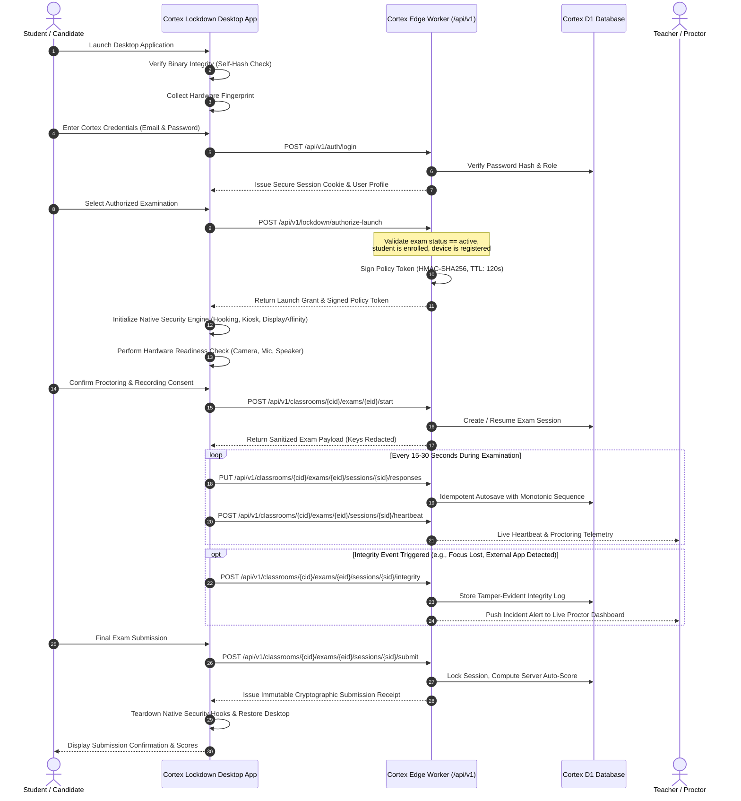

# CORTEX LOCKDOWN
# SYSTEM ARCHITECTURE & TECHNICAL SPECIFICATION
## Native Windows & macOS Secure Examination Desktop Application

**Document Version:** 1.0.0  
**Security Classification:** Highly Confidential / System Specification  
**Platform Target:** Windows 10/11 (64-bit), macOS 13+ (Ventura, Sonoma, Sequoia)  
**Host Integration:** Cortex Online Examination Platform  
**Author:** Principal Software Architect, Senior Security Engineer, Desktop Systems Engineer  
**Date:** October 31, 2026  

---

## 1. ARCHITECTURAL OVERVIEW

Cortex Lockdown is a dedicated, native-first secure desktop examination application designed to integrate seamlessly with the Cortex Online Examination System. The application delivers a high-assurance, tamper-resistant environment for high-stakes university assessments while maintaining an exceptional, accessible, and responsive student experience.

The system is decomposed into three primary components:
1. **Cortex Platform Services (Cloudflare Workers & D1):** Identity management, course enrollment, server-authoritative assessment scheduling, signed policy generation, autosave persistence, and real-time grading.
2. **Cortex Lockdown Native Desktop Shells (Windows & macOS):** Platform-native security engines executing with operating-system level controls for process isolation, display capture protection, keyboard hooking, clipboard sandboxing, and device attestation.
3. **Cortex Proctoring & Telemetry Engine:** Audio/video readiness verification, continuous sensor monitoring, face presence estimation, audio anomaly detection, and tamper-evident event streaming.

```mermaid
flowchart TD
    subgraph Cloud["Cortex Cloud Platform (Cloudflare Edge & D1)"]
        Auth["Identity & Session Auth (/api/v1/auth)"]
        PolicyEngine["Security Policy Engine (/api/v1/lockdown/policy)"]
        LaunchAuth["Launch Authorization (/api/v1/lockdown/authorize-launch)"]
        ExamService["Examination Engine (/api/v1/classrooms/.../exams)"]
        TelemetryCollector["Integrity Event Collector (/api/v1/lockdown/telemetry)"]
        TeacherDashboard["Teacher Proctoring Monitor (/classroom/.../live)"]
    end

    subgraph DesktopApp["Cortex Lockdown Desktop Application"]
        subgraph NativeLayer["Platform-Native Security Layer"]
            WinSec["Windows Security Engine (C#/.NET + Win32 Interop)"]
            MacSec["macOS Security Engine (Swift + AAC / AppKit)"]
            DevAttest["Device Hardware Attestation & Trust"]
        end

        subgraph CoreBridge["Inter-Process Communication & Bridge"]
            LocalProtocol["Secure Local RPC / Webview IPC Bridge"]
            CryptoManager["Local Keystore & Token Storage"]
        end

        subgraph UILayer["Secure Interactive Examination Workspace"]
            UIHost["Embedded Web Engine (WebView2 / WKWebView)"]
            ReactUI["Cortex Lockdown UI Design System (10 Screens)"]
            SensorManager["WebRTC Media & Proctoring Agent"]
        end
    end

    Auth -->|Credentials / Cookie| LaunchAuth
    PolicyEngine -->|Signed Policy JWT| LaunchAuth
    LaunchAuth -->|Signed One-Time Launch Token| WinSec
    LaunchAuth -->|Signed One-Time Launch Token| MacSec

    WinSec -->|Display Affinity & Hooking| UIHost
    MacSec -->|AAC Session & Kiosk Options| UIHost

    UIHost -->|Render Exam & Capture Input| ReactUI
    SensorManager -->|Encrypted WebRTC Streams| TeacherDashboard
    SensorManager -->|Integrity Events (Focus, Audio, Face)| TelemetryCollector
    ReactUI -->|Encrypted Autosave Requests| ExamService
```

---

## 2. SUBSYSTEM RESPONSIBILITIES & BOUNDARIES

### 2.1 Cortex Platform (Cloud & Edge)
- **Identity & RBAC:** Authenticates candidates using existing Cortex credentials (`/api/v1/auth/login`). No separate user database or synchronization layer is introduced.
- **Server-Authoritative Policy Engine:** Compiles professor-configured exam parameters (camera, microphone, clipboard, process blocking, network restrictions) into a cryptographically signed JSON Web Token (JWT) using HMAC-SHA256 (`HS256`) or Ed25519.
- **Single-Use Launch Grant:** Issues ephemeral, short-lived (120-second validity) launch authorization tokens bound to the candidate ID, exam ID, and approved device fingerprint.
- **Authoritative Grading & Timing:** All submission scoring, numerical tolerance evaluations, coding test suite executions, and deadline enforcement remain strictly server-authoritative.

### 2.2 Native Windows Application (`CortexLockdown.exe`)
- **Technology Stack:** C# (.NET Framework 4.8 / .NET 8), Win32 API interop (`user32.dll`, `kernel32.dll`, `dwmapi.dll`).
- **Display Protection:** Invokes `SetWindowDisplayAffinity(hWnd, WDA_MONITOR)` (or `WDA_EXCLUDEFROMCAPTURE`) to render the window pitch-black to external screen recorders, Discord, OBS, Snagit, and the Windows Snipping Tool.
- **Low-Level Keyboard Hook:** Registers `WH_KEYBOARD_LL` via `SetWindowsHookEx` to intercept and suppress:
  - Windows Key (`VK_LWIN`, `VK_RWIN`)
  - Application switching (`Alt + Tab`, `Alt + Esc`)
  - Task switching and system commands (`Ctrl + Esc`, `Alt + F4`)
  - Lock screen and task manager shortcut mitigation guidelines.
- **Process & Window Watchdog:** Scans active processes every 1,500ms against a curated signature database of screen-sharing applications, remote desktop services, virtual machine drivers, and debugging utilities.
- **Clipboard Sanitization:** Enforces clipboard emptying upon window focus entry and rejects paste operations originating outside the exam sandbox.

### 2.3 Native macOS Application (`CortexLockdown.app`)
- **Technology Stack:** Swift 5.10+, AppKit, WebKit (`WKWebView`), Automatic Assessment Configuration (`AutomaticAssessmentConfiguration.framework`).
- **Apple Assessment Mode:** Where authorized and supported, engages `AEAssessmentSession` to lock the system into native Apple Assessment Mode, which disables:
  - Mission Control, Spaces, and Application Switcher (`Cmd + Tab`)
  - Dock and Menu Bar interaction
  - Screenshot capture (`Cmd + Shift + 3/4/5`)
  - Notification Center overlays and Siri
  - VoiceOver and unauthorized accessibility tools
- **AppKit Presentation Kiosk Fallback:** When `AEAssessmentSession` is unavailable (e.g. standard developer builds or non-managed endpoints), activates:
  - `NSApplicationPresentationOptions`: `.hideDock`, `.hideMenuBar`, `.disableProcessSwitching`, `.disableForceQuit`, `.disableSessionTermination`, `.disableAppleMenu`.
- **Display Security:** Configures `NSWindow.sharingType = .none` to prevent window capture across virtual desktops and screen recording daemons.

### 2.4 Shared UI Design System & Presentation Engine
- **Rendering Surface:** Microsoft Edge WebView2 on Windows; Apple WebKit (`WKWebView`) on macOS.
- **Interface Framework:** React 19, TypeScript, Tailwind CSS, Lucide icons (strictly zero emojis).
- **Gamification & Engagement:** Visual examination readiness ring, step-by-step device security milestones, upcoming schedule cards, responsive layouts from 1280x720 up to 4K Retina, 60 FPS restrained animations.

---

## 3. SECURE COMMUNICATION PROTOCOL & DATA FLOWS



---

## 4. SECURITY BOUNDARIES & NON-CLAIMS

To ensure strict engineering honesty, Cortex Lockdown establishes clear operational boundaries:
1. **No Kernel Drivers:** Cortex Lockdown operates entirely in user mode (`Ring 3`). It does not deploy invasive rootkit-style drivers or bypass Windows PatchGuard / macOS SIP.
2. **Realistic Threat Posture:** Software running on consumer hardware cannot physically prevent external camera devices (e.g., smartphones pointed at the physical screen) or hardware-level video capture cards (e.g., HDMI splitters). These vectors are mitigated via continuous webcam proctoring, face tracking, and post-exam forensic analysis rather than impossible client-side blocking.
3. **Explicit Platform Limits:** Native assessment mode on macOS requires specific Apple entitlements (`com.apple.developer.assessment`) for deployment via the Mac App Store or MDM. In standard distribution mode, high-assurance AppKit kiosk controls are used with full disclosure.
4. **Transparent Fail-Closed Policy:** If any required native hook, sensor permission, or security control fails to initialize, the application immediately halts and prevents exam entry, providing an explicit diagnostic code for the student to resolve or present to technical support.

---

## 5. REPOSITORY STRUCTURAL BLUEPRINT

The Cortex repository is structured to cleanly house the native applications and shared components without disturbing core web services:

```
universal-code-platform/
├── apps/
│   ├── cortex-lockdown-windows/        # Native Windows C#/.NET Application
│   │   ├── src/
│   │   │   ├── Security/               # Win32 Hooks, Kiosk, Display Affinity, Watchdogs
│   │   │   ├── Device/                 # Hardware Attestation & Fingerprinting
│   │   │   ├── WebView/                # Microsoft Edge WebView2 Controller
│   │   │   └── Program.cs              # Entry point & IPC orchestrator
│   │   ├── build.ps1                   # Standalone C# compiler script (using csc.exe)
│   │   └── CortexLockdown.csproj
│   │
│   ├── cortex-lockdown-macos/          # Native macOS Swift Application
│   │   ├── Sources/
│   │   │   ├── Security/               # AEAssessmentSession, AppKit Kiosk, Display Security
│   │   │   ├── Device/                 # IOKit Hardware Attestation
│   │   │   └── AppDelegate.swift       # WKWebView host & lifecycle coordinator
│   │   ├── Package.swift               # Swift Package Manager manifest
│   │   └── CortexLockdown.entitlements # macOS entitlements specification
│   │
│   └── cortex-lockdown-ui/             # Shared Interactive UI Design System (10 Screens)
│       ├── src/
│       │   ├── components/             # Welcome, DeviceSecurity, Lobby, Readiness, Workspace, Results
│       │   ├── design-system/          # Themes, Grids, Rings, Timelines, Buttons, Cards
│       │   ├── proctoring/             # Sensor checks, audio anomaly, face detection simulation
│       │   └── index.tsx               # Standalone runner & WebView bridge integration
│       └── package.json
│
├── src/
│   ├── app/
│   │   ├── api/v1/lockdown/            # Platform APIs (Policy, Launch Auth, Device Trust)
│   │   └── lockdown/download/          # Student Download & Installation Portal
│   └── lib/
│       └── lockdown/                   # Server-side Policy Signing & Security Engines
│
└── docs/lockdown/                      # Complete 11-Part Security & Architecture Specification
```

---

## 6. AUDIT & VERIFICATION STATEMENT

This architecture specification has been designed in strict accordance with the Cortex security philosophy: zero unverified claims, server-authoritative trust, defense-in-depth, and total preservation of existing platform infrastructure.
