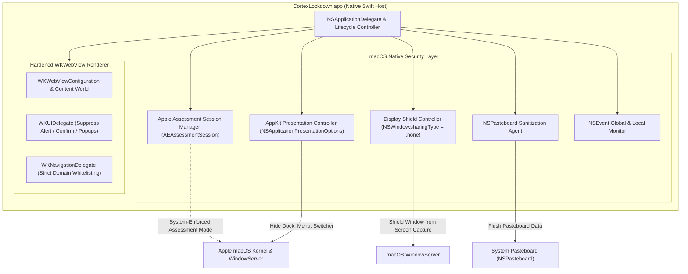

# CORTEX LOCKDOWN
# NATIVE MACOS SECURITY ENGINE SPECIFICATION
## Automatic Assessment Configuration, AppKit Kiosk & Display Shielding

**Document Version:** 1.0.0  
**Target Operating System:** macOS 13+ (Ventura, Sonoma, Sequoia)  
**Implementation Technology:** Swift 5.10+, AppKit, WebKit (`WKWebView`), AutomaticAssessmentConfiguration  
**Author:** Senior Apple Platforms & Desktop Security Engineer  
**Date:** October 31, 2026  

---

## 1. TECHNICAL OVERVIEW & COCOA ARCHITECTURE

The Cortex Lockdown macOS Security Engine utilizes Apple's native frameworks to construct an inviolable testing workspace on macOS devices. 

Where supported and provisioned with appropriate Apple developer entitlements, the engine activates **Automatic Assessment Configuration (AAC)** via `AEAssessmentSession`. For standard academic distribution or devices without specialized MDM supervision, the engine deploys a hardened **AppKit Kiosk Presentation Engine** utilizing `NSApplicationPresentationOptions` and low-level event interception.



---

## 2. DUAL-ENGINE ENFORCEMENT ARCHITECTURE

### 2.1 Engine 1: Apple Automatic Assessment Configuration (AAC)
When running on managed devices or provisioned with the `com.apple.developer.assessment` entitlement, Cortex Lockdown creates an `AEAssessmentSession`:

```swift
import AutomaticAssessmentConfiguration

@available(macOS 12.0, *)
class AppleAssessmentController: NSObject, AEAssessmentSessionDelegate {
    private var session: AEAssessmentSession?
    private(set) var isActive = false

    func beginAssessment() {
        let configuration = AEAssessmentConfiguration()
        configuration.allowsSpellCheck = false
        configuration.allowsPredictiveKeyboard = false
        configuration.allowsKeyboardShortcuts = false
        configuration.allowsActivityContinuation = false
        configuration.allowsDictation = false
        configuration.allowsAccessibilitySpeech = false

        session = AEAssessmentSession(configuration: configuration)
        session?.delegate = self
        session?.begin()
    }

    func endAssessment() {
        session?.end()
        session = nil
        isActive = false
    }

    func assessmentSessionDidBegin(_ session: AEAssessmentSession) {
        isActive = true
    }

    func assessmentSession(_ session: AEAssessmentSession, failedToBeginWithError error: Error) {
        isActive = false
        // Fall back gracefully to Engine 2 (AppKit Kiosk)
    }

    func assessmentSession(_ session: AEAssessmentSession, wasInterruptedWithError error: Error) {
        // Trigger server integrity event immediately
    }
}
```

#### Capabilities Enforced by AAC:
- The candidate cannot exit the assessment application without ending the session.
- System hotkeys (`Cmd + Tab`, `Cmd + Space`, `Cmd + Option + Esc`, `F3 / Mission Control`, `F4 / Launchpad`) are hardware-suppressed by macOS.
- Screen recording, screenshots, and remote screen sharing are blocked system-wide.
- Siri, Notification Center, and external display handoff are disabled.

---

### 2.2 Engine 2: High-Assurance AppKit Kiosk Fallback
If AAC is unavailable or not authorized for the specific environment, the engine immediately engages its hardened AppKit Kiosk presentation mode:

```swift
import AppKit

class AppKitKioskController {
    func activateKiosk() {
        let options: NSApplication.PresentationOptions = [
            .hideDock,
            .hideMenuBar,
            .disableProcessSwitching,
            .disableForceQuit,
            .disableSessionTermination,
            .disableAppleMenu,
            .autoHideToolbar
        ]

        NSApp.presentationOptions = options
    }

    func deactivateKiosk() {
        NSApp.presentationOptions = []
    }
}
```

#### Window Configuration:
```swift
func configureKioskWindow(_ window: NSWindow) {
    window.level = .floating
    window.styleMask = [.borderless, .fullSizeContentView]
    window.collectionBehavior = [.canJoinAllSpaces, .fullScreenPrimary]
    
    // Shield window buffer from screen recording and screenshot utilities
    window.sharingType = .none
    
    // Maximize to full display frame
    if let screen = NSScreen.main {
        window.setFrame(screen.frame, display: true)
    }
    
    window.makeKeyAndOrderFront(nil)
}
```

---

## 3. DISPLAY SHIELDING & SCREEN CAPTURE DEFENSE

To prevent screen capture through QuickTime, OBS for macOS, CleanShot X, Discord, Zoom, or the native macOS screenshot shortcut (`Cmd + Shift + 3 / 4 / 5`):
1. **Window Sharing Restriction:** `window.sharingType = .none` instructs the macOS `WindowServer` to exclude the window backing store from any application querying window images via `CGWindowListCreateImage` or `ScreenCaptureKit`.
2. **Global Event Monitor:** An `NSEvent` global monitor listens for screenshot combinations:
```swift
NSEvent.addLocalMonitorForEvents(matching: .keyDown) { event in
    let flags = event.modifierFlags
    if flags.contains(.command) && flags.contains(.shift) {
        if event.keyCode == 20 || event.keyCode == 21 || event.keyCode == 23 { // '3', '4', '5'
            return nil // Consume event
        }
    }
    if flags.contains(.command) && event.keyCode == 48 { // Cmd + Tab
        return nil
    }
    return event
}
```

---

## 4. CLIPBOARD & DRAG-AND-DROP CONTAINMENT

The macOS system pasteboard is purged on exam launch and upon any window focus change:

```swift
func sanitizePasteboard() {
    let pasteboard = NSPasteboard.general
    pasteboard.clearContents()
}
```

In the embedded `WKWebView`, drag-and-drop registration is explicitly unregistered:
```swift
webView.unregisterDraggedTypes()
```

---

## 5. HARDENED WKWEBVIEW CONFIGURATION

The embedded browser is configured to block unauthorized browser capabilities and external navigation:

```swift
let preferences = WKWebpagePreferences()
preferences.allowsContentJavaScript = true

let config = WKWebViewConfiguration()
config.defaultWebpagePreferences = preferences
config.allowsAirPlayForMediaPlayback = false
config.mediaTypesRequiringUserActionForPlayback = []

// Disable contextual menus via script injection
let disableContextMenuScript = WKUserScript(
    source: """
    document.addEventListener('contextmenu', e => e.preventDefault(), true);
    document.addEventListener('dragstart', e => e.preventDefault(), true);
    document.addEventListener('drop', e => e.preventDefault(), true);
    """,
    injectionTime: .atDocumentStart,
    forMainFrameOnly: false
)
config.userContentController.addUserScript(disableContextMenuScript)
```

---

## 6. MACOS ENTITLEMENTS SPECIFICATION

The application is signed with hardened runtime enabled and explicit entitlements declared in `CortexLockdown.entitlements`:

```xml
<?xml version="1.0" encoding="UTF-8"?>
<!DOCTYPE plist PUBLIC "-//Apple//DTD PLIST 1.0//EN" "http://www.apple.com/DTDs/PropertyList-1.0.dtd">
<plist version="1.0">
<dict>
    <key>com.apple.security.app-sandbox</key>
    <false/>
    <key>com.apple.security.device.camera</key>
    <true/>
    <key>com.apple.security.device.audio-input</key>
    <true/>
    <key>com.apple.security.network.client</key>
    <true/>
    <key>com.apple.developer.assessment</key>
    <true/>
</dict>
</plist>
```
