# CORTEX LOCKDOWN
# COMPREHENSIVE TEST STRATEGY & ADVERSARIAL QA PLAN
## Native Verification, Security Drills & End-to-End Validation

**Document Version:** 1.0.0  
**Test Frameworks:** Vitest, Playwright, Win32 Native Test Harness, Swift XCTest  
**Adversarial Methodology:** MITRE ATT&CK Matrix for Enterprise + Custom Kiosk Escape Drills  
**Author:** QA Engineering Lead & Senior Penetration Testing Lead  
**Date:** October 31, 2026  

---

## 1. QUALITY ASSURANCE PHILOSOPHY & OBJECTIVES

The Cortex Lockdown testing programme is designed to ensure mathematical correctness, operating system resilience, and resistance to unauthorized assistance.

The testing lifecycle spans four distinct tiers:
1. **Tier 1 (Unit & Cryptographic Assertions):** Validation of JWT token signing, hardware fingerprint generation, sequence validation, and answer sanitization.
2. **Tier 2 (UI/UX & Component Interaction Tests):** Dual-browser and touch interaction verification of the 10 core screens, responsive scaling, keyboard navigation, and zero console errors.
3. **Tier 3 (Native OS Security Drills):** Verification of Win32 low-level hooks, display capture blocking (`SetWindowDisplayAffinity`), clipboard flushing, and process blacklist watchdogs on Windows, and AppKit kiosk/AAC on macOS.
4. **Tier 4 (Adversarial Penetration Program):** Formal drills simulating determined student cheaters attempting process injection, window switching, secondary monitors, network disconnection, and session replay.

---

## 2. TEST TIERS & VERIFICATION SUITES

### 2.1 Tier 1: Unit & Protocol Tests
- **Hardware Fingerprint Consistency:** Confirms that identical hardware returns the same SHA-256 fingerprint while varying MAC/CPU strings produce unique IDs.
- **Signed Policy Token Generation:** Validates that tampering with any policy parameter in the signed JWT payload invalidates HMAC-SHA256 signature verification.
- **Answer Sanitization (Anti-Leak):** Confirms that all student-facing payload serializers completely scrub `correctAnswer`, `expectedOutput`, and hidden test cases.
- **Monotonic Sequence Enforcement:** Tests that stale autosaves ($S_{\text{new}} \le S_{\text{existing}}$) are rejected with HTTP 409, preventing out-of-order race conditions.

### 2.2 Tier 2: UI/UX & Interactive Design System Tests
- **The 10 Screens Lifecycle:** Automated traversal from Welcome Dashboard -> Device Security Centre -> Lobby -> Hardware Readiness -> Instructions -> Workspace -> Confirmation -> Results.
- **Responsive Layout Verification:** Verified under 1280x720, 1366x768, 1920x1080, and 2560x1440 resolutions.
- **Keyboard-Only Accessibility:** Complete examination sitting simulation using only `Tab`, `Arrow`, `Space`, `Enter`, and `Alt` shortcuts without mouse input.
- **Reduced-Motion Mode:** Verified that when `prefers-reduced-motion` is active, animations fall back to instant transitions with zero visual delay.

### 2.3 Tier 3: Native Windows & macOS Security Verification
- **Win32 Low-Level Keyboard Hook:** Simulated synthetic keyboard events verifying that `Alt+Tab`, `WinKey`, `PrintScreen`, `Ctrl+Esc`, and `Alt+F4` are consumed and never reach Windows Explorer or DWM.
- **Display Affinity Protection:** Verification that screenshot utilities and screen capture APIs capture pitch-black buffers when `WDA_MONITOR` is active.
- **Process Watchdog Poll:** Simulated background spawn of prohibited process (`obs64.exe` / `discord.exe`); verified detection and termination/alerting within 1,500ms.
- **Clipboard Flushing:** Verification that copying sensitive text outside the application and switching focus into Cortex Lockdown flushes the clipboard to null.
- **macOS Kiosk Options:** Verification of `NSApplicationPresentationOptions` suppressing Dock and Menu Bar.

### 2.4 Tier 4: Adversarial Penetration Drills
- **Window Switching & Focus Stealing:** Injecting external foreground focus requests; verifying that `CortexLockdown` re-asserts `HWND_TOPMOST` and logs `focus_lost` integrity events.
- **Network Disconnect & Reconnect:** Severing network connection mid-exam; verifying that IndexedDB buffers answers, displays clean reconnection banner, and flushes changes upon network restoration without loss.
- **Post-Deadline Submission Attempt:** Submitting answers after the deadline + 30s grace period; verifying that the edge worker hard-rejects the payload with HTTP 400.

---

## 3. ADVERSARIAL DRILL SPECIFICATIONS

```mermaid
flowchart TD
    subgraph Drill1["Drill 1: Hotkey Escape"]
        H1["Simulate Alt+Tab, WinKey, PrintScreen"] --> H2["LowLevelKeyboardHook Intercepts"]
        H2 --> H3["Assert Hook Consumes Message (return 1)"]
    end

    subgraph Drill2["Drill 2: Screen Recording"]
        S1["Simulate OBS / Screen Capture API Call"] --> S2["DWM Evaluates WDA_MONITOR"]
        S2 --> S3["Assert Captured Image is Pitch Black RGB(0,0,0)"]
    end

    subgraph Drill3["Drill 3: Clipboard Exfiltration"]
        C1["Simulate Ctrl+C in Exam / External Text in Buffer"] --> C2["Clipboard Guard Intercepts"]
        C2 --> C3["Assert System Clipboard is Cleared"]
    end

    subgraph Drill4["Drill 4: Process Injection"]
        P1["Spawn Blacklisted Process (obs64 / discord)"] --> P2["Process Watchdog Polls (1500ms)"]
        P2 --> P3["Assert Process Detected & Incident Logged"]
    end
```

---

## 4. PASS/FAIL CRITERIA & QUALITY GATES

1. **Zero Critical Vulnerabilities:** Zero unmitigated vulnerabilities permitting question exfiltration, application escape, or unauthorized assistance.
2. **100% Pass Rate on Protocol Tests:** Cryptographic tokens, anti-leak serializers, and monotonic sequencing must pass all unit assertions.
3. **Zero Console Errors:** The UI design system must execute across all 10 screens with zero unhandled exceptions, zero broken CSS layouts, and zero console warnings.
4. **Strictly Zero Emojis:** All UI components, reports, logs, and dialogs must contain zero emojis.
