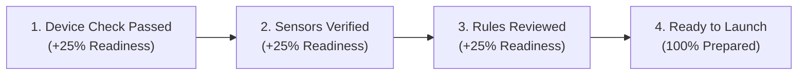

# CORTEX LOCKDOWN
# INTERACTIVE UI/UX DESIGN SYSTEM & SCREEN SPECIFICATION
## Desktop Examination Experience, Gamification & Accessibility

**Document Version:** 1.0.0  
**Design System Name:** Cortex Charcoal & Ember (Dark Mode Native)  
**Target Viewports:** 1280x720 (minimum) to 3840x2160 (4K Retina), High-DPI Scale 100%–250%  
**Animation Budget:** 60 FPS target, 150–250ms transitions, strictly zero emojis  
**Author:** Principal UI/UX Architect & Accessibility Engineer  
**Date:** October 31, 2026  

---

## 1. VISUAL IDENTITY & DESIGN LANGUAGE

The Cortex Lockdown desktop application builds upon the recognized Cortex web aesthetic—characterized by deep charcoal surfaces, subtle dotted-grid backdrops, precise amber-orange highlights, and crisp technical typography.

```
Color Palette System:
* Background Primary:    #0B0C10 (Deep Black-Charcoal)
* Surface Elevated 1:    #121316 (Card Base)
* Surface Elevated 2:    #181920 (Interactive Card / Header)
* Border Subtle:         #22242a (Default Dividers & Card Edges)
* Border Active:         #30333d (Hover & Focus States)
* Accent Primary:        #FF9100 (Cortex Amber Orange - Action / Primary Callouts)
* Accent Secondary:      #00E5FF (Cyan - Informational & Routing Highlights)
* Status Emerald:        #10B981 (Verified / Ready / Passing)
* Status Rose:           #F43F5E (Alert / Prohibited / Locked)
* Status Violet:         #8B5CF6 (Results / Historical Review)
* Typography Primary:    #F9FAFB (High-Contrast Body & Headings)
* Typography Muted:      #9CA3AF (Labels, Descriptions & Metadata)
```

```
Typography Scale:
* Display Heading:   Outfit / Orbitron Bold (24px - 32px)
* Section Heading:   Outfit SemiBold (18px - 22px)
* Component Titles:  Inter Medium (14px - 16px)
* Body & Controls:   Inter Regular / Medium (12px - 14px)
* Code & Telemetry:  JetBrains Mono (12px - 13px)
```

---

## 2. THE 10 CORE APPLICATION SCREENS

### Screen 1: Welcome Dashboard
- **Purpose:** Primary authenticated landing view upon launching Cortex Lockdown.
- **Components:**
  - Header with student identity, institutional affiliation, and logout control.
  - Active / Upcoming Examination Hero Card with one-click "Enter Lobby" action.
  - Device Trust Badge ("Verified Desktop: ThinkPad P1 Gen 5 - Windows 11").
  - Readiness Progress Ring (overall readiness index).
  - Examination History & Passed Credentials carousel.

### Screen 2: Device Security Centre
- **Purpose:** Comprehensive local hardware audit prior to entering high-stakes assessments.
- **Milestones Verified:**
  - Display Integrity: Single monitor verified (external display count: 0).
  - Background Process Scan: 0 blacklisted processes detected.
  - Remote Access Inspection: No active RDP/VNC sessions detected.
  - Virtualization Check: Physical bare-metal execution confirmed.
  - Kiosk Hook Readiness: Windows LowLevelHook or macOS AAC pre-armed.
- **Interactivity:** Real-time re-scan button with visual animated checkmarks.

### Screen 3: Examination Lobby
- **Purpose:** Pre-exam waiting room and scheduled countdown before the examination starts.
- **Components:**
  - Synchronized server countdown timer ($T_{\text{start}} - T_{\text{now}}$) with circular sweep.
  - Assessment metadata: Course Code, Duration, Total Marks, Security Level (Level 2 Restricted / Level 3 SEB).
  - Candidate identity confirmation card with student avatar and institutional ID.
  - Real-time network latency indicator (ping in milliseconds to Cloudflare Edge).

### Screen 4: Camera & Microphone Readiness (Hardware & Consent)
- **Purpose:** Sensor permissions, loopback preview, and transparent proctoring disclosure.
- **Components:**
  - Live webcam preview stream (mirrored) with face bounding box detection indicator.
  - Real-time audio input level visualizer (dynamic green-to-amber decibel bar).
  - Speaker audio check with "Play Test Sound" button.
  - Transparent Privacy Disclosure card: explicit listing of sensors active, retention period (30 days), and human-in-the-loop review policy.
  - Explicit agreement checkbox: "I consent to academic integrity recording for this examination."

### Screen 5: Examination Instructions
- **Purpose:** Formal academic rules and code of conduct disclosure before entering lockdown.
- **Components:**
  - Allowed / Disallowed materials summary (e.g. scrap paper allowed, calculators disallowed).
  - Navigation rules (free navigation vs sequential sections).
  - Negative marking alerts and scoring rules.
  - Fullscreen lock warning: "Exiting or attempting to switch applications will record an immediate integrity violation."
  - "Begin Examination" primary button with confirm countdown.

### Screen 6: Secure Examination Workspace
- **Purpose:** The core assessment solving surface.
- **Layout Architecture:**
  - **Top Bar:** Exam title, Question palette jump drawer, Server-Authoritative countdown timer, Autosave status badge ("Autosaved 2s ago"), Live recording indicator (Green dot + "PROCTOR ACTIVE"), Finish Exam button.
  - **Left Rail (Optional / Collapsible):** Question outline tree categorized by Sections (Part A, Part B, Part C) with completion status pills (Answered, Unanswered, Marked for Review).
  - **Main Canvas:** Question prompt rendered with LaTeX math (KaTeX) and syntax-highlighted code snippets.
  - **Interaction Area:** Specialized input widget according to Question Type:
    - `mcq_single`: Large, accessible radio tiles with full-row click targets.
    - `mcq_multiple`: Distinct checkbox tiles with multi-selection feedback.
    - `numerical`: Precision input with unit indicator and allowed tolerance.
    - `subjective`: Rich formatted text area with live character/word count.
    - `coding`: Embedded Monaco / Code Studio editor with language selector, dark theme, and instant test runner.
  - **Bottom Bar:** Previous Question, Mark for Review, Clear Response, Next Question.

### Screen 7: Submission Confirmation
- **Purpose:** Pre-submission verification and final candidate lock.
- **Components:**
  - Summary matrix: Total questions, answered questions, marked for review, unanswered questions.
  - Visual warning if questions remain unanswered.
  - Unsaved change sync flush: forces immediate background sync before final lock.
  - "Confirm & Finalize Submission" button requiring double confirmation.

### Screen 8: Results View
- **Purpose:** Immediate or post-grading performance dashboard.
- **Components:**
  - Score Card: Total Points Earned vs Total Points Available, Percentage, Pass/Fail status.
  - Cryptographic Submission Receipt: Verification Hash (SHA-256), timestamp, attempt number.
  - Section-by-section performance breakdown bars.
  - Instructor feedback card.
  - "Exit Application" button releasing all OS kiosk locks.

### Screen 9: Settings & Diagnostics
- **Purpose:** Student device tuning, font scaling, audio device selection, and local diagnostics.
- **Components:**
  - Camera & microphone input device selection dropdowns.
  - High-DPI font size zoom controls (100%, 125%, 150%, 175%).
  - Dark mode contrast tuning (Charcoal standard vs OLED High-Contrast).
  - Network diagnostic tool: test packet round-trip time and packet loss to Cortex API.

### Screen 10: Error Recovery & Support
- **Purpose:** Graceful handling of network drops, device disconnects, or session interruptions.
- **Components:**
  - Network disconnection banner: "Connection Lost. Your answers are saved locally in write-ahead buffer."
  - Auto-reconnect countdown with manual "Retry Connection Now" button.
  - Emergency Instructor / Proctor Passcode Unlock input.
  - Diagnostic support code generator for communicating with university helpdesk.

---

## 3. MEANINGFUL GAMIFICATION & STUDENT ENGAGEMENT

Gamification in Cortex Lockdown is designed strictly around **academic readiness, confidence, and positive preparation milestones**—never around surveillance or integrity penalties:



1. **Readiness Progress Ring:** An elegant SVG circular ring on the dashboard that tracks completion of hardware checks, identity validation, and instruction review. Reaching 100% illuminates the primary "Start Assessment" action.
2. **Milestone Achievements:** Non-distracting achievement badges celebrating preparation (e.g., "Hardware Certified", "Early Bird Lobby Check-in", "Zero Network Glitches").
3. **Session Progress Timeline:** In the workspace, answered questions illuminate in subtle cyan and emerald along a clean numerical progress bar, providing positive visual reinforcement of progress through long examinations.

---

## 4. ANIMATION SPECIFICATION & PERFORMANCE BUDGET

All visual transitions adhere to a strict performance budget to eliminate input lag and preserve CPU/GPU headroom for code compilation and proctoring:
- **Standard Transition Duration:** 150ms to 250ms with `cubic-bezier(0.16, 1, 0.3, 1)` (ease-out-expo).
- **Reduced Motion Support:** When `prefers-reduced-motion: reduce` is detected in the operating system, all transform and translate animations are replaced with instant opacity crossfades (50ms).
- **Zero Heavy Filter Load:** No CSS `backdrop-filter: blur(...)` across active answering surfaces to prevent GPU fill-rate exhaustion on integrated Intel/AMD laptop graphics.
- **Autosave Pulse:** Subtle, single-pulse animation (200ms) on the autosave indicator when a response is successfully committed to Cloudflare D1.

---

## 5. TOUCHSCREEN & ACCESSIBILITY SPECIFICATION

- **Touch Target Sizing:** All interactive buttons, question choices, and navigation tabs have a minimum hit target of $44 \times 44$ CSS pixels.
- **Keyboard Navigation (Tab Traversal):** Full keyboard navigation support:
  - `Tab` / `Shift + Tab`: Focus traversal between question options and navigation.
  - `Arrow Keys`: Option selection within radio/checkbox groups.
  - `Alt + N` / `Alt + P`: Next and Previous question shortcuts.
  - `Alt + M`: Mark for Review shortcut.
  - `Space`: Select highlighted option.
- **High-DPI Display Scaling:** Scaled vector icons (Lucide SVG) and rem-based typography scale cleanly from 100% up to 250% Windows display scaling without pixelation or clipping.
- **Color Contrast:** All text satisfies WCAG 2.1 AAA contrast requirements ($\ge 7:1$ ratio against `#0B0C10` background).
