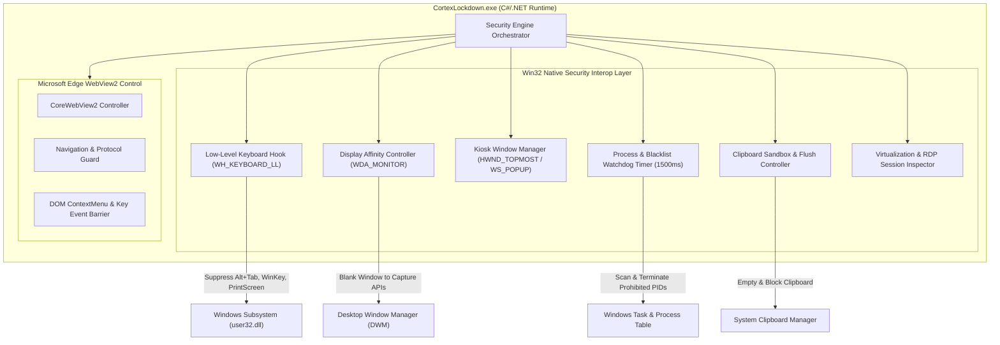

# CORTEX LOCKDOWN
# NATIVE WINDOWS SECURITY ENGINE SPECIFICATION
## Win32 Low-Level Interop, Kiosk Confinement & Display Protection

**Document Version:** 1.0.0  
**Target Operating System:** Windows 10 & Windows 11 (64-bit Architecture)  
**Implementation Technology:** C# (.NET Framework 4.8 / .NET 8 LTS) + Win32 Native APIs  
**Author:** Senior Windows Desktop Systems Engineer & Security Researcher  
**Date:** October 31, 2026  

---

## 1. TECHNICAL OVERVIEW & SUBSYSTEM ARCHITECTURE

The Cortex Lockdown Windows Security Engine operates natively at the user-mode desktop boundary to establish an isolated, high-assurance examination kiosk. It interfaces directly with core Windows subsystems via Platform Invocation Services (`P/Invoke`) across `user32.dll`, `kernel32.dll`, `dwmapi.dll`, and `gdi32.dll`.



---

## 2. NATIVE WIN32 INTEROP & API IMPLEMENTATION

### 2.1 Low-Level Keyboard Hook (`WH_KEYBOARD_LL`)
To prevent the candidate from switching applications, launching system menus, or triggering screen capture hotkeys, the engine installs a global thread-independent low-level keyboard hook via `SetWindowsHookEx`.

```csharp
[StructLayout(LayoutKind.Sequential)]
public struct KBDLLHOOKSTRUCT {
    public uint vkCode;
    public uint scanCode;
    public uint flags;
    public uint time;
    public UIntPtr dwExtraInfo;
}

public delegate IntPtr LowLevelKeyboardProc(int nCode, IntPtr wParam, IntPtr lParam);

[DllImport("user32.dll", SetLastError = true)]
public static extern IntPtr SetWindowsHookEx(int idHook, LowLevelKeyboardProc lpfn, IntPtr hMod, uint dwThreadId);

[DllImport("user32.dll", SetLastError = true)]
public static extern bool UnhookWindowsHookEx(IntPtr hhk);

[DllImport("user32.dll")]
public static extern IntPtr CallNextHookEx(IntPtr hhk, int nCode, IntPtr wParam, IntPtr lParam);
```

#### Hook Suppression Logic:
When `nCode >= 0` and the message is `WM_KEYDOWN`, `WM_SYSKEYDOWN`, `WM_KEYUP`, or `WM_SYSKEYUP`, the hook inspects the virtual key code and flags:
- `flags & 0x20` indicates the `ALT` key is depressed.
- **Blocked Keys & Combinations:**
  - `VK_TAB` with `ALT` (Task Switcher) -> Consumed (`return (IntPtr)1`)
  - `VK_ESCAPE` with `ALT` (Direct Window Switcher) -> Consumed
  - `VK_ESCAPE` with `CTRL` (Start Menu) -> Consumed
  - `VK_LWIN` / `VK_RWIN` (Windows Key) -> Consumed
  - `VK_SNAPSHOT` (PrintScreen) -> Consumed
  - `VK_F4` with `ALT` (Window Close) -> Consumed
  - `VK_F12` (Browser DevTools) -> Consumed

### 2.2 Display Affinity & Screen Capture Shielding (`WDA_MONITOR`)
To defend against unauthorized screen capture, broadcasting, or background recording (OBS Studio, Discord screen sharing, Snagit, Camtasia, Windows Snipping Tool `Win + Shift + S`), the application configures display affinity on the main window handle:

```csharp
[DllImport("user32.dll", SetLastError = true)]
public static extern bool SetWindowDisplayAffinity(IntPtr hWnd, uint dwAffinity);

// Constants
public const uint WDA_NONE = 0x00000000;
public const uint WDA_MONITOR = 0x00000001;
public const uint WDA_EXCLUDEFROMCAPTURE = 0x00000011; // Windows 10 Version 2004+
```

When set to `WDA_MONITOR` (or `WDA_EXCLUDEFROMCAPTURE`), the Desktop Window Manager (DWM) excludes the window contents from any render target other than the physical monitor. Capture APIs (such as `BitBlt`, `GetWindowDC`, Direct3D desktop duplication, and Windows.Graphics.Capture) receive a pitch-black rectangle.

### 2.3 Window Styling & Kiosk Mode Enactment
The window is constructed as an exclusive borderless popup with maximum z-order priority:

```csharp
[DllImport("user32.dll", SetLastError = true)]
public static extern int SetWindowLong(IntPtr hWnd, int nIndex, int dwNewLong);

[DllImport("user32.dll", SetLastError = true)]
public static extern bool SetWindowPos(IntPtr hWnd, IntPtr hWndInsertAfter, int X, int Y, int cx, int cy, uint uFlags);

public static readonly IntPtr HWND_TOPMOST = new IntPtr(-1);
public const uint SWP_SHOWWINDOW = 0x0040;
public const int GWL_STYLE = -16;
public const int WS_POPUP = unchecked((int)0x80000000);
public const int WS_VISIBLE = 0x10000000;
```

Upon activation, the window covers the primary monitor's bounds (`Screen.PrimaryScreen.Bounds.Width` by `Screen.PrimaryScreen.Bounds.Height`), ensuring that the Windows Taskbar, notification area, and background applications are obscured.

### 2.4 Clipboard Containment & Sanitization
The system clipboard is purged immediately upon window launch and upon any window focus re-acquisition:

```csharp
[DllImport("user32.dll", SetLastError = true)]
public static extern bool OpenClipboard(IntPtr hWndNewOwner);

[DllImport("user32.dll", SetLastError = true)]
public static extern bool EmptyClipboard();

[DllImport("user32.dll", SetLastError = true)]
public static extern bool CloseClipboard();

public static void FlushClipboard(IntPtr hWnd) {
    if (OpenClipboard(hWnd)) {
        try {
            EmptyClipboard();
        } finally {
            CloseClipboard();
        }
    }
}
```

### 2.5 Virtual Machine & Remote Desktop Inspection
Before granting examination entry, the environment inspector checks for active virtualization or remote sessions:

```csharp
[DllImport("user32.dll")]
public static extern int GetSystemMetrics(int nIndex);

public const int SM_REMOTESESSION = 0x1000;

public static bool IsRemoteSession() {
    return GetSystemMetrics(SM_REMOTESESSION) != 0;
}
```

In addition, hardware vendor strings are inspected in WMI (`Win32_ComputerSystem.Manufacturer`, `Win32_BIOS.SerialNumber`) to flag known hypervisors (`VMware`, `VirtualBox`, `QEMU`, `Microsoft Corporation / Hyper-V`).

---

## 3. PROCESS WATCHDOG & BLACKLIST DEFINITIONS

The `ProcessWatchdog` background thread polls active process names every 1,500ms using `Process.GetProcesses()`. Any match against prohibited signatures triggers an immediate alert and, where configured, automatic process termination or examination locking:

| Category | Prohibited Process Signatures | Action |
| :--- | :--- | :--- |
| **Screen Recorders & Streamers** | `obs64`, `obs32`, `discord`, `camtasia`, `snagit32`, `snagit64`, `action`, `bandicam`, `fraps`, `xsplit` | Terminate or Lock Exam |
| **Remote Access & Collaboration** | `teamviewer`, `anydesk`, `vncviewer`, `tv_w32`, `chromeremotedesktop`, `logmein`, `parsec`, `ammyy` | Halt Session & Log Incident |
| **Browsers & Communication** | `chrome`, `firefox`, `msedge`, `brave`, `opera`, `telegram`, `whatsapp`, `slack`, `skype`, `teams` | Graceful Exit Prompt |
| **Analysis & Debuggers** | `wireshark`, `fiddler`, `cheatengine`, `x64dbg`, `ida64`, `processhacker`, `procexp` | Immediate Hard Fail-Closed |

---

## 4. MICROSOFT EDGE WEBVIEW2 CONFIGURATION & HARDENING

The examination workspace is hosted within Microsoft Edge WebView2, configured with strict defense-in-depth settings:

```csharp
var options = new CoreWebView2EnvironmentOptions {
    AdditionalBrowserArguments = "--disable-features=Translate,AutofillServerCommunication --disable-popup-blocking"
};

var env = await CoreWebView2Environment.CreateAsync(null, userDataFolder, options);
await webView.EnsureCoreWebView2Async(env);

// Hardened Security Settings
webView.CoreWebView2.Settings.AreDevToolsEnabled = false;
webView.CoreWebView2.Settings.AreDefaultContextMenusEnabled = false;
webView.CoreWebView2.Settings.IsStatusBarEnabled = false;
webView.CoreWebView2.Settings.IsZoomControlEnabled = false;
webView.CoreWebView2.Settings.IsBuiltInErrorPageEnabled = false;
webView.CoreWebView2.Settings.AreBrowserAcceleratorKeysEnabled = false;
```

---

## 5. RECOVERY & EMERGENCY EXIT MECHANISMS

To protect against hardware hangs or power loss without compromising exam integrity:
1. **Teacher Emergency Quit Code:** Instructors can unlock the kiosk locally by pressing a specialized key combination (`Ctrl + Shift + Alt + F10`) and entering the exam's unique server-hashed quit password.
2. **Graceful Hook Unregistration:** Application shutdown handlers (`Application.ApplicationExit`, `AppDomain.CurrentDomain.ProcessExit`, `ConsoleCtrlDelegate`) unhook low-level hooks cleanly so that the candidate's operating system is restored to its standard state.
3. **Write-Ahead Session Resume:** If the machine experiences sudden power loss, the student can relaunch Cortex Lockdown; the server validates the active session and resumes from the latest verified sequence number.
