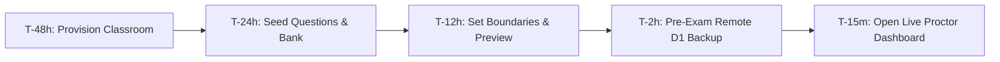
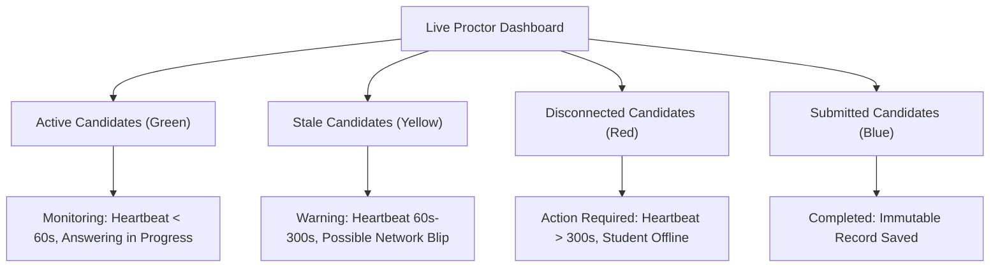
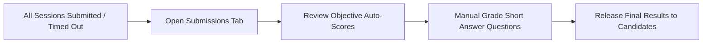

# Cortex Online Examination System — University Pilot Runbook

## Document Overview

This operational runbook provides university course coordinators, faculty instructors, teaching assistants, and examination proctors with authoritative, step-by-step procedures for administering online examinations on the Cortex Code Platform.

All protocols in this document have been validated against the production-hardened Cortex platform following Phase 3.9.3 final acceptance and Phase 4.0 release engineering.

---

## 1. System Targets & Environment Architecture

| Environment | Purpose | Target Worker URL | Cloudflare D1 Database |
| :--- | :--- | :--- | :--- |
| **Production** | Controlled University Pilots & Live Exams | `https://cortex-code-platform.cortexbuild1.workers.dev` | `cortex-db` (UUID: `f756374b-0e9b-4112-b502-b703788dd86f`) |
| **Staging** | Faculty Dry Runs & Pre-Exam Testing | `https://cortex-code-platform-staging.cortexbuild1.workers.dev` | `cortex-staging-db` (UUID: `e6375738-d9b2-4c5a-a3e5-3a34e892f49d`) |

---

## 2. Scope & Eligible Examination Tracks

Before planning an assessment, review the authorized assessment tracks:

| Track | Eligible Question Types | Permitted Scale | Pilot Status |
| :--- | :--- | :--- | :--- |
| **Track A (Authorized)** | Single-choice MCQ, Multi-choice MCQ, True/False, Numerical, Short Answer (Manual Grading) | Up to 150 concurrent students per examination | **APPROVED FOR PILOT** |
| **Track B (Web Proctored)** | Objective & Short Answer with WebRTC audio/video proctoring | Up to 75 concurrent students per room | **APPROVED FOR PILOT** |
| **Track C (Excluded)** | Safe Exam Browser (SEB) Enforced Exams | N/A | **DEFERRED** (Pending physical lab device certification) |

> [!IMPORTANT]
> For the initial university pilot, only **Track A** and **Track B** examinations are authorized. Do not configure examinations with `seb` security level.

---

## 3. Pre-Examination Preparation (T - 48 Hours to T - 2 Hours)



### Step 3.1: Classroom Provisioning
1. Sign in with your institutional instructor credentials.
2. Navigate to **Classroom** and click **Create Classroom**.
3. Provide the formal Course Code (e.g., `CS201`), Course Title, Academic Term, and Section.
4. Note the generated **6-character Classroom Join Code** (e.g., `W4K8Z2`). Distribute this code to enrolled candidates via your institutional LMS announcement.

### Step 3.2: Examination Construction
1. Inside the classroom, open the **Examination Center** tab.
2. Click **Create Examination**.
3. Configure the administrative parameters:
   - **Title**: Official examination title (e.g., `CS201 Midterm Examination 2026`).
   - **Duration**: Duration in minutes (allowed range: `5` to `600` minutes).
   - **Passing Benchmark**: Benchmark points required to pass (e.g., `40` out of `100`).
   - **Attempts Allowed**: Strictly set to `1` for official assessments.
   - **Security Level**: Select `Standard` or `Restricted Fullscreen`.
   - **Immediate Results**: Set to `Off` (Unchecked) if manual grading is required for short answer questions.
4. Add Examination Sections:
   - Divide the examination into structured sections (e.g., *Section 1: Objective Theory*, *Section 2: Analytical Numerical Problems*).
5. Populate Questions:
   - **Option A (Question Bank Import)**: Open **Question Bank**, search for verified departmental questions, and click **Import Snapshot**.
   - **Option B (Direct Authoring)**: Click **Add Question**, select question type (`mcq_single`, `mcq_multiple`, `true_false`, `numerical`, or `short_answer`), enter the prompt, assign points, and configure the correct answer key.

### Step 3.3: Verification Preview & Publication
1. Click **Preview Examination** to inspect questions, option order, and layout from the candidate perspective.
2. Confirm that correct answers are hidden and points sum to the intended total.
3. Click **Publish Examination**. Once published, the examination snapshot becomes immutable.

### Step 3.4: Mandatory Pre-Exam Remote D1 Backup (T - 2 Hours)
IT operators or course coordinators execute the verified remote backup tool:
```bash
# For staging dry runs:
npx tsx scripts/cortex-d1-backup.ts --action=backup --database=cortex-staging-db --reason=pre_exam

# For live production exams:
npx tsx scripts/cortex-d1-backup.ts --action=backup --database=cortex-db --allow-production --reason=pre_exam
```
Verify that the output confirms:
- Remote export finished in < 15 seconds.
- Cryptographic SHA-256 `.meta.json` generated.
- Isolated restoration test passes with 0 foreign key violations.

---

## 4. Candidate Preparation & Technical Requirements

Distribute the following technical requirements to students at least 24 hours prior to the examination:

### Student Workstation Requirements
- **Supported Web Browsers**:
  - Google Chrome (version 120 or higher) — *Recommended*
  - Microsoft Edge (version 120 or higher) — *Recommended*
- **Screen Display**: Minimum resolution of `1366 x 768`. Desktop or laptop recommended. Tablets are supported in landscape orientation. Mobile phones are discouraged for formal examinations.
- **Network Connection**: Stable broadband connection. Minimum recommended speed: 1.5 Mbps upload/download.
- **Browser Settings**: Disable third-party ad-blockers and browser extensions on the examination domain. Ensure cookies and JavaScript are enabled.

### Authentication & Lockout Resilience
- The authentication service employs compound `(IP, Identifier)` rate limiting. If an unauthorized party spams invalid passwords for a student's email, the legitimate student will **NOT** be locked out on their own device or IP.
- If a candidate accidentally types 5 incorrect passwords on their own device, their IP is throttled for 60 seconds. Advise candidates to wait 60 seconds before re-attempting or consult proctors for credential verification.

---

## 5. Live Examination Monitoring & Proctoring (T - 0 to Submission)

Proctors should open the **Live Proctor Dashboard** 15 minutes before the start time.



### Candidate Telemetry Indicators

| Indicator | Visual Badge | System Definition | Proctor Action |
| :--- | :--- | :--- | :--- |
| **Active** | Green Badge | Heartbeat received within last 60 seconds | Normal operation. No action required. |
| **Stale** | Yellow Badge | No heartbeat for 60 to 300 seconds | Candidate may have closed tab, switched apps, or experienced network lag. Monitor closely. |
| **Disconnected** | Red Badge | No heartbeat for more than 300 seconds (5 min) | Candidate has lost connection. Refer to Emergency Protocol 8.1. |
| **Submitted** | Blue Badge | Examination submitted by student or proctor | Session locked. Auto-score calculated. |
| **Expired** | Gray Badge | Session exceeded duration plus 30s grace window | Automatically closed by server. |

### Proctor Interventions

#### 1. Granting Individual Time Extensions
If a candidate experiences verified technical difficulties (e.g., local Wi-Fi drop), the proctor can dynamically extend their session:
1. Locate the candidate's card on the **Live Proctor Dashboard**.
2. Click the **+ Time** dropdown on the candidate card.
3. Select one of the verified preset extensions:
   - **+5 Minutes** (Standard transient network lag)
   - **+10 Minutes** (Device reboot or browser restart)
   - **+15 Minutes** (Major connection recovery)
   - **+30 Minutes** (Severe institutional facility delay)
4. Confirm the extension. The candidate's `expiresAt` timestamp will be extended immediately on the server and resynchronized on their next heartbeat. An audit log event (`time_extension_granted`) is recorded automatically.

#### 2. Early Termination / Force Submission
If a candidate must be withdrawn due to academic integrity violations, misconduct, or technical failure:
1. Locate the candidate's card on the proctor dashboard.
2. Click **Terminate Session**.
3. Confirm in the modal prompt.
4. The session status immediately locks to `submitted` using an atomic server transaction (`expectedStatus = 'in_progress'`).
5. The server automatically scores all objective questions (Single MCQ, Multi MCQ, True/False, Numerical). Unanswered questions receive 0 points without blocking submission.
6. If subjective Short Answer questions are present, `pendingManualGrading` is marked as `true`, and `finalScore` is held in a protected `null` state so that unreleased or unearned marks are strictly concealed from student portals until the instructor evaluates them.
7. An integrity audit event (`eventType: 'proctor_action'`, action: `force_submit`) is recorded in the D1 database capturing instructor ID, student ID, timestamp, and proctoring notes.

---

## 6. Deadline Boundaries & Grace Period Protocol

The Cortex assessment engine enforces a strict server-authoritative timeline:

```
[ Active Answering Window ] -----------> [ 30s Grace Window ] -----------> [ Expired ]
  now <= expiresAt                         expiresAt < now <= +30s           now > expiresAt + 30s
  - Answers saved (HTTP 200)               - Answering REJECTED (HTTP 403)   - Marked timed_out
  - Full navigation                        - Final delivery ACCEPTED         - Locked permanently
```

1. **Active Examination Window (`now <= expiresAt`)**: Students can answer, modify, and flag questions. Every answer save is confirmed by the server.
2. **30-Second Network Grace Period (`expiresAt < now <= expiresAt + 30s`)**:
   - Designed exclusively for final network packet transmission of pre-existing answers.
   - **Answering is strictly closed**: Any attempt to modify an answer returns HTTP 403 (`Examination duration has ended`).
   - If a student clicks **Submit Examination** during this 30-second window, their pre-existing answers are graded, and their status is marked as `submitted` (normal completion).
3. **Post-Grace Timeout (`now > expiresAt + 30s`)**: Any session received after the 30-second grace window is permanently marked as `timed_out`.

---

## 7. Post-Examination Procedures & Grading Workflow



### Step 7.1: Submission Review
1. Open classroom **Examination Center**.
2. Click **View Submissions** on the completed examination.
3. Review candidate list: verify total points, auto-graded marks, and pending manual grading count.

### Step 7.2: Subjective Question Grading
1. Filter submission list by **Pending Review**.
2. Click on a candidate submission to open the grading viewer.
3. For each `short_answer` question:
   - Inspect the student's text response against the teacher rubric notes.
   - Enter awarded marks (up to maximum question points).
   - Enter constructive feedback comments in the feedback field.
4. Click **Save Evaluation**. The candidate's final score will recalculate automatically.

### Step 7.3: Publishing Results
1. Once all subjective responses are evaluated, click **Release Examination Results**.
2. Candidates will now be able to view their final percentage, score breakdown, and instructor feedback in their classroom portal.

---

## 8. Emergency Incident Response Protocols

### Incident 8.1: Candidate Network Drop (Mid-Exam)
- **Symptom**: Candidate screen displays orange banner: *"You are currently offline. Answers are being saved locally."*
- **Action**:
  1. Instruct the candidate **NOT** to close their browser window.
  2. The candidate can continue reading and answering questions; responses are securely buffered in IndexedDB and `localStorage`.
  3. Once network connectivity restores, the banner updates to *"Reconnected"*, and all queued answers automatically flush to the server.
  4. If the outage exceeds 2 minutes, grant a **+5 minute** or **+10 minute** extension via the proctor dashboard.

### Incident 8.2: Accidental Browser Crash or Tab Closure
- **Symptom**: Candidate accidentally closes browser or computer reboots.
- **Action**:
  1. Instruct candidate to re-open Chrome or Edge.
  2. Navigate back to the Cortex classroom and click **Resume Examination**.
  3. The system will detect active session, reconstruct exact question and option order, restore all previously saved answers, and synchronize remaining timer to server time.
  4. Attempt count remains strictly `1` (does not consume an extra attempt).

### Incident 8.3: Widespread Facility Network Failure
- **Symptom**: Multiple candidates in a computer lab transition to *Disconnected* status simultaneously.
- **Action**:
  1. Announce to hall to pause typing and remain in browser tab.
  2. In proctor dashboard, apply a **+15 minute** or **+30 minute** extension to all affected candidates.
  3. Report incident to departmental IT.
  4. When connectivity restores, monitor candidate heartbeats as they transition back to *Active*.

---

## 9. Proctor Checklist Summary

```markdown
[ ] T-48h: Classroom created, join code issued to students.
[ ] T-24h: Track A examination authored, duration and benchmarks set.
[ ] T-12h: Examination previewed and published.
[ ] T-2h:  Pre-exam remote D1 backup executed and verified (scripts/cortex-d1-backup.ts).
[ ] T-15m: Proctor opens Live Dashboard; confirms active candidates.
[ ] T+00m: Examination starts; monitor candidate tiles for Stale/Disconnected alerts.
[ ] T+End: Allow 30-second grace window to close naturally.
[ ] Post:  Review submissions, manually grade short answers, release results.
```
