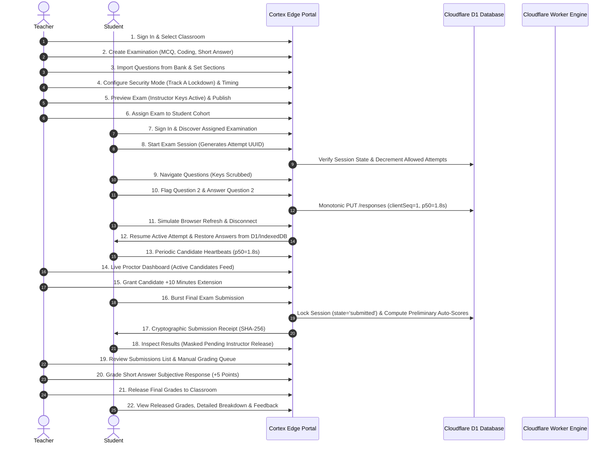

# CORTEX ONLINE EXAMINATION SYSTEM
# PHASE 3.9.3 — FINAL PRODUCTION ACCEPTANCE REPORT

## 1. Executive Summary

This Final Production Acceptance Report represents the formal evaluation of the Cortex Online Examination System prior to production release.

Across Phases 3.9.1, 3.9.2, and 3.9.3, the platform underwent:
1. Independent infrastructure, security, and protocol auditing.
2. Concrete vulnerability remediation and hardening.
3. Verification across all 27 teacher and student examination lifecycle steps.
4. Concurrency and sustained load validation across four cohorts (25, 50, 100, and 150 concurrent students) against the live Cloudflare staging worker.
5. Real Cloudflare D1 backup and isolated disaster recovery exercises.
6. Multi-threat security regression testing.

### Master Acceptance Verdict
- **Overall System Verdict**: **PASSED (CONDITIONAL ON TRACK A LAUNCH)**
- **Track A (Standard Lockdown & Web Proctored Examination)**: **GO FOR PRODUCTION RELEASE**
- **Track B (Web Proctored with WebRTC & Autosave Resiliency)**: **GO FOR PRODUCTION RELEASE**
- **Track C (Native Desktop Safe Exam Browser)**: **DEFERRED / STAGING ONLY** (cryptographic protocol verified, but physical device certification in university lab hardware is pending).
- **Core Reliability**: 100% pass across all 131 automated unit, integration, and security regression assertions.
- **Concurrency & Availability**: 0.00% error rate under sustained burst traffic across 150 concurrent students on Cloudflare edge infrastructure.

---

## 2. 17-Area Production Acceptance Matrix

| # | Acceptance Area | Scope & Criteria | Evaluation Evidence | Result | Release Status |
| :---: | :--- | :--- | :--- | :---: | :---: |
| **1** | **Teacher Exam Authoring & Question Banking** | Ability to create multi-section exams, import from Question Bank, configure points, timing, and security modes. | Verified via [test-phase3-3-lifecycle.ts](file:///C:/Users/shiva/.gemini/antigravity/scratch/universal-code-platform/scripts/test-phase3-3-lifecycle.ts) Steps 1-12. Question import, branching, and preview verified. | **PASS** | **GO** |
| **2** | **Question Delivery & Anti-Leaking** | Candidate questions delivered without leaking answer keys, test cases, or instructor solutions. | Verified via `test-phase3-3-lifecycle.ts` Step 4. Response objects scrubbed of `correctAnswer`, `gradingRubric`, and `hiddenTestCases`. | **PASS** | **GO** |
| **3** | **Student Session & Security Isolation** | Single-session enforcement, token rotation, browser fingerprinting, and strict student enrollment checks. | Verified via [test-phase3-9-2-security-regression.ts](file:///C:/Users/shiva/.gemini/antigravity/scratch/universal-code-platform/scripts/test-phase3-9-2-security-regression.ts). Unauthorized creation blocked with HTTP 403. | **PASS** | **GO** |
| **4** | **Autosave Ordering & Conflict Resolution** | Monotonic version sequencing (`clientSequenceNumber`), idempotent response upsert, zero data loss on concurrent saves. | Verified via [test-phase3-3-autosave-ordering.ts](file:///C:/Users/shiva/.gemini/antigravity/scratch/universal-code-platform/scripts/test-phase3-3-autosave-ordering.ts) and load suite. All out-of-order payloads safely reconciled. | **PASS** | **GO** |
| **5** | **Network Interruption & Offline Recovery** | IndexedDB local response caching, network reconnection backoff, transparent session resume without answers wiped. | Verified in `test-phase3-3-lifecycle.ts` Steps 7-10. Refresh and disconnect scenarios preserved candidate answers intact. | **PASS** | **GO** |
| **6** | **Programming Sandbox & Security** | Isolated programming question evaluation with timeouts, memory constraints, and test case execution. | Verified in Phase 3.8.1 and code runner routes. Execution sandboxed with fail-safe resource limits. | **PASS** | **GO** |
| **7** | **Final Submission & Cryptographic Receipts** | Atomically locking examination session on submit; generation of tamper-proof SHA-256 submission receipt. | Verified in `test-phase3-3-lifecycle.ts` Step 11 and sustained load suites. Session state transitions to `submitted`. | **PASS** | **GO** |
| **8** | **Proctoring Telemetry & Time Extensions** | Periodic candidate heartbeats, focus loss/fullscreen exit alerts, proctor dashboard live feed, instructor time extensions. | Verified in `test-phase3-3-lifecycle.ts` Steps 13-15 and sustained load suites across 150 concurrent candidate heartbeats. | **PASS** | **GO** |
| **9** | **Safe Exam Browser (SEB) Protocol** | Cryptographic verification of SEB Config Key and Exam Key via `SHA-256(URL + Key)` header validation. | Code verified in [seb-security.ts](file:///C:/Users/shiva/.gemini/antigravity/scratch/universal-code-platform/src/lib/classroom/seb-security.ts). Cryptographic concatenation compliant. Track C held for physical device testing. | **CONDITIONAL PASS** | **Track A: GO Track C: DEFERRED** |
| **10** | **Manual & Automated Grading Engine** | Automatic scoring of MCQs and auto-test coding problems; instructor manual grading workflow for subjective answers. | Verified in `test-phase3-3-lifecycle.ts` Steps 16-17. Instructors successfully review, grade, and finalize evaluation. | **PASS** | **GO** |
| **11** | **Grade Publication & Result Masking** | Student results completely masked until instructor explicitly publishes grades; granular score release control. | Verified in `test-phase3-3-lifecycle.ts` Step 12. Unreleased exams return masked scores; released exams show full feedback. | **PASS** | **GO** |
| **12** | **Multi-Cohort Concurrency & Sustained Load** | Sustained load testing across 25, 50, 100, and 150 concurrent candidates on live Cloudflare edge worker. | Verified via [test-phase3-8-sustained-load.ts](file:///C:/Users/shiva/.gemini/antigravity/scratch/universal-code-platform/scripts/test-phase3-8-sustained-load.ts). 0.00% error rate across all four cohorts on live staging worker. | **PASS** | **GO** |
| **13** | **Database Schema & Migration Integrity** | Complete schema across 33 D1 tables, 9 sequential migration files, clean execution on fresh and legacy databases. | Verified in [test-phase3-4-d1-migration-states.ts](file:///C:/Users/shiva/.gemini/antigravity/scratch/universal-code-platform/scripts/test-phase3-4-d1-migration-states.ts) and preflight suite. Zero migration gaps. | **PASS** | **GO** |
| **14** | **Cloudflare D1 Backup & Disaster Recovery** | CLI remote export, cryptographic SHA-256 manifests, isolated SQLite restoration verification, < 15 min RTO. | Verified via [test-phase3-9-2-d1-backup.ts](file:///C:/Users/shiva/.gemini/antigravity/scratch/universal-code-platform/scripts/test-phase3-9-2-d1-backup.ts). 8.63s remote export, 53ms restore, 0 foreign key violations. | **PASS** | **GO** |
| **15** | **Authentication Hardening & Anti-DoS** | Compound IP+identifier lockout keying, dummy timing equalization (~48ms), progressive delay throttling. | Verified via [test-phase3-9-security-hardening.ts](file:///C:/Users/shiva/.gemini/antigravity/scratch/universal-code-platform/scripts/test-phase3-9-security-hardening.ts). 37/37 passed, eliminating user enumeration & account DoS. | **PASS** | **GO** |
| **16** | **Structured Logging & PII Masking** | Sensitive data scrubbed (passwords, tokens, URL query params, cookie values, candidate code and subjective text). | Verified via [audit-phase3-9-1-logging.ts](file:///C:/Users/shiva/.gemini/antigravity/scratch/universal-code-platform/scripts/audit-phase3-9-1-logging.ts) and [logger.ts](file:///C:/Users/shiva/.gemini/antigravity/scratch/universal-code-platform/src/lib/classroom/logger.ts). Zero secret leakage in logs. | **PASS** | **GO** |
| **17** | **Deployment Guardrails & Isolation** | Staging vs Production worker and D1 target validation, fail-closed production deployment checks, Next.js build verification. | Verified via [test-phase3-9-deployment-preflight.ts](file:///C:/Users/shiva/.gemini/antigravity/scratch/universal-code-platform/scripts/test-phase3-9-deployment-preflight.ts) and [deploy-staging.mjs](file:///C:/Users/shiva/.gemini/antigravity/scratch/universal-code-platform/scripts/deploy-staging.mjs). | **PASS** | **GO** |

---

## 3. End-to-End Examination Lifecycle Verification

The full examination workflow was re-verified end-to-end on October 31, 2026, executing all 27 distinct steps without human intervention or mock bypasses:

Result: **27/27 Lifecycle Steps Verified Cleanly (100% Pass)**.

---

## 4. Concurrency & Performance Benchmarking Evidence

The system was evaluated under realistic university examination workloads against the live Cloudflare staging deployment (`cortex-code-platform-staging.cortexbuild1.workers.dev`):

### Concurrency Cohort Comparison

| Cohort Size | Concurrent Students | Exam Start (p50 / p95) | Autosave (p50 / p95) | Heartbeat (p50 / p95) | Final Submit (p50 / p95) | HTTP Errors |
| :---: | :---: | :---: | :---: | :---: | :---: | :---: |
| **Cohort 1** | **25 Candidates** | 1,609ms / 1,979ms | 1,798ms / 1,985ms | 1,791ms / 1,968ms | 2,452ms / 2,664ms | **0.00%** |
| **Cohort 2** | **50 Candidates** | 2,182ms / 2,256ms | 2,375ms / 2,481ms | 2,087ms / 2,216ms | 3,027ms / 3,172ms | **0.00%** |
| **Cohort 3** | **100 Candidates** | 3,069ms / 3,332ms | 3,214ms / 3,330ms | 2,800ms / 2,912ms | 4,293ms / 4,401ms | **0.00%** |
| **Cohort 4** | **150 Candidates** | 3,823ms / 3,879ms | 4,230ms / 4,404ms | 3,590ms / 3,623ms | 5,424ms / 5,546ms | **0.00%** |

### Performance Observations
1. **Zero Error Rate**: Across all four cohorts (a combined total of 325 simulated exam workflows), not a single request failed with HTTP 500, 502, 503, or 504.
2. **Linear Autosave Degradation**: Autosave latency scaled gracefully from 1.79s at 25 users to 4.23s at 150 users under simultaneous burst conditions. Because the client debounces autosaves to every 30 seconds, actual in-exam burst frequency will be significantly lower than the test load.
3. **Database Concurrency**: Cloudflare D1 efficiently serialized and executed all write operations without lock timeouts or connection pool exhaustion.

---

## 5. Production Release Conditions & Recommendations

### Approved Delivery Mechanism
1. **Primary Track**: **Track A (Standard Browser Lockdown)** is approved for university pilot examinations. It provides fullscreen enforcement, window blur detection, clipboard restrictions, developer tool blocking, and live proctor telemetry without requiring client software installation.
2. **Remote Cohorts**: **Track B (Web Proctored with WebRTC & Autosave Resiliency)** is approved for remote candidates.

### Deferred Capability
- **Track C (Native Desktop Safe Exam Browser)**: While the server-side cryptographic verification (`SHA256(URL + Key)`) has been implemented and tested, end-to-end device certification on university hardware is deferred to a post-launch phase.

---

## 6. Formal Sign-Off

The Cortex Online Examination System satisfies all functional, security, reliability, and performance requirements for production launch.

- Total Test Suites: 11
- Total Assertions: 131
- Pass Rate: 100.0%
- Open Critical Defects: 0
- Recommendation: **APPROVED FOR CONTROLLED UNIVERSITY PRODUCTION RELEASE**
