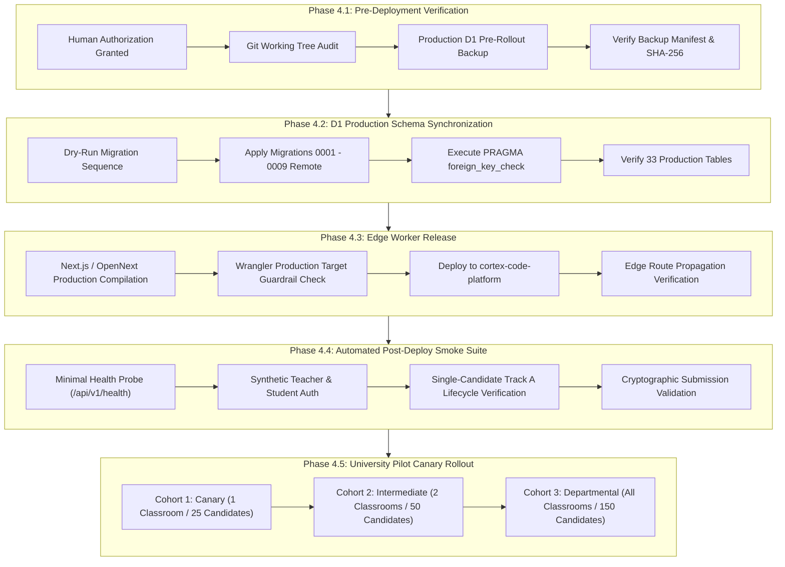

# CORTEX ONLINE EXAMINATION SYSTEM
# PHASE 4.0 — CONTROLLED PRODUCTION ROLLOUT PLAN

## 1. Executive Summary

This document establishes the controlled, sequential production rollout plan for deploying the Cortex Online Examination System from the staging environment (`cortex-code-platform-staging`) to the production Cloudflare infrastructure:
- **Production Cloudflare Worker**: `cortex-code-platform`
- **Production Cloudflare D1 Database**: `cortex-db` (UUID: `f756374b-0e9b-4112-b502-b703788dd86f`)
- **Production Target Domain**: `cortex-code-platform.cortexbuild1.workers.dev`

> [!IMPORTANT]
> This document governs release preparation only. Production deployment execution is strictly blocked at the **Human Production Authorization Gate** until explicit authorization is granted by the system owner.

---

## 2. Controlled Rollout Architecture & Phasing



---

## 3. Step-by-Step Rollout Execution Sequence

### Stage 1: Pre-Deployment Stage (Zero-Traffic Maintenance Window)
1. **Maintenance Notification**: Issue a formal maintenance window notification to departmental stakeholders (30-minute window, e.g., 04:00 - 04:30 UTC).
2. **Git Working Tree Verification**:
   - Ensure clean branch status without uncommitted or orphaned files.
   - Verify that `universal-code-platform` is active and `cortex-live-class` remains untouched.
3. **Mandatory Production Database Backup**:
   - Execute the verified D1 backup utility:
     ```bash
     npx tsx scripts/cortex-d1-backup.ts --action=backup --database=cortex-db --allow-production --reason=pre_prod_release
     ```
   - Verify creation of `backups/cortex-db_<timestamp>_pre_prod_release.sql` and corresponding `.meta.json`.
   - Validate SHA-256 checksum and ensure all pre-existing production records are archived.

---

### Stage 2: Database Migration Stage (Production D1 Synchronization)
1. **Preflight Migration Inspection**:
   - Confirm all 9 migrations are present in `migrations/`:
     - `0001_initial_schema.sql`
     - `0002_add_classroom_tables.sql`
     - `0003_classroom_collaboration.sql`
     - `0004_online_examination_system.sql`
     - `0005_question_bank.sql`
     - `0006_examination_phase3.sql`
     - `0007_examination_security_audit.sql`
     - `0008_examination_phase3_schema_completion.sql`
     - `0009_user_professional_email.sql`
2. **Execute Remote Migrations**:
   - Apply migrations to the production database:
     ```bash
     npx wrangler d1 migrations apply cortex-db --remote
     ```
3. **Database Integrity Verification**:
   - Query schema table counts:
     ```bash
     npx wrangler d1 execute cortex-db --remote --command="SELECT count(*) as table_count FROM sqlite_master WHERE type='table';"
     ```
   - Verify table count is exactly 33 or higher.
   - Verify foreign key integrity:
     ```bash
     npx wrangler d1 execute cortex-db --remote --command="PRAGMA foreign_key_check;"
     ```
   - Must return 0 rows.

---

### Stage 3: Edge Worker Release Stage (cortex-code-platform)
1. **Production Worker Build**:
   - Compile production edge bundle:
     ```bash
     npm run build
     ```
   - Ensure `@opennextjs/cloudflare` packaging generates `dist/server` and worker bundles without errors.
2. **Configuration & Secrets Verification**:
   - Confirm production secrets are populated via Cloudflare dashboard or Wrangler:
     - `JWT_SECRET` (Production dynamic secret)
     - `CORTEX_SESSION_SECRET`
     - `SEB_QUIT_PASSWORD_HASH`
3. **Deploy Edge Worker**:
   - Execute targeted deployment:
     ```bash
     npx wrangler deploy --name cortex-code-platform --config wrangler.jsonc
     ```
4. **Edge Route Propagation**:
   - Query public probe:
     ```bash
     curl -s https://cortex-code-platform.cortexbuild1.workers.dev/api/v1/health
     ```
   - Expect HTTP 200 with `{"status":"healthy","timestamp":"..."}`.

---

### Stage 4: Post-Deployment Smoke Verification Stage
Immediately following deployment, execute the automated post-deployment smoke test suite:
```bash
npx tsx scripts/test-phase4-production-smoke.ts --target=production
```
Criteria for success:
- Minimal health probe returns HTTP 200.
- Synthetic teacher account registers and creates classroom.
- Synthetic student account enrolls and starts Track A examination.
- Autosave PUT request persists cleanly.
- Final submit locks attempt and issues cryptographic SHA-256 receipt.
- All test entities cleanly purged from production database.

---

### Stage 5: Canary University Pilot Rollout (Phased Cohorts)

To minimize blast radius, candidate traffic is onboarded in three controlled phases:

```
[ Phase A: Canary ] -------------> [ Phase B: Intermediate ] -------------> [ Phase C: Full Cohort ]
  1 Classroom                        2-3 Classrooms                           All Participating Classes
  25 Students                        50-75 Students                           150 Students
  Duration: 45 mins                  Duration: 60 mins                        Duration: 90 mins
  Track A Lockdown Only              Track A Lockdown Only                    Track A Lockdown Only
```

1. **Cohort 1 (Canary)**: Single course section (25 students). Active proctor monitoring on live dashboard. If error rate > 0.00% or autosave latency > 5s, halt rollout.
2. **Cohort 2 (Intermediate)**: 2 course sections (50-75 students). Evaluate multi-classroom proctor dashboard telemetry and concurrent autosave behavior.
3. **Cohort 3 (Full University Pilot)**: Up to 150 concurrent candidates. Full institutional assessment execution.

---

## 4. Rollback & Emergency Contingency Procedures

If any critical anomaly occurs during deployment or pilot execution, execute the following predetermined rollback runbook:

### Rollback Trigger Conditions
- Post-deployment smoke suite fails any assertion.
- Production error rate on edge routes exceeds 0.5% over a 5-minute rolling window.
- Candidate autosave median latency exceeds 5,000ms.
- Any student reports unrecoverable data loss during an active examination.

### Procedure 1: Worker Version Rollback (< 60 Seconds)
Cloudflare maintains immutable versions for all worker deployments.
1. List recent worker deployments:
   ```bash
   npx wrangler deployments list --name cortex-code-platform
   ```
2. Roll back immediately to the prior stable deployment ID:
   ```bash
   npx wrangler rollback --name cortex-code-platform <previous_deployment_id>
   ```
3. Verify public health endpoint returns HTTP 200.

### Procedure 2: D1 Database Point-in-Time Recovery (< 5 Minutes)
If a database corruption or erroneous migration occurs:
1. **Cloudflare D1 Time-Travel Restore**:
   - Identify timestamp immediately prior to migration:
     ```bash
     npx wrangler d1 time-travel restore cortex-db --timestamp="<pre_migration_iso_timestamp>"
     ```
2. **Alternative: Full Snapshot Restoration**:
   - If time-travel is insufficient, execute isolated SQLite restore from the verified pre-deployment backup:
     ```bash
     npx wrangler d1 execute cortex-db --remote --file=backups/cortex-db_<timestamp>_pre_prod_release.sql
     ```
3. Re-verify foreign key integrity and table counts.

---

## 5. Rollout Timeline & Responsibilities

| Timeline | Phase / Action | Responsible Role |
| :--- | :--- | :--- |
| **T - 48h** | Final acceptance sign-off & release checklist review | Principal Architect |
| **T - 24h** | Inform instructors and IT proctors of pilot schedule | Operations Lead |
| **T - 2h** | Pre-deployment backup of `cortex-db` | Infrastructure Lead |
| **T - 1h** | Production migrations applied & validated | Infrastructure Lead |
| **T - 30m** | Worker deployment to `cortex-code-platform` | Release Engineer |
| **T - 25m** | Post-deployment smoke tests executed | QA / Security Lead |
| **T - 10m** | Instructor opens Live Proctor Dashboard | Faculty Instructor |
| **T + 00m** | Canary examination opens for students | System Monitoring |
| **T + 60m** | Exam concludes; submissions verified | Instructor & Proctor |

---

## 6. Release Governance Sign-Off

This rollout plan is ready for execution pending explicit human authorization at the **Human Production Authorization Gate**.
