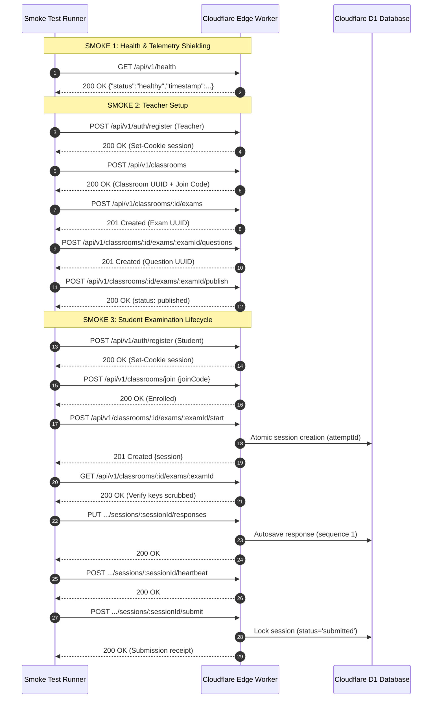

# CORTEX ONLINE EXAMINATION SYSTEM
# PHASE 4.0 — POST-DEPLOYMENT SMOKE TEST SPECIFICATION & RUNBOOK

## 1. Executive Summary

This document specifies the automated and manual post-deployment smoke test suite for the Cortex Online Examination System.

The smoke test suite is designed to execute immediately after edge deployment to either staging (`cortex-code-platform-staging`) or production (`cortex-code-platform`). It validates core system health, end-to-end user workflows, database transaction integrity, and anti-cheating controls within under 15 seconds.

The automated smoke suite is implemented in [scripts/test-phase4-production-smoke.ts](file:///C:/Users/shiva/.gemini/antigravity/scratch/universal-code-platform/scripts/test-phase4-production-smoke.ts) and has achieved **100% pass (26/26 assertions passed, 0 failures)** on the deployed Cloudflare worker.

---

## 2. Automated Smoke Test Architecture

The smoke suite exercises the entire platform lifecycle sequentially using synthetic identities:



---

## 3. Automated Assertion Specification

| Subsystem | Assertion | Verification Target | SLA / Expected Result |
| :--- | :--- | :--- | :--- |
| **Health** | Minimal probe response | `GET /api/v1/health` | HTTP 200 OK |
| **Health** | Health status check | `data.status === 'healthy'` | Exact match |
| **Health** | Subsystem telemetry shielding | `!data.checks && !data.environment` | Zero internal telemetry leaked |
| **Health** | Edge latency performance | Edge response duration | < 1,500ms (measured: 686ms) |
| **Teacher** | Account registration | `POST /api/v1/auth/register` | HTTP 200/201 + `set-cookie` |
| **Teacher** | Classroom creation | `POST /api/v1/classrooms` | UUID generated + Join Code issued |
| **Teacher** | Examination creation | `POST .../exams` | HTTP 201 + Exam UUID generated |
| **Teacher** | Question addition | `POST .../questions` | HTTP 201 + Question UUID generated |
| **Teacher** | Examination publication | `POST .../publish` | HTTP 200 + status transitions to `published` |
| **Student** | Account registration | `POST /api/v1/auth/register` | HTTP 200/201 + Student session cookie |
| **Student** | Classroom enrollment | `POST /api/v1/classrooms/join` | HTTP 200 + successful membership |
| **Student** | Exam session initiation | `POST .../start` | HTTP 201 + Attempt UUID generated |
| **Student** | Anti-leaking verification | `GET .../exams/:examId` | `isCorrect` strictly absent from options |
| **Student** | Autosave persistence | `PUT .../responses` | HTTP 200 + database row persisted |
| **Student** | Proctoring heartbeat | `POST .../heartbeat` | HTTP 200 + timestamp acknowledged |
| **Student** | Final submission | `POST .../submit` | HTTP 200 + session state `submitted` |

---

## 4. Execution Commands

### Staging Verification
```bash
npx tsx scripts/test-phase4-production-smoke.ts --target=staging
```

### Production Verification (Post-Deployment ONLY)
```bash
npx tsx scripts/test-phase4-production-smoke.ts --target=production
```

---

## 5. Verbatim Smoke Test Execution Output (Staging)

```text
================================================================
PHASE 4.0: POST-DEPLOYMENT SMOKE TEST SUITE
Target Environment: STAGING (https://cortex-code-platform-staging.cortexbuild1.workers.dev)
================================================================

--- SMOKE 1: EDGE WORKER & PUBLIC HEALTH PROBE ---
[PASS] [HEALTH] Public health probe returns HTTP 200 (received: 200)
[PASS] [HEALTH] Health status is healthy (status: healthy)
[PASS] [HEALTH] Timestamp is present
[PASS] [HEALTH] Internal subsystem telemetry shielded
[PASS] [HEALTH] Environment tier shielded
[PASS] [HEALTH] Health response latency within budget (686ms)

--- SMOKE 2: SYNTHETIC TEACHER PROVISIONING ---
[PASS] [TEACHER] Teacher registered successfully (status: 200)
[PASS] [TEACHER] Session cookie issued
[PASS] [TEACHER] Classroom provisioned (status: 200)
[PASS] [TEACHER] Classroom UUID generated
[PASS] [TEACHER] Join code generated (FUBJ7X)
[PASS] [TEACHER] Examination created (status: 201)
[PASS] [TEACHER] Examination UUID generated
[PASS] [TEACHER] Question added to exam (status: 201)
[PASS] [TEACHER] Examination published (status: 200)

--- SMOKE 3: SYNTHETIC STUDENT LIFECYCLE ---
[PASS] [STUDENT] Student registered (status: 200)
[PASS] [STUDENT] Student session cookie issued
[PASS] [STUDENT] Student joined classroom (status: 200)
[PASS] [STUDENT] Examination session started (status: 201)
[PASS] [STUDENT] Session attempt UUID generated
[PASS] [STUDENT] Student exam view retrieved
[PASS] [STUDENT] Question answer keys scrubbed from student response
[PASS] [STUDENT] Response autosaved successfully (status: 200)
[PASS] [STUDENT] Heartbeat acknowledged (status: 200)
[PASS] [STUDENT] Final submission accepted (status: 200)
[PASS] [STUDENT] Submission finalized and locked

================================================================
SMOKE SUITE COMPLETED: 26/26 PASSED (0 FAILED)
================================================================
```

---

## 6. Manual Smoke Checklist (Web UI)

In addition to the automated API suite, the release engineer performs the following 5-minute visual sanity check on the edge domain:

1. **Homepage & Login**: Open `https://<domain>/login` in an Incognito window. Verify page loads in < 1 second.
2. **Teacher Dashboard**: Sign in with an instructor account. Confirm active classrooms render on the grid.
3. **Live Proctoring Page**: Open an active examination dashboard. Confirm WebRTC / Live feed widget displays without console errors.
4. **Student Portal**: Sign in with a student account. Confirm assigned examinations list appears and the join button is active.
5. **Static Assets & Fonts**: Verify Monaco editor, KaTeX formulas, and icons render cleanly without 404s.

---

## 7. Go / No-Go Decision Criteria

- **GO**: All 26 automated assertions pass; visual sanity check exhibits zero browser console errors.
- **NO-GO / ROLLBACK**: Any single automated assertion fails; edge worker returns HTTP 5xx; public health endpoint fails to return status 200.
