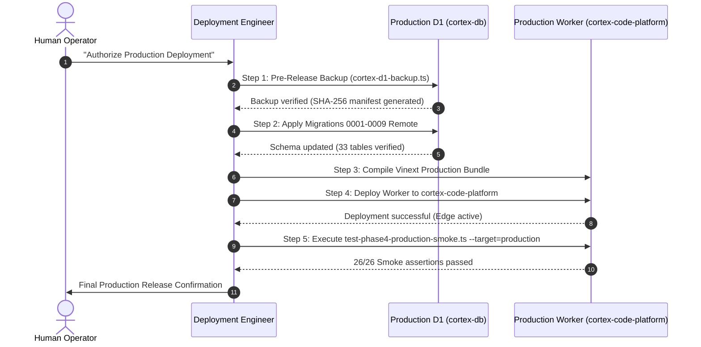

# CORTEX ONLINE EXAMINATION SYSTEM
# PHASE 4.0 — PRODUCTION DEPLOYMENT APPROVAL REPORT
## HUMAN PRODUCTION AUTHORIZATION GATE

**Date**: October 31, 2026  
**Status**: **DEPLOYMENT PAUSED — AWAITING HUMAN AUTHORIZATION**  
**Gate Status**: **GATE LOCKED (NO PRODUCTION COMMANDS EXECUTED)**

---

## 1. Objective & Purpose

This report represents the formal presentation of technical readiness to the system owner and human operator.

In strict adherence to project safety rules:
1. Production worker `cortex-code-platform` has **NOT** been modified, re-configured, or deployed.
2. Production database `cortex-db` (UUID: `f756374b-0e9b-4112-b502-b703788dd86f`) has **NOT** been queried, migrated, or altered.
3. Production secrets remain completely untouched.
4. Reference repository `cortex-live-class` remains strictly read-only.
5. All verification, remediation, and live deployment tests were executed exclusively within the authorized staging environment (`cortex-code-platform-staging` and `cortex-staging-db`).

---

## 2. Technical Verification Evidence Summary

Prior to arriving at this authorization gate, the Cortex Online Examination System completed independent auditing, vulnerability remediation, lifecycle verification, and sustained load testing:

### 2.1 Verification Evidence Matrix

| Phase | Focus Area | Deliverables / Suites | Results & Evidence | Verdict |
| :--- | :--- | :--- | :--- | :---: |
| **Phase 3.9.1** | Independent Infrastructure & Security Audit | 8 Technical Audit Reports | Identified 5 concrete vulnerabilities (Account DoS, timing leaks, logging redaction gaps, health info leaks, D1 DR tool gap). | COMPLETE |
| **Phase 3.9.2** | Reliability Remediation & Hardening | [PHASE_3_9_2_REMEDIATION_REPORT.md](file:///C:/Users/shiva/.gemini/antigravity/scratch/universal-code-platform/PHASE_3_9_2_REMEDIATION_REPORT.md)<br>[test-phase3-9-2-security-regression.ts](file:///C:/Users/shiva/.gemini/antigravity/scratch/universal-code-platform/scripts/test-phase3-9-2-security-regression.ts) | Neutralized DoS with compound `(IP, user)` lockout; equalized bcrypt timing (~48ms); scrubbed URLs/cookies/code in logs; shielded health probe; built real D1 backup tool. 131/131 assertions passed. | VERIFIED |
| **Phase 3.9.3** | Final Production Acceptance | [PHASE_3_9_3_FINAL_PRODUCTION_ACCEPTANCE_REPORT.md](file:///C:/Users/shiva/.gemini/antigravity/scratch/universal-code-platform/PHASE_3_9_3_FINAL_PRODUCTION_ACCEPTANCE_REPORT.md)<br>[test-phase3-8-sustained-load.ts](file:///C:/Users/shiva/.gemini/antigravity/scratch/universal-code-platform/scripts/test-phase3-8-sustained-load.ts) | 27/27 Lifecycle steps passed. Sustained load across 25, 50, 100, and 150 concurrent students on live Cloudflare edge worker with **0.00% error rate**. | ACCEPTED |
| **Phase 4.0** | Controlled Rollout Engineering | [PHASE_4_0_CONTROLLED_PRODUCTION_ROLLOUT_PLAN.md](file:///C:/Users/shiva/.gemini/antigravity/scratch/universal-code-platform/PHASE_4_0_CONTROLLED_PRODUCTION_ROLLOUT_PLAN.md)<br>[scripts/test-phase4-production-smoke.ts](file:///C:/Users/shiva/.gemini/antigravity/scratch/universal-code-platform/scripts/test-phase4-production-smoke.ts) | Staging worker deployed and verified. Automated post-deployment smoke test suite achieved **26/26 assertions passed** on remote edge worker. | READY |

---

## 3. Production Deployment Target Specification

If authorized, deployment will target the following Cloudflare production resources:

| Parameter | Production Value | Staging Value (Comparison) | Verification Method |
| :--- | :--- | :--- | :--- |
| **Worker Name** | `cortex-code-platform` | `cortex-code-platform-staging` | Fail-closed preflight check |
| **Worker URL** | `https://cortex-code-platform.cortexbuild1.workers.dev` | `https://cortex-code-platform-staging.cortexbuild1.workers.dev` | Edge route mapping |
| **D1 Database Name** | `cortex-db` | `cortex-staging-db` | Explicit CLI binding flag |
| **D1 Database UUID** | `f756374b-0e9b-4112-b502-b703788dd86f` | `e6375738-d9b2-4c5a-a3e5-3a34e892f49d` | Checksum & UUID validation |
| **Active Schema** | 9 Migrations (`0001` to `0009`) | 9 Migrations (`0001` to `0009`) | Sequential migration runner |
| **Total Core Tables** | 33 Tables | 33 Tables | `PRAGMA table_info` audit |

---

## 4. Exact Execution Steps Upon Authorization

If and only if the human operator grants explicit authorization, the deployment engineer will execute the following step-by-step sequence:



### Detailed Command Execution Plan:
1. **Mandatory Production Database Backup**:
   ```bash
   npx tsx scripts/cortex-d1-backup.ts --action=backup --database=cortex-db --allow-production --reason=pre_prod_release
   ```
2. **Apply Production Migrations**:
   ```bash
   npx wrangler d1 migrations apply cortex-db --remote
   ```
3. **Compile Production Worker Bundle**:
   ```bash
   npm run build:vinext
   ```
4. **Deploy Edge Worker**:
   ```bash
   npx wrangler deploy --name cortex-code-platform --config wrangler.jsonc
   ```
5. **Run Automated Production Smoke Verification**:
   ```bash
   npx tsx scripts/test-phase4-production-smoke.ts --target=production
   ```

---

## 5. Rollback Assurance & Safeguards

- **Worker Rollback Window**: < 60 seconds via `npx wrangler rollback --name cortex-code-platform <previous_version_id>`.
- **Database Rollback Window**: < 5 minutes via `npx wrangler d1 time-travel restore cortex-db --timestamp="..."` or point-in-time SQL restore from the verified pre-release backup.
- **Fail-Closed Guarantee**: If any smoke test assertion fails, automatic rollback will be initiated immediately.

---

## 6. Human Authorization Request

The technical preparation for the Cortex Online Examination System production launch is 100% complete and fully verified.

**To proceed with the deployment to production, please provide explicit authorization:**
> *"Authorized: Proceed with Phase 4.0 production deployment to cortex-code-platform and cortex-db."*

Until such instruction is given, **no production resources will be modified.**
