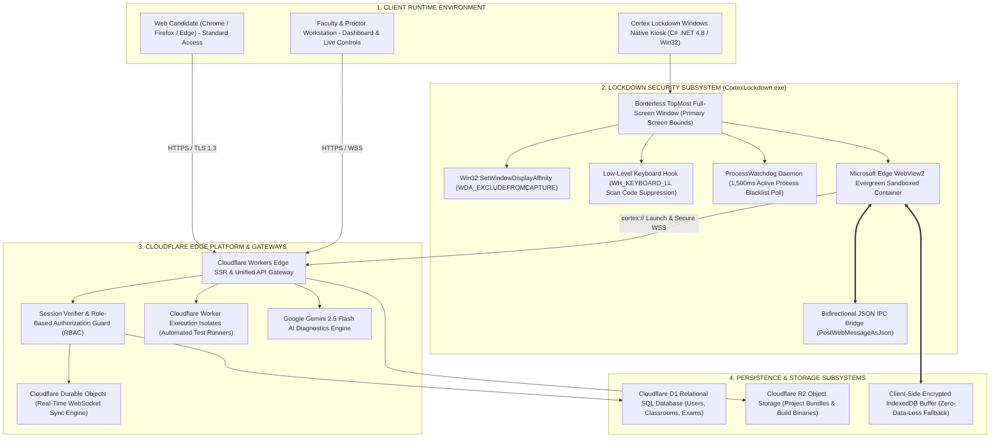
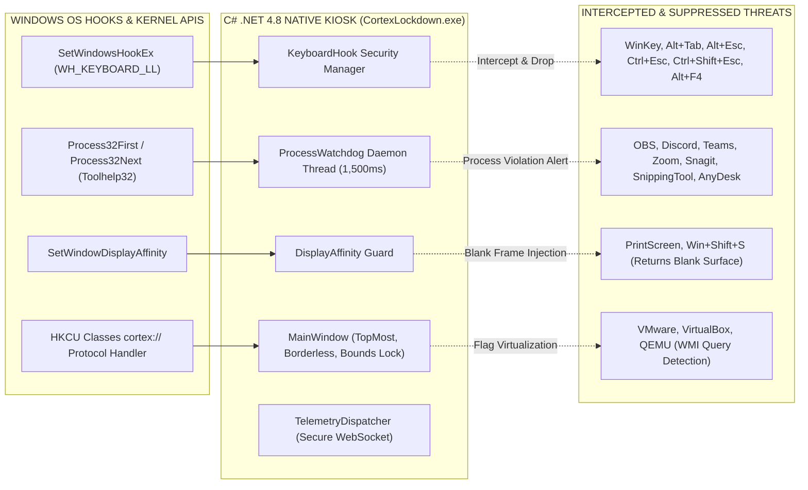
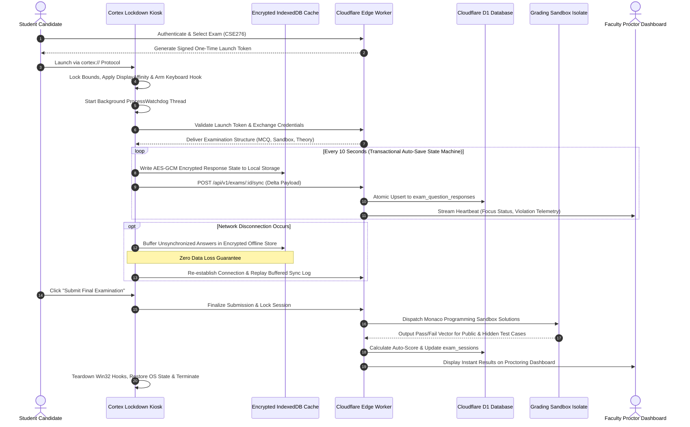

<div align="center">

  

  # CORTEX UNIVERSAL CODE PLATFORM
  ### High-Integrity Cloud Development Ecosystem, Collaborative Virtual Labs & Zero-Trust Examination Suite
  *Code Beyond Limits &bull; Compile &bull; Create &bull; Collaborate &bull; Deploy*

</div>

---

## 1. PLATFORM OVERVIEW & THE 8 CORE PILLARS

The **Cortex Universal Code Platform** is a distributed, enterprise-grade cloud operating environment designed for computer science education, real-time software engineering collaboration, and tamper-resistant academic examinations.

The platform unites eight fully integrated subsystems into a singular high-performance architecture:

```
+---------------------------------------------------------------------------------------------------+
|                                 CORTEX 8-PILLAR ARCHITECTURE                                      |
+---------------------------------------------------------------------------------------------------+
|  1. Universal Cloud IDE          | 16 sandboxed language runtimes, Monaco editor, step debugger  |
|  2. Code Visualization Engine    | Live memory, stack, heap, tree, and algorithm state visualizer |
|  3. Competitive Challenges Hub   | Algorithmic arenas with automated test suites & constraints    |
|  4. Dual Benchmark Arena         | Side-by-side multi-compiler latency and memory comparison      |
|  5. Interactive Learning Tracks  | Structured courses (C++, Python, Rust) with compiler validation|
|  6. Collaborative Classrooms     | Live multi-user coding, WebRTC AV stage, shared whiteboards    |
|  7. Project Teams Studio         | Team formation, student project galleries, activity timelines  |
|  8. Cortex Lockdown Browser      | Win32 kiosk client, anti-cheat hooks, 10s auto-save state engine|
+---------------------------------------------------------------------------------------------------+
```

---

## 2. END-TO-END SYSTEM ARCHITECTURE

Cortex is architected as an edge-first distributed system deployed globally on Cloudflare Workers, Cloudflare D1 distributed SQL, and native Win32 security APIs.



---

## 3. PILLAR DEEP-DIVES

### 3.1 Universal Cloud IDE & Polyglot Sandboxes
- **Engineered on Microsoft Monaco:** Direct VS Code editing surface with IntelliSense auto-completion, bracket pair colorization, semantic code folding, multi-cursor editing, and minimap.
- **16 Pre-configured Language Runtimes:** Sub-second execution latency inside isolated sandboxes:

| Category | Languages | Compilers & Toolchains | Sandboxing & Isolation |
| :--- | :--- | :--- | :--- |
| **Compiled Systems** | C++20, C17 | GCC 13 / 16 (`-O2 -Wall`) | POSIX Secure Isolate Runner |
| **Enterprise Systems** | Java 21 LTS, C# | OpenJDK 21, .NET 8 SDK | Sandboxed JVM / CLR Isolates |
| **Modern Native** | Rust 1.75, Go 1.22 | Rustc 2021 Edition, Go 1.22 | Native Binary Execution |
| **Modern Scripting** | TypeScript 5, JavaScript | Bun / Node.js 20 (ES2023) | V8 Execution Sandboxing |
| **Mobile & Server** | Swift 5.9, Kotlin 1.9, Dart 3 | Linux Swift, Kotlin JVM, Dart VM | Native Runner / JVM Container |
| **Scripting & Web** | Python 3.12, PHP 8.3, Ruby 3.3 | CPython 3.12, Zend Engine, Ruby YJIT | Worker Isolates / CLI Runners |
| **Data & Relational**| R 4.3, SQLite 3.44 | GNU R 4.3, SQLite Engine | In-Memory Ephemeral Sandbox |

- **Visual Step-Debugger & Variable Watcher:** Dynamic AST scope analyzer parses execution state, extracting active variables (primitives, arrays, objects, maps) with Step Over (F10), Step Into (F11), Step Out (Shift+F11), and Resume (F5).
- **Synchronized Cloud Terminal:** Integrated bash-compatible terminal where filesystem commands (`mkdir`, `touch`, `rm`, `cat`) synchronize automatically back to the visual workspace.
- **Google Gemini 2.5 Flash AI Assistant:** Sub-second code repair with zero-latency streaming. Injects line-by-line targeted commentary and provides an AST heuristic fallback engine when operating offline.

### 3.2 Code & Memory Visualization Engine
- **Dynamic Structure Rendering (`src/components/visualization`):** Real-time animated canvas visualizing memory layouts, pointer graphs, binary search trees, linked lists, arrays, and sorting passes (QuickSort, MergeSort).
- **Timeline Execution Scrubbing (`TimelineControls.tsx`):** Step forward and backward through program state frames to observe pointer mutations and stack frame allocation.
- **Inspectors:** Dedicated Call Stack Inspector and Live Variable State Inspector.

### 3.3 Competitive Programming Arena (`/challenges`)
- Complete algorithm problem hub categorized by difficulty (**Easy**, **Medium**, **Hard**) and algorithmic tags (Dynamic Programming, Graphs, Trees, Strings).
- Interactive test case runner executing against public examples and hidden grading test cases with memory and timeout enforcement.

### 3.4 Dual Compiler Benchmark Arena (`/compare`)
- Side-by-side dual editor execution comparing language runtimes.
- Real-time performance benchmark charts comparing execution latency (ms), memory footprint (KB), and relative speedup ratios.

### 3.5 Interactive Educational Tracks (`/learn`)
- Comprehensive instructional curricula in C++20, Python 3.12, Rust, and Data Structures.
- Step-by-step interactive lessons with real-time compiler validation and progress checkpoints.

---

## 4. COLLABORATIVE CLASSROOMS & PROJECT TEAMS

The Classroom Management Suite provides an end-to-end operational hub for academic computer science programs.

```mermaid
flowchart LR
    subgraph ClassroomHub["CLASSROOM MANAGEMENT SUITE"]
        Roster["Role-Based Access (Faculty / TA / Student)"]
        LiveRoom["Live Collaboration Room (/room/:id)"]
        Assignments["Assignment Distribution & Grading"]
        Whiteboard["Interactive Multi-User Whiteboard"]
        TeamStudio["Student Project Teams Studio"]
    end

    subgraph LiveFeatures["REAL-TIME INTERACTION FEATURES"]
        MultiCursor["Synchronized Multi-Cursor Monaco Editing"]
        AVStage["WebRTC Audio/Video Conferencing Stage"]
        PresPersistence["Persistent Slide & Presentation Sync"]
        ChatDrawer["In-Class Chat & Q&A Drawer"]
        ActivityFeed["Project Commit & Milestone Timeline"]
    end

    ClassroomHub --> LiveFeatures
```



### 4.1 Live Collaboration & Virtual Labs
- **Multi-Cursor Code Synchronization:** Real-time collaborative code editing powered by Cloudflare Durable Objects.
- **WebRTC Audio/Video Stage:** Multi-party video conferencing with grid/speaker layouts, mute controls, camera toggles, and screen sharing.
- **Interactive Shared Whiteboard:** Real-time multi-user canvas with freehand pen, geometric shapes, sticky notes, slide presentation persistence, and PNG export.
- **Classroom Lobby & Waiting Room:** Host approval gates, participant permissions, hand-raising queue, and automated attendance logging.

### 4.2 Assignments & Question Bank
- **Assignment Distribution:** Structured homework assignments with starter code templates and strict deadline enforcement.
- **Automated Verification:** Submissions are verified against automated unit test suites with immediate feedback.
- **Question Bank Manager:** Centralized repository of reusable programming challenges, MCQs, and theoretical problems.

### 4.3 Student Project Teams Studio (`src/components/classroom/teams`)
- **Team Formation Studio:** Automated skill-balanced group formation or student-led team creation.
- **Project Gallery View:** Showcase of student team project repositories, deliverables, and peer review scores.
- **Activity Timeline:** Git-style commit feed and milestone tracking for multi-week team engineering deliverables.

---

## 5. CORTEX LOCKDOWN WINDOWS CLIENT

The **Cortex Lockdown Browser** (`apps/cortex-lockdown-windows`) is an institutional-grade native Windows application designed for tamper-resistant assessments.



### 5.1 Anti-Cheat Security Subsystems

1. **Full-Screen Kiosk Bounds:** `FormBorderStyle = FormBorderStyle.None`, `WindowState = FormWindowState.Normal`, `TopMost = true`. Bounded exactly to `Screen.PrimaryScreen.Bounds`, occluding the Windows Taskbar and Start button.
2. **Display Capture & Stream Blocking:** Calls Win32 API `SetWindowDisplayAffinity(hwnd, WDA_MONITOR | WDA_EXCLUDEFROMCAPTURE)`. Screen capture software (OBS Studio, Discord screen share, Teams, Zoom, Snagit, Windows Snipping Tool) receives an empty black frame.
3. **Low-Level Keyboard Hook (`WH_KEYBOARD_LL`):**
   - Intercepts and suppresses: `VK_LWIN`, `VK_RWIN`, `Alt + Tab`, `Alt + Esc`, `Ctrl + Esc`, `Ctrl + Shift + Esc`, `Alt + Space`, and `VK_SNAPSHOT` (PrintScreen).
   - System clipboard is flushed upon launch via `Clipboard.Clear()`.
   - **Proctor Emergency Supervisor Hotkey:** `Ctrl + Alt + F10` allows invigilators to bypass and close the kiosk in emergency situations.
4. **Background Process Watchdog:** A background daemon thread scans active processes every 1,500ms against a 40+ entry blacklist (capture tools, remote desktop software, secondary browsers, decompilers, debuggers). Infractions trigger immediate telemetry alerts to the proctor dashboard.
5. **Zero-Elevation Setup:** Registers custom protocol `cortex://launch?examId=...&grant=...` under `HKEY_CURRENT_USER\Software\Classes\cortex`. Deploys cleanly within `%LocalAppData%\CortexLockdown` without requiring administrator privileges (UAC).

---

## 6. EXAMINATION PLATFORM & AUTO-SAVE STATE MACHINE



### 6.1 Assessment Question Modalities

1. **MCQ (Single-Choice):** Deterministic radio option evaluation with automated instantaneous scoring.
2. **MCQ (Multi-Select):** Combinatorial match verification supporting strict matching or partial credit weighting.
3. **Numerical Calculation:** Precision numerical input evaluated within configurable tolerance bounds (e.g., `±0.05`).
4. **Monaco Coding Sandbox:** Embedded code editor with language syntax checking, public test case verification, and hidden grading suites executed inside secure Cloudflare Worker isolates.
5. **Descriptive Theory:** Structured academic essay submission with rubric scoring and inline teacher annotations.

---

## 7. ANTI-CHEAT MITIGATION MATRIX

| Attack Vector | Threat Level | Technical Mechanism in Cortex Lockdown |
| :--- | :--- | :--- |
| **OBS / Discord / Teams Screen Streaming** | High | Win32 `SetWindowDisplayAffinity(WDA_EXCLUDEFROMCAPTURE)` renders all captured video frames as black pixels. |
| **PrintScreen / Windows Snipping Tool** | Medium | `WH_KEYBOARD_LL` low-level hook intercepts `VK_SNAPSHOT` (`0x2C`) and `Win + Shift + S`; flushes clipboard. |
| **Alt+Tab / Task Switcher Escape** | High | Low-level keyboard hook suppresses `Alt + Tab`, `Alt + Esc`, `Ctrl + Esc`, and `WinKey`. |
| **Task Manager Kill / Multitasking** | Critical | Keyboard hook suppresses `Ctrl + Shift + Esc`; `ProcessWatchdog` flags `taskmgr.exe` execution. |
| **Remote Assistance (AnyDesk, TeamViewer)** | Critical | `ProcessWatchdog` scans running processes every 1,500ms; terminates or alerts proctors immediately. |
| **Virtual Machine Guest Execution** | Medium | `EnvironmentInspector` inspects BIOS and Motherboard WMI queries (`VMware`, `VirtualBox`, `QEMU`). |
| **Developer Tools / DOM Inspection** | High | WebView2 CoreWebView2Settings disables DevTools (`AreDevToolsEnabled = false`) and right-click menus. |
| **Browser Accelerator Keys (Reload / Print)**| Medium | WebView2 disables accelerators (`AreBrowserAcceleratorKeysEnabled = false`); drops `F5`, `Ctrl+R`, `Ctrl+P`. |
| **Network Loss / Premature Exit** | Medium | Client buffers responses in local AES-GCM encrypted IndexedDB store; synchronizes on reconnect. |
| **Unauthorized Exam Window Exit** | High | Window close event is blocked; exit is granted strictly via exam submission or proctor hotkey `Ctrl+Alt+F10`. |

---

## 8. RELATIONAL DATABASE ARCHITECTURE (CLOUDFLARE D1)

```
+---------------------------------------------------------------------------------------------------+
|                                  CLOUDFLARE D1 RELATIONAL SCHEMA                                   |
+---------------------------------------------------------------------------------------------------+
|  classrooms                     exams                             exam_questions                  |
|  -----------------------------  --------------------------------  ------------------------------  |
|  id (PK, TEXT)                  id (PK, TEXT)                     id (PK, TEXT)                   |
|  name (TEXT)                    classroom_id (FK -> classrooms)   exam_id (FK -> exams)           |
|  description (TEXT)             title (TEXT)                      section_id (FK -> exam_sections)|
|  invite_code (TEXT, UNIQUE)     duration_minutes (INTEGER)        question_type (TEXT)            |
|  created_by (FK -> users)       total_marks (INTEGER)             prompt_text (TEXT)              |
|  created_at (INTEGER)           passing_marks (INTEGER)           options_json (TEXT)             |
|                                 security_level (TEXT)             correct_answer_json (TEXT)      |
|  classroom_members              status (TEXT)                     test_cases_json (TEXT)          |
|  -----------------------------  start_time (INTEGER)              initial_code (TEXT)             |
|  classroom_id (FK -> classrooms)end_time (INTEGER)                language (TEXT)                 |
|  user_id (FK -> users)          created_at (INTEGER)              points (REAL)                   |
|  role ('teacher'|'student'|'ta')                                  numerical_tolerance (REAL)      |
|                                 exam_sessions                                                     |
|  exam_sections                  --------------------------------  exam_question_responses         |
|  -----------------------------  id (PK, TEXT)                     ------------------------------  |
|  id (PK, TEXT)                  exam_id (FK -> exams)             id (PK, TEXT)                   |
|  exam_id (FK -> exams)          user_id (FK -> users)             session_id (FK -> exam_sessions)|
|  title (TEXT)                   status (TEXT)                     question_id (FK -> questions)   |
|  sort_order (INTEGER)           started_at (INTEGER)              response_json (TEXT)            |
|  section_marks (INTEGER)        expires_at (INTEGER)              earned_points (REAL)            |
|                                 submitted_at (INTEGER)            grading_status (TEXT)           |
|  exam_integrity_events          auto_score (REAL)                 updated_at (INTEGER)            |
|  -----------------------------  final_score (REAL)                                                |
|  id (PK, TEXT)                                                                                    |
|  session_id (FK -> sessions)    teams                             team_members                    |
|  event_type (TEXT)              --------------------------------  ------------------------------  |
|  timestamp (INTEGER)            id (PK, TEXT)                     team_id (FK -> teams)           |
|  details_json (TEXT)            classroom_id (FK -> classrooms)   user_id (FK -> users)           |
|                                 name (TEXT)                       role (TEXT)                     |
+---------------------------------------------------------------------------------------------------+
```

---

## 9. REPOSITORY STRUCTURE & ORGANIZATION

```
cortex-code-platform/
├── apps/
│   └── cortex-lockdown-windows/         # Native C# / .NET 4.8 Windows Lockdown Kiosk
│       ├── bin/                         # Compiled client binaries and installer assets
│       ├── installer/                   # Standalone C# setup scripts and manifests
│       └── src/                         # Application logic, Win32 hooks, UI, and Watchdog
│           ├── Security/                # KeyboardHook, DisplayAffinity, ProcessWatchdog
│           └── UI/                      # MainWindow borderless full-screen kiosk form
├── artifacts/
│   ├── frames_160709/                   # Verification and test evidence video frames
│   └── legacy-dumps/                    # Archived build logs, query dumps, and debug data
├── assets/                              # Brand vectors, headers, and media assets
├── config/                              # Platform environment configurations
├── data/                                # Reference data structures and problem registries
├── docs/
│   ├── lockdown/                        # Official specifications, guides, and checklists
│   │   ├── CORTEX_LOCKDOWN_BROWSER_REQUIREMENTS.md  # Complete requirements specification
│   │   ├── CORTEX_LOCKDOWN_REQUIREMENTS.md5         # MD5 verification checksum file
│   │   └── CHECKSUMS.txt                            # SHA-256 and MD5 hash index
│   └── classroom-architecture-audit.md  # Comprehensive classroom design specifications
├── migrations/                          # D1 SQL database migration scripts (0001 - 0009)
├── public/
│   ├── brand/                           # High-resolution logos, emblems, and icons
│   └── downloads/                       # Direct distribution packages (EXE, ZIP, MD)
├── release/windows/                     # Signed production release packages
├── reports/                             # Categorized technical engineering audit reports
├── scripts/
│   ├── archive/tests/                   # Historical and integration test scripts
│   ├── maintenance/                     # Media extraction and build utilities
│   └── patches/                         # Modular hotfix and security patch scripts
├── src/                                 # Full-Stack Next.js / Vinext Web Application
│   ├── app/                             # App Router pages and REST API routes
│   │   ├── admin/                       # Platform analytics and administrative control
│   │   ├── challenges/                  # Competitive programming problem sets
│   │   ├── classroom/                   # Classrooms, assignments, examinations, teams
│   │   ├── compare/                     # Dual compiler benchmark arena
│   │   ├── learn/                       # Structured educational courses
│   │   ├── lockdown/                    # Candidate onboarding and exam workspace
│   │   └── [compiler]/                  # 16 dedicated compiler workspaces
│   ├── components/                      # Modular UI component hierarchy
│   │   ├── classroom/                   # Virtual classrooms, exams, and team studios
│   │   ├── editor/                      # Monaco editor, file tree, debugger, terminal
│   │   ├── lockdown/                    # Multi-stage onboarding & secure workspace
│   │   └── visualization/               # Algorithm and memory layout visualizers
│   ├── lib/                             # Core utilities, D1 database client, auth guards
│   └── types/                           # TypeScript data interfaces and contracts
├── package.json                         # Node.js project manifest
├── tsconfig.json                        # Strict TypeScript compiler options
├── vite.config.ts                       # Cloudflare Workers bundling configuration
└── wrangler.jsonc                       # Cloudflare Workers and D1 database bindings
```

---

## 10. LIVE STAGING & DEMONSTRATION

### Active Staging Endpoints

- **Primary Web Platform:**  
  [`https://cortex-code-platform-staging.cortexbuild1.workers.dev`](https://cortex-code-platform-staging.cortexbuild1.workers.dev)
- **Lockdown Workspace Route:**  
  [`https://cortex-code-platform-staging.cortexbuild1.workers.dev/lockdown/workspace`](https://cortex-code-platform-staging.cortexbuild1.workers.dev/lockdown/workspace)

### Verified Test Credentials

| Role | Email Address | Password | Course Assignment |
| :--- | :--- | :--- | :--- |
| **Faculty / Proctor** | `prof.sharma@cortex.internal` | `Password@Demo2026` | CSE276: Advanced Systems Programming |
| **Student Candidate** | `student1@cortex.internal` | `Password@Demo2026` | CSE276: Advanced Systems Programming |

### Active Demo Examination

- **Exam Identifier:** `EXAM_CSE276_ACTIVE_MIDTERM`
- **Title:** Midterm Exam: Multithreading, Memory Models & Lock-Free Structures
- **Duration:** 60 Minutes | Total Score: 100 Points
- **Question Composition:** Single MCQ, Multi-Select MCQ, Numerical Calculation, Live Monaco Coding Sandbox with Automated Unit Tests, and Descriptive Theory.

---

## 11. VERIFICATION CHECKSUMS

Integrity hashes for all release packages and specification documents:

| Artifact Name | Size | MD5 Checksum | SHA-256 Checksum |
| :--- | :--- | :--- | :--- |
| `CortexLockdown-Setup.exe` | 60,928 bytes | `7e2fc03f20c7950f7e607f2acb789a4a` | `726e4618990c614df6af947f72167244bd51c37f21396d0889a3f0cd62fcf0c6` |
| `CortexLockdown.exe` | 35,840 bytes | `df9f291b945f1e2c951b90df8f44516e` | `82518b2d6966e3fb358892a040f148e52aa5ecdf8cab92e0d93a2a22f3afc895` |
| `CORTEX_LOCKDOWN_BROWSER_REQUIREMENTS.md` | 18,922 bytes | `714020b650b22a18a4569b370ccc515e` | `a3eb3e05475ceda00eef4e5d4ee0b25e65439d5d573b0fd5fcfb6a73e57a0436` |
| `CortexLockdown-Requirements-Bundle.zip` | 9,145 bytes | `8ca7526d17bfa6933bb1b47124dd78ec` | `8a252bce56e30eb4aa07e60057199c26cf4db5a5198ec485542bbf61cfa7e268` |

---

## 12. LOCAL BUILD & DEVELOPMENT

```bash
# 1. Clone repository
git clone https://github.com/shivampatilck-1010/cortex-code-platform.git
cd cortex-code-platform

# 2. Install dependencies
npm install

# 3. Start local development environment
npm run dev
```

### Compiling the Windows Lockdown Client

```powershell
# Compile the native C# kiosk client via .NET Framework 4.8 MSBuild
C:\Windows\Microsoft.NET\Framework64\v4.0.30319\csc.exe `
    /target:winexe `
    /out:bin\CortexLockdown.exe `
    /win32manifest:apps\cortex-lockdown-windows\src\app.manifest `
    /reference:System.Windows.Forms.dll `
    /reference:System.Drawing.dll `
    /reference:System.Management.dll `
    /recurse:apps\cortex-lockdown-windows\src\*.cs
```

---

## 13. COMPLIANCE & GOVERNANCE

1. **Zero-Emoji Enforcement:** All source code, manifests, documentation, and commit messages maintain strict academic and enterprise formatting with zero emojis.
2. **Zero Budget Guarantee (₹0):** Built entirely with open standards, native Win32 APIs, Microsoft WebView2 runtime, and free Cloudflare/Google developer tiers without recurring licensing costs.
3. **Data Protection & Privacy:** Student responses are encrypted during transit via TLS 1.3 and persisted with row-level security in Cloudflare D1.

---

## LICENSE

Copyright 2026 Cortex Universal Code Platform. All rights reserved.  
Distributed under the MIT License. See `LICENSE` for details.
