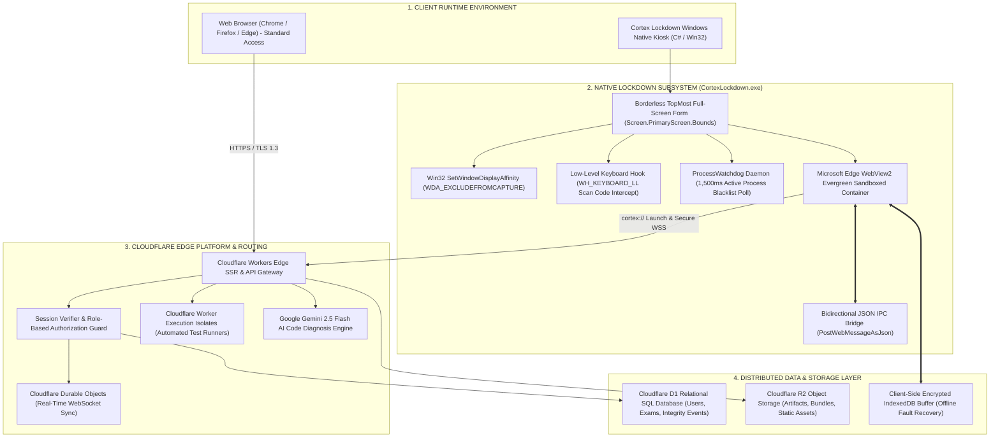
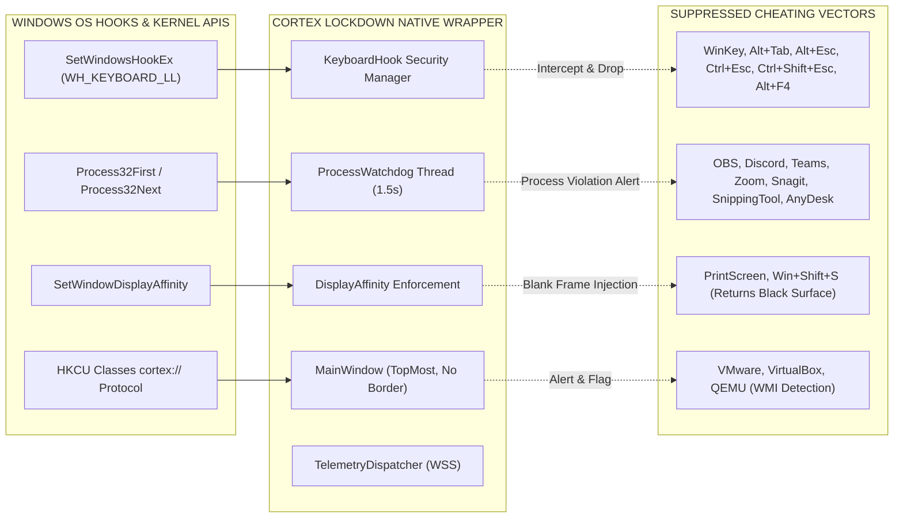

<div align="center">

  

  # CORTEX UNIVERSAL CODE PLATFORM
  ### High-Integrity Cloud Development Ecosystem & Zero-Trust Examination Suite
  *Code Beyond Limits &bull; Compile &bull; Create &bull; Collaborate &bull; Deploy*

</div>

---

## 1. PLATFORM OVERVIEW

The **Cortex Universal Code Platform** is a distributed, enterprise-grade cloud operating environment designed for computer science education, real-time software engineering collaboration, and tamper-resistant academic examinations.

The platform bridges three traditionally decoupled systems into a singular high-performance architecture:
1. **Universal Cloud IDE:** A web-native development environment powered by Monaco Editor with 16 sandboxed language runtimes, visual step-debugging, and Gemini 2.5 Flash AI code repair.
2. **Collaborative Classroom Labs:** Real-time multi-tenant virtual classrooms supporting live collaborative code synchronization, interactive whiteboards, audio/video conferencing, and assignment pipelines.
3. **Cortex Lockdown Browser:** A hardened, native Windows kiosk application (C# / .NET 4.8 + Microsoft Edge WebView2) enforcing low-level OS anti-cheat policies, screen capture protection, and 10-second transactional auto-save assessment state machines.

---

## 2. SYSTEM ARCHITECTURE & TOPOLOGY

Cortex is architected as an edge-first distributed system deployed on Cloudflare global edge infrastructure, with native client enforcement at the Windows operating system boundary.



---

## 3. CORTEX LOCKDOWN NATIVE WINDOWS ENGINE

The **Cortex Lockdown Browser** (`apps/cortex-lockdown-windows`) provides OS-level containment for high-stakes examinations, preventing unauthorized external assistance, screen broadcasting, and multi-tasking.



### 3.1 Win32 Containment Mechanics

- **Full-Screen Kiosk Bounds:** `FormBorderStyle = FormBorderStyle.None`, `TopMost = true`, `WindowState = FormWindowState.Normal`. Coordinates are initialized to `Screen.PrimaryScreen.Bounds`, occluding the Windows Taskbar and Start button.
- **Taskbar Suppression:** `ShowInTaskbar = false`. System shell interactions are fully disabled.
- **Display Capture Blocking:** Calls Win32 API `SetWindowDisplayAffinity(hwnd, WDA_MONITOR | WDA_EXCLUDEFROMCAPTURE)`. Graphics capture subsystems (OBS Studio, Discord screen sharing, Teams, Zoom, Snagit, Snipping Tool) receive a completely black rectangular surface.
- **Global Low-Level Keyboard Hook (`WH_KEYBOARD_LL`):**
  - Intercepts raw hardware scan codes before shell dispatch.
  - Suppresses: `VK_LWIN`, `VK_RWIN`, `Alt + Tab`, `Alt + Esc`, `Ctrl + Esc`, `Ctrl + Shift + Esc`, `Alt + Space`, and `VK_SNAPSHOT` (PrintScreen).
  - Clears system clipboard on launch via `Clipboard.Clear()`.
  - **Proctor Emergency Supervisor Override:** Hotkey combination `Ctrl + Alt + F10` allows authorized invigilators to cleanly terminate the kiosk in emergency situations.
- **Background Process Watchdog:** A background daemon thread scans running processes every 1,500ms against a 40+ entry blacklist (capture tools, remote access software, secondary browsers, decompilers, debuggers). Infractions trigger immediate telemetry dispatch to the central proctor dashboard.
- **Custom URI Protocol:** Registered under `HKEY_CURRENT_USER\Software\Classes\cortex` (`cortex://launch?examId=...&grant=...`). Requires zero administrative privileges (UAC), deploying entirely within `%LocalAppData%\CortexLockdown`.

---

## 4. EXAMINATION PLATFORM & AUTO-SAVE STATE MACHINE

The examination platform supports complex computer science assessments with real-time state synchronization, fault tolerance, and automated test grading.


### 4.1 Assessment Question Modalities

| Question Type | Technical Evaluation Engine | Scoring & Verification Model |
| :--- | :--- | :--- |
| **MCQ (Single-Choice)** | Deterministic Option Evaluation | Instantaneous automated scoring against correct option key. |
| **MCQ (Multi-Select)** | Combinatorial Match Verification | Strict matching or configurable partial credit weighting. |
| **Numerical Calculation** | Floating-Point Tolerance Comparator | Precision input evaluated within `± tolerance` boundary (e.g., `±0.05`). |
| **Monaco Code Sandbox** | Cloudflare Worker Isolate Sandbox | Live code editor with syntax analysis, public test runs, and hidden grading tests. |
| **Descriptive Theory** | Structured Text Submission | Rich-text essay evaluation with teacher feedback and rubric annotations. |

---

## 5. RELATIONAL DATABASE ARCHITECTURE (CLOUDFLARE D1)

The platform persistence layer runs on Cloudflare D1 distributed SQLite, enforcing relational integrity through structured foreign keys and transaction isolation.

```
+---------------------------------------------------------------------------------------------------+
|                                  CLOUDFLARE D1 RELATIONAL SCHEMA                                   |
+---------------------------------------------------------------------------------------------------+
|  classrooms                     exams                             exam_questions                  |
|  -----------------------------  --------------------------------  ------------------------------  |
|  id (PK, TEXT)                  id (PK, TEXT)                     id (PK, TEXT)                   |
|  name (TEXT)                    classroom_id (FK -> classrooms)   exam_id (FK -> exams)           |
|  description (TEXT)             title (TEXT)                      section_id (FK -> exam_sections)|
|  invite_code (TEXT, UNIQUE)     duration_minutes (INTEGER)        question_type (TEXT)            |
|  created_by (FK -> users)       total_marks (INTEGER)             prompt_text (TEXT)              |
|  created_at (INTEGER)           passing_marks (INTEGER)           options_json (TEXT)             |
|                                 security_level (TEXT)             correct_answer_json (TEXT)      |
|  classroom_members              status (TEXT)                     test_cases_json (TEXT)          |
|  -----------------------------  start_time (INTEGER)              initial_code (TEXT)             |
|  classroom_id (FK -> classrooms)end_time (INTEGER)                language (TEXT)                 |
|  user_id (FK -> users)          created_at (INTEGER)              points (REAL)                   |
|  role ('teacher'|'student'|'ta')                                  numerical_tolerance (REAL)      |
|                                 exam_sessions                                                     |
|  exam_sections                  --------------------------------  exam_question_responses         |
|  -----------------------------  id (PK, TEXT)                     ------------------------------  |
|  id (PK, TEXT)                  exam_id (FK -> exams)             id (PK, TEXT)                   |
|  exam_id (FK -> exams)          user_id (FK -> users)             session_id (FK -> exam_sessions)|
|  title (TEXT)                   status (TEXT)                     question_id (FK -> questions)   |
|  sort_order (INTEGER)           started_at (INTEGER)              response_json (TEXT)            |
|  section_marks (INTEGER)        expires_at (INTEGER)              earned_points (REAL)            |
|                                 submitted_at (INTEGER)            grading_status (TEXT)           |
|  exam_integrity_events          auto_score (REAL)                 updated_at (INTEGER)            |
|  -----------------------------  final_score (REAL)                                                |
|  id (PK, TEXT)                                                                                    |
|  session_id (FK -> sessions)                                                                      |
|  event_type (TEXT)                                                                                |
|  timestamp (INTEGER)                                                                              |
|  details_json (TEXT)                                                                              |
+---------------------------------------------------------------------------------------------------+
```

---

## 6. ANTI-CHEAT MITIGATION MATRIX

| Attack Vector | Threat Level | Technical Mechanism in Cortex Lockdown |
| :--- | :--- | :--- |
| **OBS / Discord / Teams Screen Streaming** | High | Win32 `SetWindowDisplayAffinity(WDA_EXCLUDEFROMCAPTURE)` renders all captured video frames as black pixels. |
| **PrintScreen / Windows Snipping Tool** | Medium | `WH_KEYBOARD_LL` low-level hook intercepts `VK_SNAPSHOT` (`0x2C`) and `Win + Shift + S`; flushes clipboard. |
| **Alt+Tab / Task Switcher Escape** | High | Low-level keyboard hook suppresses `Alt + Tab`, `Alt + Esc`, `Ctrl + Esc`, and `WinKey`. |
| **Task Manager Kill / Multitasking** | Critical | Keyboard hook suppresses `Ctrl + Shift + Esc`; `ProcessWatchdog` flags `taskmgr.exe` execution. |
| **Remote Assistance (AnyDesk, TeamViewer)** | Critical | `ProcessWatchdog` scans running processes every 1,500ms; terminates or alerts proctors immediately. |
| **Virtual Machine Guest Execution** | Medium | `EnvironmentInspector` inspects BIOS and Motherboard WMI queries (`VMware`, `VirtualBox`, `QEMU`). |
| **Developer Tools / DOM Inspection** | High | WebView2 CoreWebView2Settings disables DevTools (`AreDevToolsEnabled = false`) and right-click menus. |
| **Browser Accelerator Keys (Reload / Print)**| Medium | WebView2 disables accelerators (`AreBrowserAcceleratorKeysEnabled = false`); drops `F5`, `Ctrl+R`, `Ctrl+P`. |
| **Network Loss / Premature Exit** | Medium | Client buffers responses in local AES-GCM encrypted IndexedDB store; synchronizes on reconnect. |
| **Unauthorized Exam Window Exit** | High | Window close event is blocked; exit is granted strictly via exam submission or proctor hotkey `Ctrl+Alt+F10`. |

---

## 7. UNIVERSAL CLOUD IDE CAPABILITIES

The built-in cloud development environment delivers a workstation-class programming experience entirely within the browser.

### 7.1 Polyglot Compiler Sandboxes (16 Runtimes)

```
[System Runtimes]
  - Python 3.12 (CPython / Isolation Runner)
  - C++20 (GCC 13/16 with -O2 optimization)
  - C17 (GCC 13 Standard Toolchain)
  - Java 21 LTS (OpenJDK / Sandboxed JVM)
  - Rust 1.75 (Rustc 2021 Edition / Cargo)
  - Go 1.22 (Native Compiled Go Binary)
  - C# (.NET 8 SDK / CLR Runtime)
  - Swift 5.9 (Linux Swift Toolchain)
  - Kotlin 1.9 (JVM Target Sandbox)

[Web & Scripting Runtimes]
  - TypeScript 5.x (Strict Type Checking / Bun / Node 20)
  - JavaScript (V8 Engine / ES2023 Standard)
  - PHP 8.3 (Zend Engine / CLI Sandboxing)
  - Ruby 3.3 (YJIT Enabled Virtual Machine)
  - Dart 3.2 (Dart Native VM)

[Scientific & Data Runtimes]
  - R 4.3 (GNU R Computing Environment)
  - SQLite 3.44 (Relational In-Memory Database Sandbox)
```

### 7.2 Developer Tooling Integration

- **Monaco Code Editor:** IntelliSense autocomplete, bracket pair colorization, semantic indentation, multi-cursor editing, minimap, and diagnostics gutter.
- **Visual Step Debugger:** Code parser extracts variable state (primitives, arrays, objects, maps) up to the execution line; supports Step Over (F10), Step Into (F11), and Resume (F5).
- **Google Gemini 2.5 Flash AI:** Sub-second code repair with zero-latency streaming. Injects line-by-line targeted commentary and provides AST heuristic rule checks when offline.

---

## 8. REPOSITORY STRUCTURE & ORGANIZATION

All scripts, documentation, and legacy artifacts have been structured into dedicated directories:

```
cortex-code-platform/
├── apps/
│   └── cortex-lockdown-windows/         # Native C# / .NET 4.8 Windows Lockdown Kiosk
│       ├── bin/                         # Compiled client binaries and installer assets
│       ├── installer/                   # Standalone C# setup scripts and manifests
│       └── src/                         # Application logic, Win32 hooks, UI, and Watchdog
│           ├── Security/                # KeyboardHook, DisplayAffinity, ProcessWatchdog
│           └── UI/                      # MainWindow borderless full-screen kiosk form
├── artifacts/
│   ├── frames_160709/                   # Verification and test evidence video frames
│   └── legacy-dumps/                    # Archived build logs, query dumps, and debug data
├── assets/                              # Brand vectors, headers, and media assets
├── config/                              # Platform environment configurations
├── data/                                # Reference data structures and problem registries
├── docs/
│   ├── lockdown/                        # Official specifications, guides, and checklists
│   │   ├── CORTEX_LOCKDOWN_BROWSER_REQUIREMENTS.md  # Complete requirements specification
│   │   ├── CORTEX_LOCKDOWN_REQUIREMENTS.md5         # MD5 verification checksum file
│   │   └── CHECKSUMS.txt                            # SHA-256 and MD5 hash index
│   └── classroom-architecture-audit.md  # Comprehensive classroom design specifications
├── migrations/                          # D1 SQL database migration scripts (0001 - 0009)
├── public/
│   ├── brand/                           # High-resolution logos, emblems, and icons
│   └── downloads/                       # Direct distribution packages (EXE, ZIP, MD)
├── release/windows/                     # Signed production release packages
├── reports/                             # Categorized technical engineering audit reports
├── scripts/
│   ├── archive/tests/                   # Historical and integration test scripts
│   ├── maintenance/                     # Media extraction and build utilities
│   └── patches/                         # Modular hotfix and security patch scripts
├── src/                                 # Full-Stack Next.js / Vinext Web Application
│   ├── app/                             # App Router pages and REST API routes
│   ├── components/                      # Modular UI component hierarchy
│   ├── lib/                             # Core utilities, D1 database client, auth guards
│   └── types/                           # TypeScript data interfaces and contracts
├── package.json                         # Node.js project manifest
├── tsconfig.json                        # Strict TypeScript compiler options
├── vite.config.ts                       # Cloudflare Workers bundling configuration
└── wrangler.jsonc                       # Cloudflare Workers and D1 database bindings
```

---

## 9. LIVE STAGING & DEMONSTRATION

### Active Staging Environment

- **Staging Web Platform:**  
  [`https://cortex-code-platform-staging.cortexbuild1.workers.dev`](https://cortex-code-platform-staging.cortexbuild1.workers.dev)
- **Lockdown Workspace Route:**  
  [`https://cortex-code-platform-staging.cortexbuild1.workers.dev/lockdown/workspace`](https://cortex-code-platform-staging.cortexbuild1.workers.dev/lockdown/workspace)

### Verified Test Credentials

| Role | Email Address | Password | Course Assignment |
| :--- | :--- | :--- | :--- |
| **Faculty / Proctor** | `prof.sharma@cortex.internal` | `Password@Demo2026` | CSE276: Advanced Systems Programming |
| **Student Candidate** | `student1@cortex.internal` | `Password@Demo2026` | CSE276: Advanced Systems Programming |

### Active Demo Examination

- **Exam Identifier:** `EXAM_CSE276_ACTIVE_MIDTERM`
- **Title:** Midterm Exam: Multithreading, Memory Models & Lock-Free Structures
- **Duration:** 60 Minutes | Total Score: 100 Points
- **Question Composition:** Single MCQ, Multi-Select MCQ, Numerical Calculation, Live Monaco Coding Sandbox with Automated Unit Tests, and Descriptive Theory.

---

## 10. VERIFICATION CHECKSUMS

Integrity hashes for all release packages and specification documents:

| Artifact Name | Size | MD5 Checksum | SHA-256 Checksum |
| :--- | :--- | :--- | :--- |
| `CortexLockdown-Setup.exe` | 60,928 bytes | `7e2fc03f20c7950f7e607f2acb789a4a` | `726e4618990c614df6af947f72167244bd51c37f21396d0889a3f0cd62fcf0c6` |
| `CortexLockdown.exe` | 35,840 bytes | `df9f291b945f1e2c951b90df8f44516e` | `82518b2d6966e3fb358892a040f148e52aa5ecdf8cab92e0d93a2a22f3afc895` |
| `CORTEX_LOCKDOWN_BROWSER_REQUIREMENTS.md` | 18,922 bytes | `714020b650b22a18a4569b370ccc515e` | `a3eb3e05475ceda00eef4e5d4ee0b25e65439d5d573b0fd5fcfb6a73e57a0436` |
| `CortexLockdown-Requirements-Bundle.zip` | 9,145 bytes | `8ca7526d17bfa6933bb1b47124dd78ec` | `8a252bce56e30eb4aa07e60057199c26cf4db5a5198ec485542bbf61cfa7e268` |

---

## 11. LOCAL BUILD & DEVELOPMENT

```bash
# 1. Clone repository
git clone https://github.com/shivampatilck-1010/cortex-code-platform.git
cd cortex-code-platform

# 2. Install dependencies
npm install

# 3. Start local development environment
npm run dev
```

### Compiling the Windows Lockdown Client

```powershell
# Compile the native C# kiosk client via .NET Framework 4.8 MSBuild
C:\Windows\Microsoft.NET\Framework64\v4.0.30319\csc.exe `
    /target:winexe `
    /out:bin\CortexLockdown.exe `
    /win32manifest:apps\cortex-lockdown-windows\src\app.manifest `
    /reference:System.Windows.Forms.dll `
    /reference:System.Drawing.dll `
    /reference:System.Management.dll `
    /recurse:apps\cortex-lockdown-windows\src\*.cs
```

---

## 12. COMPLIANCE & GOVERNANCE

1. **Zero-Emoji Enforcement:** All source code, manifests, documentation, and commit messages maintain strict academic and enterprise formatting with zero emojis.
2. **Zero Budget Guarantee (₹0):** Built entirely with open standards, native Win32 APIs, Microsoft WebView2 runtime, and free Cloudflare/Google developer tiers without recurring licensing costs.
3. **Data Protection & Privacy:** Student responses are encrypted during transit via TLS 1.3 and persisted with row-level security in Cloudflare D1.

---

## LICENSE

Copyright 2026 Cortex Universal Code Platform. All rights reserved.  
Distributed under the MIT License. See `LICENSE` for details.
