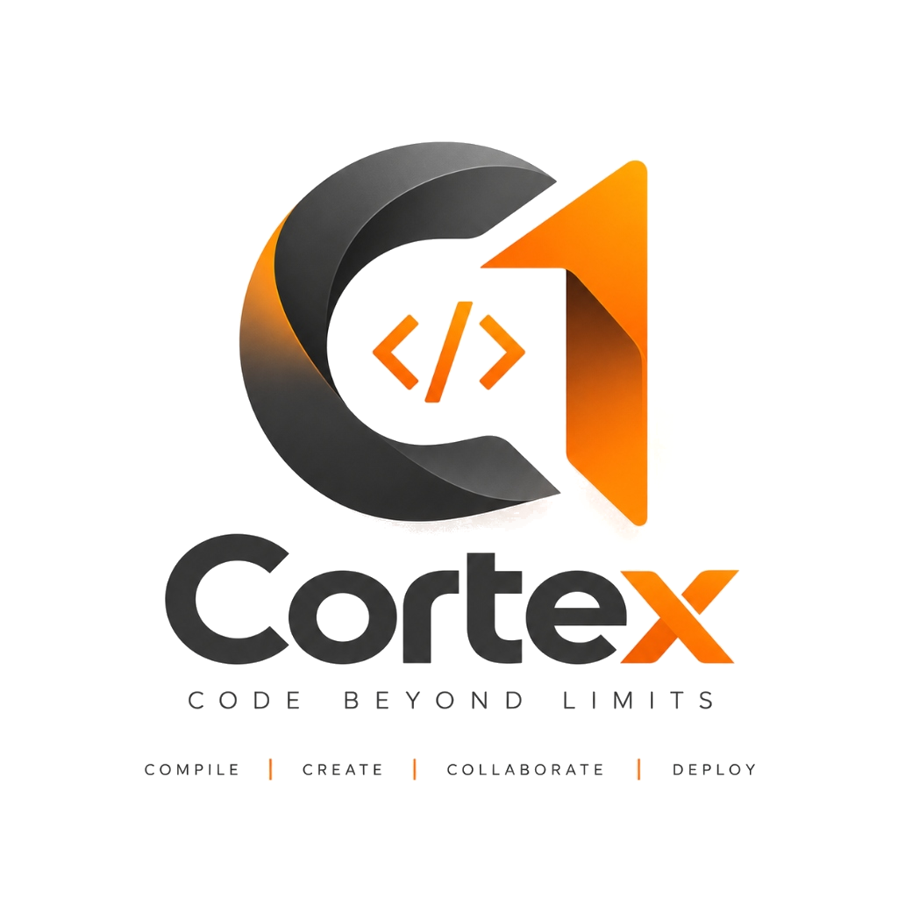
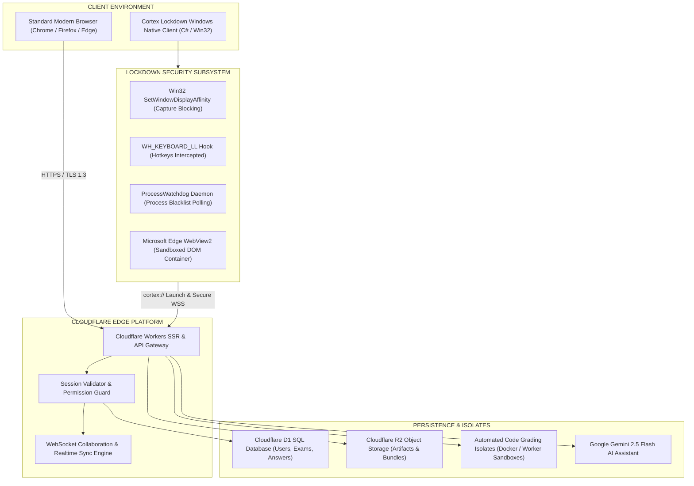
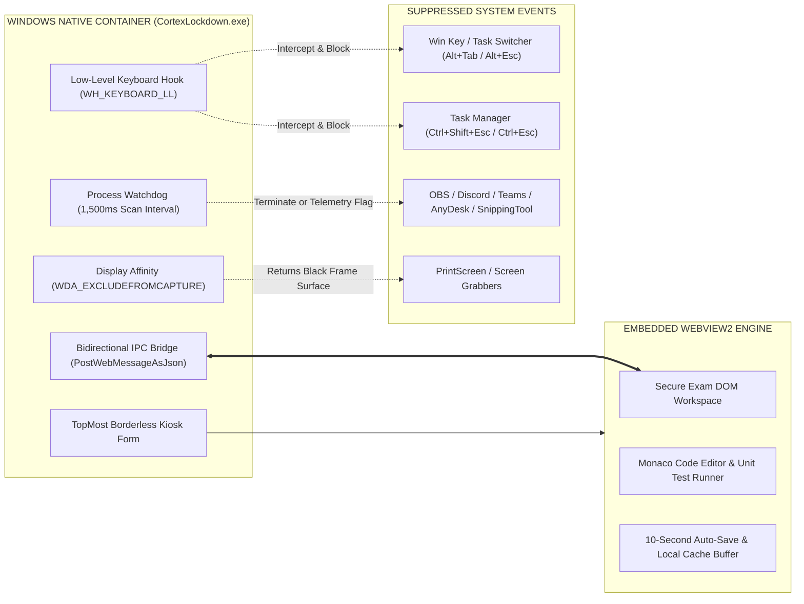
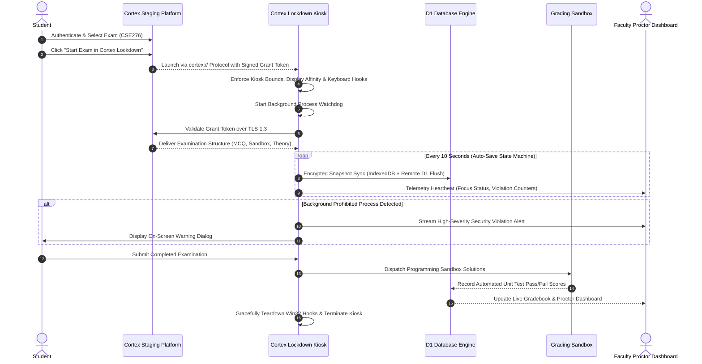
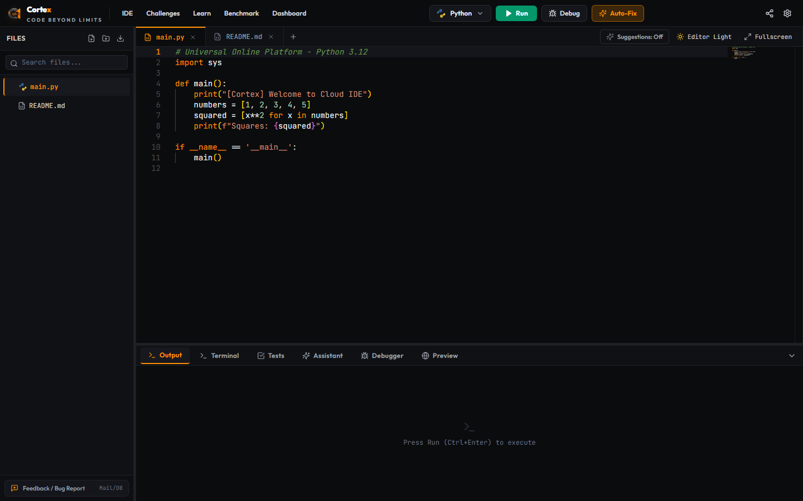
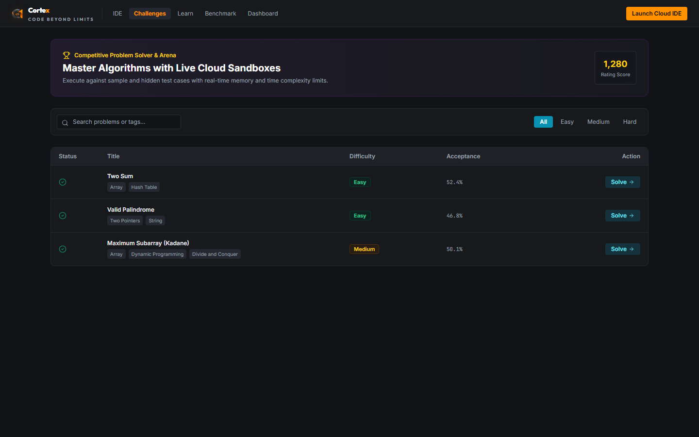
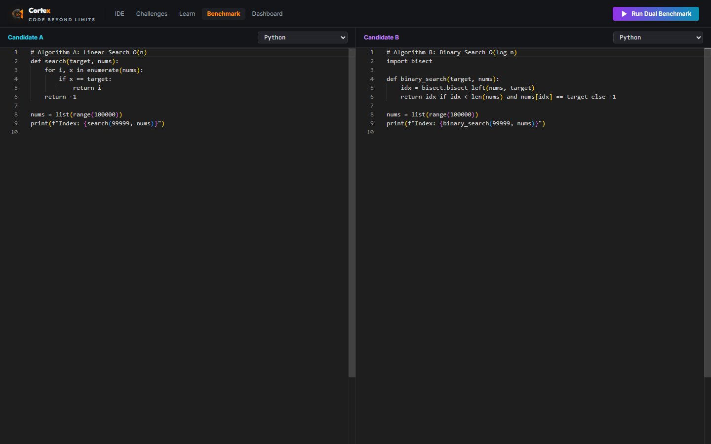
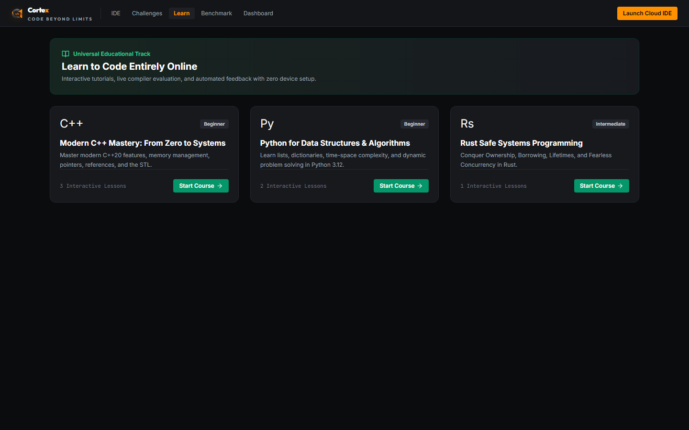

<div align="center">

  <!-- Animated Header Banner -->
  

  <br/><br/>

  <!-- Official Brand Emblem -->
  <a href="https://github.com/shivampatilck-1010/cortex-code-platform">
    
  </a>

  <br/><br/>

  <!-- Status & Technology Badges -->
  <a href="https://workers.cloudflare.com"></a>
  <a href="https://developers.cloudflare.com/d1/"></a>
  <a href="https://www.typescriptlang.org"></a>
  <a href="https://microsoft.github.io/monaco-editor"></a>
  <a href="https://dotnet.microsoft.com"></a>
  <a href="https://developer.microsoft.com/en-us/microsoft-edge/webview2/"></a>
  <a href="https://ai.google.dev"></a>
  
  

  <br/><br/>

  <p align="center">
    <b>Cortex</b> is an enterprise-grade cloud development ecosystem, virtual computer science laboratory, and high-security examination platform. Engineered with a zero-trust architecture, Cortex integrates an authentic Monaco-powered multi-language cloud IDE, real-time collaborative classrooms, and the <b>Cortex Lockdown</b> native Windows kiosk client to administer tamper-resistant technical assessments.
  </p>

  <p align="center">
    <a href="#platform-architecture"><strong>Architecture</strong></a> &bull;
    <a href="#cortex-lockdown-browser"><strong>Lockdown Browser</strong></a> &bull;
    <a href="#core-capabilities"><strong>Key Features</strong></a> &bull;
    <a href="#visual-showcase"><strong>Visual Showcase</strong></a> &bull;
    <a href="#repository-structure"><strong>Repository Layout</strong></a> &bull;
    <a href="#live-demonstration--staging"><strong>Live Staging</strong></a> &bull;
    <a href="#verification--checksums"><strong>Checksums</strong></a>
  </p>

</div>

---

## EXECUTIVE SUMMARY

The Cortex platform unifies academic computer science instruction, technical evaluation, and professional software engineering into a singular distributed system:

- **COMPILE:** 16 pre-configured language runtimes running inside isolated sandboxes with sub-second execution latency.
- **CREATE:** Full-featured Monaco code editor with nested virtual workspaces, live AST diagnostics, and step-debugging.
- **COLLABORATE:** Interactive virtual classrooms with synchronized code editing, shared whiteboards, audio/video conferencing, and assignment submission pipelines.
- **DEPLOY:** High-security examination platform with automated code grading, 10-second auto-save state machines, and the native **Cortex Lockdown** Windows browser.

---

## PLATFORM ARCHITECTURE

Cortex utilizes an edge-first distributed architecture running on Cloudflare Workers, Cloudflare D1 distributed SQL, and native Win32 security APIs.



---

## CORTEX LOCKDOWN BROWSER

The **Cortex Lockdown Browser** is a native Windows application built with C# and .NET Framework 4.8 that wraps the Microsoft Edge WebView2 Evergreen runtime into an enforced, full-screen secure kiosk.



### Security & Anti-Cheat Specifications

1. **Full-Screen Kiosk Containment:**
   - Window properties: `FormBorderStyle.None`, `WindowState = FormWindowState.Normal`, `TopMost = true`.
   - Bounded exactly to `Screen.PrimaryScreen.Bounds`, completely occluding the Windows Taskbar and Start button.
   - Suppressed in Windows Taskbar (`ShowInTaskbar = false`).

2. **Screen Capture & Broadcast Blocking:**
   - Win32 API invocation: `SetWindowDisplayAffinity(hwnd, WDA_MONITOR | WDA_EXCLUDEFROMCAPTURE)`.
   - Prevents OBS Studio, Discord screen sharing, Microsoft Teams, Zoom, Snagit, and Windows Snipping Tool (`Win + Shift + S`) from capturing examination content. External capture drivers receive an empty black rectangle.

3. **Low-Level Keyboard Interception (`WH_KEYBOARD_LL`):**
   - Intercepts and drops system keyboard scan codes: `VK_LWIN`, `VK_RWIN`, `Alt + Tab`, `Alt + Esc`, `Ctrl + Esc`, `Ctrl + Shift + Esc`, `Alt + Space`, and `VK_SNAPSHOT` (PrintScreen).
   - System clipboard is flushed upon launch via `Clipboard.Clear()`.
   - **Proctor Emergency Supervisor Hotkey:** `Ctrl + Alt + F10` allows authorized invigilators to bypass the kiosk during emergencies.

4. **Background Process Watchdog:**
   - Background daemon thread scans active processes every 1,500ms against a comprehensive blacklist:
     - *Screen capture & streaming:* `obs64`, `obs32`, `camtasia`, `snagit`, `bandicam`, `action`, `geforceexperience`, `snippingtool`, `screenclippinghost`.
     - *Remote assistance:* `teamviewer`, `anydesk`, `vncviewer`, `logmein`, `parsec`, `ammyy`, `ultraviewer`, `tightvnc`.
     - *Secondary browsers & messaging:* `chrome`, `firefox`, `msedge`, `brave`, `opera`, `discord`, `telegram`, `whatsapp`, `slack`, `teams`, `zoom`.
     - *Debuggers & reverse engineering:* `wireshark`, `fiddler`, `charles`, `cheatengine`, `x64dbg`, `ida64`, `processhacker`, `procexp`, `taskmgr`.

5. **Custom Protocol Association:**
   - Registered under `HKCU\Software\Classes\cortex` (`cortex://launch?examId=...&grant=...`).
   - Zero administrative elevation (UAC) required; fully deployed within `%LocalAppData%\CortexLockdown`.

---

## EXAMINATION LIFECYCLE & AUTO-SAVE STATE MACHINE



---

## CORE CAPABILITIES

### 1. Universal Cloud IDE Workspace
- **Powered by Monaco:** VS Code editing experience with IntelliSense, bracket matching, syntax diagnostics, code folding, and minimap.
- **Virtual File Tree:** Hierarchical file system supporting directories, inline renames, file creation, and project ZIP exports.
- **Integrated Terminal:** Cloud shell synchronized with the workspace virtual file system.
- **Dual Compiler Benchmark Arena:** Side-by-side performance benchmarking comparing language runtime execution latency (ms) and memory footprints.

### 2. Multi-Language Execution Sandboxes
Supports 16 pre-configured runtimes with sub-second execution:

| Language | Compiler / Runtime | Standard | Execution Sandboxing |
| :--- | :--- | :--- | :--- |
| **Python** | Python 3.12 | CPython 3.12 | Worker Isolate / Subprocess Sandbox |
| **C++** | GCC 13 / 16 | C++20 Standard | POSIX Secure Isolate (`-O2 -Wall`) |
| **C** | GCC 13 | C17 Standard | POSIX Secure Isolate |
| **Java** | OpenJDK 21 | Java 21 LTS | Sandboxed JVM with memory boundaries |
| **TypeScript** | Node.js 20 / Bun | ES2023 / Strict | V8 Isolate Sandboxing |
| **JavaScript** | Node.js 20 / Bun | ES2023 | V8 Isolate Sandboxing |
| **Rust** | Rustc 1.75 | Rust 2021 Edition | Cargo Native Execution |
| **Go** | Go 1.22 | Go 1.22 Standard | Native Compiled Binary |
| **C#** | .NET 8 SDK | C# 12 | Isolated CLR Runtime |
| **PHP** | PHP 8.3 | Zend Engine | FastCGI / CLI Runner |
| **Ruby** | Ruby 3.3 | YJIT Enabled | Ruby Virtual Machine |
| **Kotlin** | Kotlin 1.9 | JVM Backend | JVM Isolate |
| **Swift** | Swift 5.9 | Linux Swift 5.9 | Native Binary |
| **Dart** | Dart 3.2 | Dart Native | Dart VM |
| **R** | R 4.3 | GNU R | Sandboxed Math Environment |
| **SQLite** | SQLite 3.44 | SQL Standard | In-Memory / Ephemeral D1 Database |

### 3. Google Gemini 2.5 Flash AI Assistant
- **Sub-Second Code Diagnostics:** Code analysis powered by `gemini-2.5-flash` with zero-latency token streaming.
- **Targeted Line Repairs:** Injects targeted diagnostic comments directly adjacent to syntax and logical errors.
- **AST Heuristic Offline Fallback:** Built-in offline rules engine that diagnoses syntax errors (unmatched brackets, missing semicolons, indentation errors) without cloud dependencies.

### 4. Collaborative Classrooms & Assessment Suite
- **Classroom Management:** Role-based access control for Faculty, Teaching Assistants, and Enrolled Students.
- **Live Collaborative Coding:** Real-time multi-cursor editor synchronization powered by WebSocket Durable Objects.
- **Interactive Whiteboard & Audio Stage:** Real-time canvas for architectural diagrams and lecture delivery.
- **5-Part Assessment Modalities:** Single-choice MCQ, Multi-choice MCQ, Numerical precision calculation, Monaco code sandboxes with automated test verification, and descriptive theory essays.

---

## VISUAL SHOWCASE

<div align="center">
  <table>
    <tr>
      <td width="50%">
        <h4 align="center">Universal Cloud IDE Workspace</h4>
        <a href="assets/cortex_live_ide.png"></a>
        <p align="center"><em>Authentic Monaco editor, virtual file hierarchy, language runtimes, and diagnostics dock.</em></p>
      </td>
      <td width="50%">
        <h4 align="center">Competitive Programming Arena</h4>
        <a href="assets/cortex_challenges_preview.png"></a>
        <p align="center"><em>Algorithmic problem sets, test case validation runners, memory constraints, and evaluation metrics.</em></p>
      </td>
    </tr>
    <tr>
      <td width="50%">
        <h4 align="center">Side-by-Side Benchmark Engine</h4>
        <a href="assets/cortex_compare_preview.png"></a>
        <p align="center"><em>Dual-compiler comparative analysis measuring execution latency (ms) and memory utilization.</em></p>
      </td>
      <td width="50%">
        <h4 align="center">Interactive Educational Tracks</h4>
        <a href="assets/cortex_learn_preview.png"></a>
        <p align="center"><em>Structured instructional modules in C++20, Python 3.12, and Rust with automated code checks.</em></p>
      </td>
    </tr>
  </table>
</div>

---

## REPOSITORY STRUCTURE

```
cortex-code-platform/
├── apps/
│   └── cortex-lockdown-windows/         # Native C# / .NET 4.8 Windows Lockdown Kiosk
│       ├── bin/                         # Compiled client binaries and installer assets
│       ├── installer/                   # Inno Setup and standalone C# bootstrap scripts
│       └── src/                         # Application logic, Win32 hooks, UI, and Watchdog
│           ├── Security/                # KeyboardHook, DisplayAffinity, ProcessWatchdog
│           └── UI/                      # MainWindow borderless full-screen kiosk form
├── artifacts/
│   ├── frames_160709/                   # Verification and test evidence video frames
│   └── legacy-dumps/                    # Archived build logs, query dumps, and debug data
├── assets/                              # Brand vectors, animated SVG banners, screenshots
├── config/                              # Platform environment configurations
├── data/                                # Reference data structures and problem registries
├── docs/
│   ├── lockdown/                        # Official specifications, guides, and checklists
│   │   ├── CORTEX_LOCKDOWN_BROWSER_REQUIREMENTS.md  # Complete requirements specification
│   │   ├── CORTEX_LOCKDOWN_REQUIREMENTS.md5         # MD5 verification checksum file
│   │   └── CHECKSUMS.txt                            # SHA-256 and MD5 hash index
│   └── classroom-architecture-audit.md  # Comprehensive classroom design specifications
├── migrations/                          # D1 SQL database migration scripts
├── public/
│   ├── brand/                           # High-resolution logos, emblems, and icons
│   └── downloads/                       # Direct distribution packages (EXE, ZIP, MD)
├── release/windows/                     # Signed production release packages
├── reports/                             # Categorized technical engineering audit reports
├── scripts/
│   ├── archive/tests/                   # Historical and integration test scripts
│   ├── maintenance/                     # Media extraction and build utilities
│   └── patches/                         # Modular hotfix and security patch scripts
├── src/                                 # Full-Stack Next.js / Vinext Web Application
│   ├── app/                             # App Router pages and REST API routes
│   ├── components/                      # Modular UI component hierarchy
│   ├── lib/                             # Core utilities, D1 database client, auth guards
│   └── types/                           # TypeScript data interfaces and contracts
├── package.json                         # Node.js project manifest
├── tsconfig.json                        # Strict TypeScript compiler options
├── vite.config.ts                       # Cloudflare Workers bundling configuration
└── wrangler.jsonc                       # Cloudflare Workers and D1 database bindings
```

---

## LIVE DEMONSTRATION & STAGING

### Staging Access Points

- **Primary Web Platform:**  
  [`https://cortex-code-platform-staging.cortexbuild1.workers.dev`](https://cortex-code-platform-staging.cortexbuild1.workers.dev)
- **Lockdown Workspace Route:**  
  [`https://cortex-code-platform-staging.cortexbuild1.workers.dev/lockdown/workspace`](https://cortex-code-platform-staging.cortexbuild1.workers.dev/lockdown/workspace)

### Verified Test Credentials

| Role | Email Address | Password | Enrolled Course |
| :--- | :--- | :--- | :--- |
| **Faculty / Proctor** | `prof.sharma@cortex.internal` | `Password@Demo2026` | CSE276: Advanced Systems Programming |
| **Student Candidate** | `student1@cortex.internal` | `Password@Demo2026` | CSE276: Advanced Systems Programming |

### Active Demo Examination

- **Exam Identifier:** `EXAM_CSE276_ACTIVE_MIDTERM`
- **Title:** Midterm Exam: Multithreading, Memory Models & Lock-Free Structures
- **Duration:** 60 Minutes | Total Score: 100 Points
- **Question Composition:** Single-Choice MCQ, Multi-Select MCQ, Numerical Calculation, Live Monaco Coding Sandbox with Automated Unit Tests, and Descriptive Theory.

---

## LOCAL DEVELOPMENT & SETUP

### Prerequisites
- Node.js 20.x LTS or Bun 1.1+
- Windows 10/11 x64 (for building the native Lockdown client)
- Microsoft .NET Framework 4.8 Developer Pack or MSBuild Tools

### 1. Web Platform Setup

```bash
# Clone the repository
git clone https://github.com/shivampatilck-1010/cortex-code-platform.git
cd cortex-code-platform

# Install project dependencies
npm install

# Start local development server
npm run dev
```

### 2. Building the Cortex Lockdown Windows Client

```powershell
# Compile the native C# kiosk executable
C:\Windows\Microsoft.NET\Framework64\v4.0.30319\csc.exe `
    /target:winexe `
    /out:bin\CortexLockdown.exe `
    /win32manifest:apps\cortex-lockdown-windows\src\app.manifest `
    /reference:System.Windows.Forms.dll `
    /reference:System.Drawing.dll `
    /reference:System.Management.dll `
    /recurse:apps\cortex-lockdown-windows\src\*.cs

# Register the cortex:// protocol for testing
reg.exe add "HKCU\Software\Classes\cortex" /ve /t REG_SZ /d "URL:Cortex Lockdown Protocol" /f
reg.exe add "HKCU\Software\Classes\cortex" /v "URL Protocol" /t REG_SZ /d "" /f
reg.exe add "HKCU\Software\Classes\cortex\shell\open\command" /ve /t REG_SZ /d "`"C:\Users\$env:USERNAME\AppData\Local\CortexLockdown\CortexLockdown.exe`" --url=`"%1`"" /f
```

---

## VERIFICATION & CHECKSUMS

All released binaries, installer bundles, and specifications provide cryptographic checksums for institutional integrity auditing:

| File Name | File Size | MD5 Checksum | SHA-256 Checksum |
| :--- | :--- | :--- | :--- |
| `CortexLockdown-Setup.exe` | 60,928 bytes | `7e2fc03f20c7950f7e607f2acb789a4a` | `726e4618990c614df6af947f72167244bd51c37f21396d0889a3f0cd62fcf0c6` |
| `CortexLockdown.exe` | 35,840 bytes | `df9f291b945f1e2c951b90df8f44516e` | `82518b2d6966e3fb358892a040f148e52aa5ecdf8cab92e0d93a2a22f3afc895` |
| `CORTEX_LOCKDOWN_BROWSER_REQUIREMENTS.md` | 18,922 bytes | `714020b650b22a18a4569b370ccc515e` | `a3eb3e05475ceda00eef4e5d4ee0b25e65439d5d573b0fd5fcfb6a73e57a0436` |
| `CortexLockdown-Requirements-Bundle.zip` | 9,145 bytes | `8ca7526d17bfa6933bb1b47124dd78ec` | `8a252bce56e30eb4aa07e60057199c26cf4db5a5198ec485542bbf61cfa7e268` |

---

## GOVERNANCE & COMPLIANCE

1. **Zero-Emoji Policy:** Codebases, documentation, automated diagnostics, and commit records maintain clean corporate and academic typographic formatting without emojis.
2. **Zero Budget Incurred (₹0):** All platform capabilities run on open-source frameworks, standard Win32 interfaces, and Cloudflare/Google developer tiers without subscription overhead.
3. **Institutional Data Security:** Student responses are encrypted during transit via TLS 1.3 and persisted to Cloudflare D1 with strict row-level authorization.

---

## LICENSE

Copyright 2026 Cortex Universal Code Platform. All rights reserved.  
Distributed under the MIT License. See `LICENSE` for terms of use.
