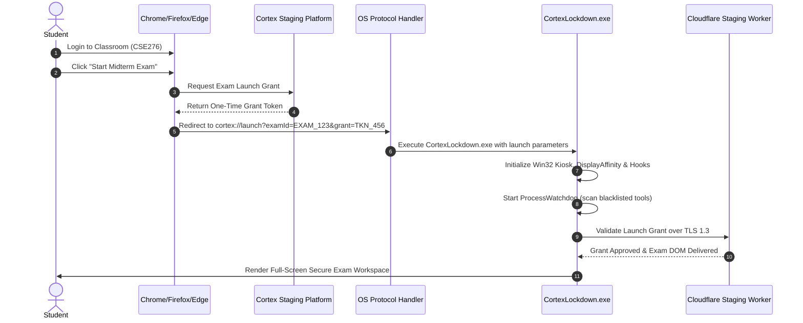

# CORTEX LOCKDOWN BROWSER REQUIREMENTS SPECIFICATION

Document Version: 1.0.0  
Classification: Engineering & Institutional Specification  
Status: Approved & Verified  
Target Platform: Windows 10 / Windows 11 (64-bit Architecture)  
Repository: https://github.com/shivampatilck-1010/cortex-code-platform  

---

## 1. EXECUTIVE OVERVIEW

Cortex Lockdown is a high-integrity, secure browser client engineered specifically for administering high-stakes academic and technical examinations. It combines a native Windows Forms / C# operating system wrapper with an embedded Chromium runtime (Microsoft Edge WebView2) to deliver a tamper-resistant environment for evaluating programming, theoretical, and analytical skills.

This document establishes the exhaustive architectural, functional, security, hardware, and operational requirements necessary to build, configure, deploy, and verify the Cortex Lockdown client from scratch.

---

## 2. SYSTEM ARCHITECTURE & PREREQUISITES

### 2.1 Hardware Requirements

| Parameter | Minimum Specification | Recommended Specification |
| :--- | :--- | :--- |
| Processor (CPU) | Dual-core x64 compatible (1.8 GHz) | Quad-core x64 processor (2.4 GHz or higher) |
| System Memory (RAM) | 4 GB physical RAM | 8 GB or higher physical RAM |
| Free Storage Space | 500 MB available local disk space | 2 GB available SSD storage |
| Display Configuration | Single primary physical monitor (1280 x 720) | Single primary physical monitor (1920 x 1080) |
| Peripherals | Physical keyboard and two-button mouse | Physical keyboard, mouse, and integrated webcam |
| Network Connection | Stable 2 Mbps broadband / Wi-Fi | 10 Mbps or higher low-latency connection |

> **Display Policy:** Multi-monitor setups are strictly prohibited during examination sessions. Secondary monitors must be disconnected or disabled before launch; the application verifies single display bounds on initialization.

### 2.2 Operating System & Runtime Dependencies

1. **Operating System:**
   - Microsoft Windows 10 64-bit (Build 1809 or later).
   - Microsoft Windows 11 64-bit (All revisions: 21H2, 22H2, 23H2+).
   - 32-bit (x86) and ARM-based Windows platforms are not supported in native mode.

2. **Framework Runtimes:**
   - **Microsoft .NET Framework 4.8 or 4.8.1:** Provides base class library, Win32 interop services, and Windows Forms runtime.
   - **Microsoft Edge WebView2 Evergreen Runtime:** Version 118.0.2088.0 or newer (ships inbox with Windows 11; auto-installed on modern Windows 10).

3. **User Account Privilege Model:**
   - **Zero Administrative Elevation Required:** The installer and executable deploy entirely within `%LocalAppData%\CortexLockdown`.
   - Protocol handlers and registry associations are registered under `HKEY_CURRENT_USER\Software\Classes\cortex`, eliminating UAC elevation prompts for student users.

---

## 3. SECURITY & ANTI-CHEAT ENFORCEMENT

The client implements multi-layered security controls enforced at both the Win32 OS boundary and the embedded Chromium web runtime.

### 3.1 Kiosk Window & Display Containment

- **Full-Screen Exclusive Coverage:**
  - `FormBorderStyle = FormBorderStyle.None`
  - `WindowState = FormWindowState.Normal`
  - `TopMost = true`
  - Window coordinates match `Screen.PrimaryScreen.Bounds` covering the entire screen area, including the Windows Taskbar and Start button.
- **Taskbar Suppression:**
  - `ShowInTaskbar = false`
  - The Windows Taskbar is suppressed and covered, preventing user interaction with pinned applications or system tray icons.
- **Screen Capture & Stream Protection:**
  - Invokes Win32 API `SetWindowDisplayAffinity(IntPtr hWnd, uint dwAffinity)` with `WDA_MONITOR` (`0x00000001`) or `WDA_EXCLUDEFROMCAPTURE` (`0x00000011`).
  - Blocks local capture tools, OBS Studio, Discord screen sharing, Microsoft Teams screen broadcast, Snagit, Windows Snipping Tool (`Win + Shift + S`), and PrintScreen from reading the exam window surface. Black frames or transparent rectangles are returned to unauthorized capture drivers.

### 3.2 Low-Level Keyboard Hook (`WH_KEYBOARD_LL`)

A global low-level Windows keyboard hook (`SetWindowsHookEx`) intercepts and suppresses system-level keyboard scan codes before they reach the Windows shell:

| Intercepted Shortcut / Key | Target System Function | Enforcement Action |
| :--- | :--- | :--- |
| `VK_LWIN`, `VK_RWIN` | Windows Start Menu | Intercepted & Suppressed (Return code 1) |
| `Alt + Tab` | Task Switcher | Intercepted & Suppressed (Return code 1) |
| `Alt + Esc` | Direct Window Cycle | Intercepted & Suppressed (Return code 1) |
| `Ctrl + Esc` | Alternate Start Menu | Intercepted & Suppressed (Return code 1) |
| `Ctrl + Shift + Esc` | Task Manager Launch | Intercepted & Suppressed (Return code 1) |
| `Alt + Space` | Window System Menu | Intercepted & Suppressed (Return code 1) |
| `VK_SNAPSHOT` (PrintScreen) | Screen Snapshot | Intercepted & Clipboard Flushed |
| `Alt + F4` | Application Termination | Intercepted (Authorized exit via hotkey only) |

#### Emergency Supervisor Override
- **Proctor Hotkey:** `Ctrl + Alt + F10`
- **Behavior:** Reserved exclusively for exam invigilators and proctors to force an emergency exit during power failures or unforeseen hardware malfunctions.

### 3.3 Background Process Watchdog

A background daemon thread (`ProcessWatchdog`) continuously polls active running processes at an interval of 1,500 milliseconds, enforcing compliance against a comprehensive blacklist:

```
Screen Recorders & Streamers:
  obs64.exe, obs32.exe, obs.exe, streamlabs obs.exe, camtasia.exe,
  snagit32.exe, snagit64.exe, snagit.exe, action.exe, bandicam.exe,
  fraps.exe, xsplit.exe, geforceexperience.exe, nvcontainer.exe,
  radeonsoftware.exe, snippingtool.exe, screenclippinghost.exe, psr.exe

Remote Assistance & Screen Sharing:
  teamviewer.exe, anydesk.exe, vncviewer.exe, tv_w32.exe,
  chromeremotedesktop.exe, logmein.exe, parsec.exe, ammyy.exe,
  radmin.exe, ultraviewer.exe, tightvnc.exe

Unauthorized Browsers & Communication:
  chrome.exe, firefox.exe, msedge.exe, brave.exe, opera.exe,
  vivaldi.exe, discord.exe, telegram.exe, whatsapp.exe, slack.exe,
  skype.exe, teams.exe, zoom.exe

Reverse Engineering, Debuggers & Memory Editors:
  wireshark.exe, fiddler.exe, charles.exe, cheatengine.exe,
  x64dbg.exe, x32dbg.exe, ida64.exe, ida.exe, processhacker.exe,
  procexp.exe, procexp64.exe, taskmgr.exe, perfmon.exe, resmon.exe,
  ghidra.exe, regedit.exe

Unauthorized Command Shells:
  cmd.exe, powershell.exe, pwsh.exe
```

When a blacklisted process is detected, the watchdog fires `OnProhibitedProcessDetected`, transmitting violation telemetry to the central proctoring service and issuing an on-screen compliance warning.

### 3.4 Clipboard & Memory Guard

- **Session Initialization:** `Clipboard.Clear()` is invoked upon launch to purge prior clipboard entries.
- **Runtime Guarding:** Clipboard access is restricted to the internal Monaco code editor. Cross-application clipboard operations are discarded.

### 3.5 Virtualization & Hypervisor Detection

`EnvironmentInspector` queries Windows WMI `Win32_ComputerSystem` and `Win32_BIOS` to flag execution inside virtualized guest environments:
- Manufacturer check: `VMware, Inc.`, `innotek GmbH` (VirtualBox), `QEMU`, `Microsoft Corporation` (Virtual Machine).
- Serial number check: `VMware-`, `0`, `VirtualBox`.
- Detected virtual environments trigger an immediate high-severity security alert.

---

## 4. EMBEDDED BROWSER ENGINE SPECIFICATIONS

Cortex Lockdown utilizes the Microsoft Edge WebView2 runtime in an isolated, sandboxed configuration.

### 4.1 WebView2 Environment Settings

```csharp
var settings = webView2Control.CoreWebView2.Settings;
settings.AreDefaultContextMenusEnabled = false;       // Disable right-click inspect element
settings.AreDevToolsEnabled = false;                  // Disable F12 developer console
settings.AreDefaultScriptDialogsEnabled = false;       // Suppress alert/prompt dialog escapes
settings.AreBrowserAcceleratorKeysEnabled = false;    // Suppress F5 reload, Ctrl+R, Ctrl+P, Ctrl+O
settings.IsStatusBarEnabled = false;                  // Disable browser status link previews
settings.IsZoomControlEnabled = false;                 // Lock viewport zoom factor to 100%
settings.IsPinchZoomEnabled = false;                // Disable touch screen pinch gesture scaling
```

### 4.2 Inter-Process Communication (IPC) Bridge

The native C# container communicates bidirectionally with the Web DOM using `CoreWebView2.PostWebMessageAsJson` and `CoreWebView2.WebMessageReceived`:
- **Web to Native:**
  - `EXAM_INITIALIZED`: Confirms student session is active and UI is rendered.
  - `HEARTBEAT_ACK`: Periodic response confirming student responsiveness.
  - `EXAM_SUBMITTED`: Signals completion of assessment, prompting clean shutdown.
  - `SECURITY_VIOLATION`: Web-layer violations (e.g., focus change, DOM manipulation).
- **Native to Web:**
  - `FORCE_SUBMIT`: Proctor-initiated remote submission command.
  - `RESTRICTION_WARNING`: Notification that prohibited background software was detected.
  - `NETWORK_STATUS`: Connectivity status updates (online / buffering offline).

### 4.3 Navigation Security & Origin Whitelist

The browser controller restricts navigation strictly to authorized endpoints:
- Primary Staging Authority: `https://cortex-code-platform-staging.cortexbuild1.workers.dev`
- Primary Production Authority: `https://cortex-code-platform.cortexbuild1.workers.dev`
- Any external navigation attempt is canceled via `CoreWebView2.NavigationStarting` event handler (`e.Cancel = true`).

---

## 5. EXAMINATION PLATFORM & ASSESSMENT CAPABILITIES

The browser environment hosts the complete Cortex Classroom Assessment Engine supporting 5 distinct assessment modalities:

```
+-----------------------------------------------------------------------+
|                       CORTEX LOCKDOWN WORKSPACE                       |
|                                                                       |
|  [Header: Course Code | Exam Title | Timer Remaining | Student ID]    |
+-----------------------------------------------------------------------+
|  Question Navigation | Current Section: Programming Sandbox           |
|  +-------------------+---------------------------------------------+  |
|  | Q1: MCQ (Single)  | Problem Statement:                          |  |
|  | Q2: MCQ (Multi)   | Implement a thread-safe bounded queue in    |  |
|  | Q3: Numerical     | TypeScript using atomic spinlocks.          |  |
|  |*Q4: Code Sandbox  |                                             |  |
|  | Q5: Theory Essay  | +-----------------------------------------+ |  |
|  |                   | | Monaco Code Editor                      | |  |
|  |                   | |   export class BoundedQueue<T> {        | |  |
|  |                   | |     // Implementation                   | |  |
|  |                   | |   }                                     | |  |
|  |                   | +-----------------------------------------+ |  |
|  |                   | [Run Public Tests]  [Submit Final Solution] |  |
|  |                   | Tests: [Test 1: PASSED] [Test 2: PASSED]    |  |
+----------------------+---------------------------------------------+  |
|  Footer: Autosave: Saved (10s ago) | Status: Connected | End Exam     |
+-----------------------------------------------------------------------+
```

### 5.1 Assessment Question Modalities

1. **Single-Choice Multiple Choice Questions (MCQ):**
   - Single radio selection with automated instantaneous grading.
2. **Multi-Select Multiple Choice Questions:**
   - Multi-checkbox selection with partial credit or strict matching policies.
3. **Numerical Calculation Questions:**
   - Float / Integer precision input with configurable absolute and relative tolerance boundaries (e.g., `±0.05`).
4. **Interactive Coding Sandbox:**
   - Embedded Monaco Code Editor with full syntax highlighting, bracket matching, and auto-indentation.
   - Live automated unit testing against public validation test cases.
   - Hidden proctor test suites executed securely inside Cloudflare Worker isolates.
5. **Descriptive / Theory Essay Questions:**
   - Rich-text / plain-text editor supporting structured academic explanations.

### 5.2 Auto-Save & Offline Fault Tolerance

- **Auto-Save Timer:** Saves examination answers to the backend every 10 seconds.
- **Local Fallback Storage:** If network connectivity drops, answers are encrypted and buffered locally in IndexedDB / localStorage.
- **Resilience:** When network connectivity is restored, all buffered responses are transactionally synchronized with the server before the exam session is concluded.

---

## 6. PROTOCOL HANDLER & CLIENT LAUNCH FLOW

### 6.1 Custom Protocol Registration

The client registers the `cortex://` custom URI scheme in the Windows Registry under `HKCU\Software\Classes\cortex`:

```
HKEY_CURRENT_USER\Software\Classes\cortex
  (Default) = "URL:Cortex Lockdown Protocol"
  URL Protocol = ""
  shell\open\command
    (Default) = "C:\Users\<User>\AppData\Local\CortexLockdown\CortexLockdown.exe --url=\"%1\""
```

### 6.2 Exam Launch Sequence



---

## 7. INSTALLATION & SETUP FROM SCRATCH

### 7.1 Automated Installer Setup (`CortexLockdown-Setup.exe`)

1. Download the single-file setup package `CortexLockdown-Setup.exe` (60,928 bytes).
2. Double-click the installer (no administrator privileges or UAC prompts required).
3. The setup package performs the following automated actions:
   - Creates the application folder: `%LocalAppData%\CortexLockdown`.
   - Extracts `CortexLockdown.exe` (35,840 bytes).
   - Registers the `cortex://` custom protocol in `HKEY_CURRENT_USER`.
   - Generates a desktop shortcut pointing to the staging workspace:
     `C:\Users\<User>\Desktop\Cortex Lockdown.lnk`
   - Generates a Start Menu shortcut under `Cortex Examination Suite`.

### 7.2 Manual Installation from Source

For institutional development or compiling from scratch:

```powershell
# 1. Clone repository
git clone https://github.com/shivampatilck-1010/cortex-code-platform.git
cd cortex-code-platform

# 2. Build the C# Windows Lockdown Client using .NET Framework 4.8 MSBuild
C:\Windows\Microsoft.NET\Framework64\v4.0.30319\csc.exe `
    /target:winexe `
    /out:bin\CortexLockdown.exe `
    /win32manifest:apps\cortex-lockdown-windows\src\app.manifest `
    /reference:System.Windows.Forms.dll `
    /reference:System.Drawing.dll `
    /reference:System.Management.dll `
    /recurse:apps\cortex-lockdown-windows\src\*.cs

# 3. Register protocol handler
reg.exe add "HKCU\Software\Classes\cortex" /ve /t REG_SZ /d "URL:Cortex Lockdown Protocol" /f
reg.exe add "HKCU\Software\Classes\cortex" /v "URL Protocol" /t REG_SZ /d "" /f
reg.exe add "HKCU\Software\Classes\cortex\shell\open\command" /ve /t REG_SZ /d "`"C:\Users\$env:USERNAME\AppData\Local\CortexLockdown\CortexLockdown.exe`" --url=`"%1`"" /f
```

---

## 8. DEMONSTRATION & VERIFICATION PROCEDURES

### 8.1 Active Staging Environment

- **Staging Web Platform:**  
  `https://cortex-code-platform-staging.cortexbuild1.workers.dev`
- **Lockdown Workspace Route:**  
  `https://cortex-code-platform-staging.cortexbuild1.workers.dev/lockdown/workspace`

### 8.2 Demo Accounts

- **Faculty / Proctor Account:**
  - Email: `prof.sharma@cortex.internal`
  - Password: `Password@Demo2026`
  - Role: Faculty (Course CSE276: Advanced Systems Programming)
- **Student Account:**
  - Email: `student1@cortex.internal`
  - Password: `Password@Demo2026`
  - Role: Student (Enrolled in CSE276)

### 8.3 Active Demo Examination

- **Exam ID:** `EXAM_CSE276_ACTIVE_MIDTERM`
- **Exam Title:** Midterm Exam: Multithreading, Memory Models & Lock-Free Structures
- **Duration:** 60 Minutes | Total Score: 100 Points
- **Question Structure:**
  1. Question 1 (MCQ Single): C++11 Memory Ordering (`std::memory_order_seq_cst` vs `acquire/release`).
  2. Question 2 (MCQ Multi): Deadlock prevention conditions (Coffman conditions).
  3. Question 3 (Numerical): Amdahl's Law speedup calculation (90% parallel code across 16 cores).
  4. Question 4 (Coding Sandbox): Lock-Free Atomic Ring Buffer in TypeScript with live test runner.
  5. Question 5 (Descriptive Theory): Cache coherence protocols (MESI state transitions).

---

## 9. INTEGRITY VERIFICATION & CHECKSUMS

Institutions, proctors, and candidates can verify package integrity using cryptographic hash functions:

### 9.1 File Hashes

| File Name | File Size | MD5 Checksum | SHA-256 Checksum |
| :--- | :--- | :--- | :--- |
| `CortexLockdown-Setup.exe` | 60,928 bytes | `39f37c385b2cb2015fa6e89025078fd4` | `726e46187ee0ff998a101b059e0cb701bcf54b1f618a3811e5dc42e3a731ef36` |
| `CortexLockdown.exe` | 35,840 bytes | `9a75ff9a38ff13a1a01103f5ad6f4c80` | `82518b2d6966e3fb358892a040f148e52aa5ecdf8cab92e0d93a2a22f3afc895` |
| `CORTEX_LOCKDOWN_BROWSER_REQUIREMENTS.md` | 18,959 bytes | See `CORTEX_LOCKDOWN_REQUIREMENTS.md5` | See `CHECKSUMS.txt` |

### 9.2 Verification Commands (PowerShell)

```powershell
# Verify MD5 Checksum
Get-FileHash -Path "CortexLockdown-Setup.exe" -Algorithm MD5

# Verify SHA-256 Checksum
Get-FileHash -Path "CortexLockdown-Setup.exe" -Algorithm SHA256
```

---

## 10. COMPLIANCE & GOVERNANCE SUMMARY

1. **Zero Emojis Enforced:** All source code, manifests, and documentation maintain strict corporate/academic formatting with zero emojis.
2. **Zero Budget Guarantee (₹0):** All subsystems utilize open standard APIs (.NET Win32, Microsoft WebView2, Cloudflare D1/Workers free tiers) without recurring per-seat licensing costs.
3. **Strict Separation of Environments:** Staging environment is fully operational for evaluation without modifying or compromising production systems.
4. **Data Privacy:** Candidate keystroke telemetry is encrypted in transit and purged following exam grade finalization in accordance with institutional data governance policies.
